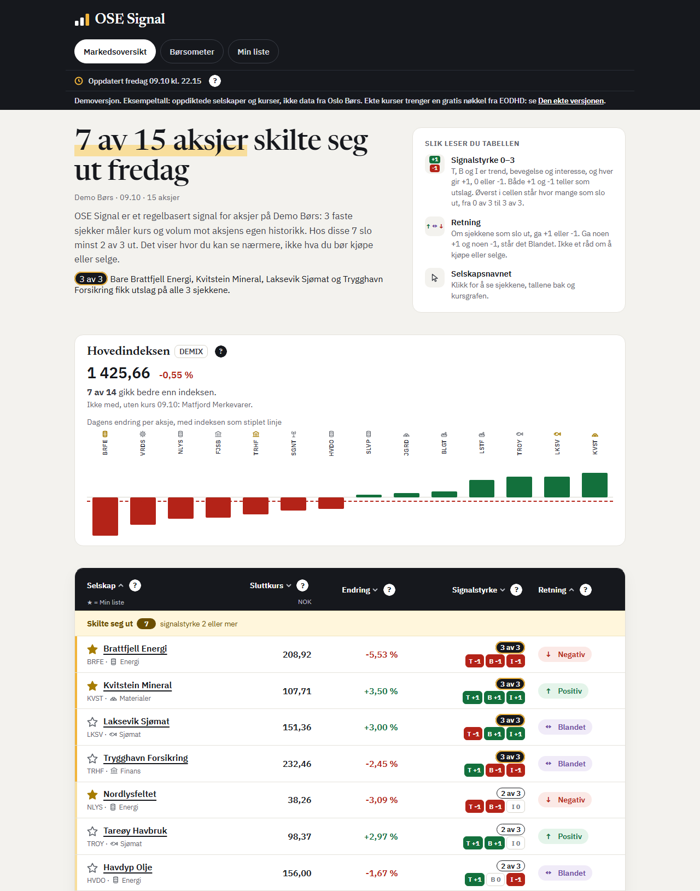
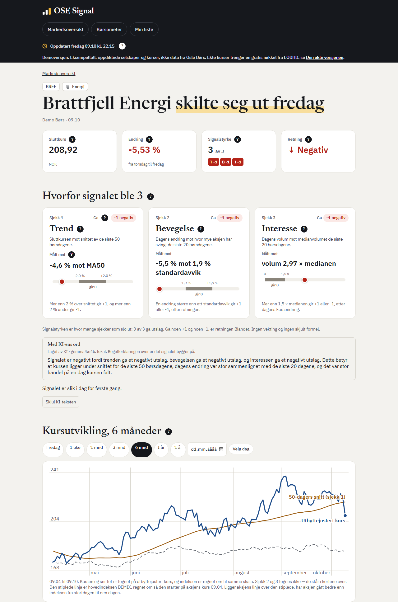

# OSE Signal

[](https://github.com/IBE160-2026/G74-lund-osen/actions/workflows/tester.yml)

Gruppe G74 (Ai Ai Ai) i IBE160 Programmering med KI, Høgskolen i Molde, høsten 2026.

OSE Signal viser 15 aksjer på Oslo Børs som omsettes mye, samlet i én oversikt. Tre enkle sjekker – trend, bevegelse og interesse (handelsvolum) – gir hver aksje en signalstyrke fra 0 til 3, så en vanlig sparer kan se hva som har endret seg, og hvorfor. Beregningene gjøres med vanlig programkode, og KI skal forklare signalet med ord. Appen gir ikke råd om å kjøpe eller selge. Den er under utvikling og ikke ferdig.

<details>
<summary>Bilder av appen (demoen)</summary>


*Oversikten i demoen, med oppdiktede selskaper og kurser («Eksempeltall»).*


*Aksjesiden for BRFE i demoen, med KI-teksten, setningen om dagene under den, og grafen, med oppdiktede tall («Eksempeltall»).*

</details>

**Innhold:** [Kom i gang](#kom-i-gang) · [Status](#status) · [Tester](#tester) · [Dokumentene](#dokumentene) · [Mappestruktur](#mappestruktur) · [Medlemmer](#medlemmer)

Til faglærer:
- Se appen med oppdiktede tall, uten konto og nøkkel, med et dobbeltklikk på «Start demoen»: [Enklest: dobbeltklikk](#enklest-dobbeltklikk-uten-docker)
- Eller med Docker Desktop, etter [steg 1–4](#med-docker-desktop): [demoen](#demoen)
- Demoen viser så mye som mulig. Prøv gjerne også ekte kurser etterpå, med en gratis nøkkel fra EODHD: [den ekte versjonen](#den-ekte-versjonen)
- De automatiske testene, med to kommandoer etter at uv er installert: [Tester](#tester)
- [Product Brief](_bmad-output/planning-artifacts/product-brief.md), arbeidskravet: versjon 8, laget etter [tilbakemeldingen 06.10](_bmad-output/planning-artifacts/tilbakemelding-product-brief.md) og låst i taggen `arbeidskrav-product-brief-v8`
- Plan og krav: [PRD](_bmad-output/planning-artifacts/prds/prd-G74-lund-osen-2026-09-20/prd.md), [arkitektur](_bmad-output/planning-artifacts/architecture/architecture-G74-lund-osen-2026-09-22/ARCHITECTURE-SPINE.md) og [epics og stories](_bmad-output/planning-artifacts/epics.md)
- [Leveranselista](docs/innlevering.md): kravene i emnet, og hvor hvert av dem står
- Prosessen og KI-bruken: [kvalitetssikringen](docs/kvalitetssikring.md), [refleksjonsloggen](docs/reflection-log.md) og [de lagrede KI-promptene](docs/ai-prompts/)
- [Vurderingsmatrisen for del 1](docs/vurderingsmatrise.md): status per kriterium, med bevis og neste tiltak

<a name="kom-i-gang"></a>

## Kom i gang: nedlasting og installasjon

Vi anbefaler demoen for faglærer og sensor, fordi den ikke trenger nøkkel og viser hovedfunksjonene med faste eksempeldata, også KI-teksten.

<a name="enklest-dobbeltklikk-uten-docker"></a>

### Enklest: dobbeltklikk (anbefalt)

1. **Last ned koden** med [den direkte lenken](https://github.com/IBE160-2026/G74-lund-osen/archive/refs/heads/main.zip).
2. **Pakk ut.** Windows: høyreklikk fila i Nedlastinger og velg «Pakk ut alle». Mac: dobbeltklikk fila. Ikke start fra inne i ZIP-fila.
3. **Åpne `G74-lund-osen-main` og dobbeltklikk «Start demoen».** Bruk den innerste mappa, der README ligger. På Windows: den uten `.command`.
4. **Svar `j`** og trykk Enter hvis vinduet spør om uv. Nettleseren åpner appen når den er klar, første gang etter noen minutter.
5. **Lukk vinduet** for å stoppe appen.

**Første gang** kan Windows og Mac stoppe fila, fordi den er lastet ned fra nettet. Slik går du videre: [Windows](docs/hjelp.md#windows-advarer-mot-fila) og [Mac](docs/hjelp.md#mac-sier-at-fila-ikke-kan-åpnes).

**Ekte kurser:** dobbeltklikk «Start den ekte versjonen» i stedet for «Start demoen». Den spør etter en gratis nøkkel fra EODHD første gang, og starter bare i en kopi fra ZIP-fila, ikke i en klon.

<details>
<summary>Demoen og den ekte versjonen</summary>

Den ekte versjonen er for å prøve løsningen med kurser fra EODHD. Begge versjonene har samme kode. Den ekte versjonen henter dagens kurser først etter kl. 22 på en børsdag. Første gang før kl. 22 henter den forrige børsdag, så du ser kursene og signalet med en gang. Demoen står først i stegene for Docker og uv, fordi den er raskest.

| | Demoen | Den ekte versjonen |
|---|---|---|
| Kurser | Oppdiktede selskaper og kurser («Eksempeltall») | Ekte sluttkurser fra Oslo Børs, hentet fra EODHD hver børsdag. Dagens vurdering lagres per aksje |
| Trenger | Ingen konto og ingen nøkkel | En gratis nøkkel fra EODHD |
| Klar | Med en gang | Etter første henting, når som helst. Før kl. 22 på en børsdag gir den forrige børsdag. Hentingen etter kl. 22 samme dag trenger bonuskvote hos EODHD; uten den får den dagen aldri signal |

**Velg vei etter hva du har:**

- [Enklest: dobbeltklikk](#enklest-dobbeltklikk-uten-docker) (anbefalt): last ned, pakk ut og dobbeltklikk. Du skriver ingen kommandoer.
- [Med Docker Desktop](#med-docker-desktop): har du Docker Desktop, eller vil du kjøre appen i Docker.
- [Uten Docker, med uv](#uten-docker-med-uv): kommandoene i et terminalvindu.

</details>

<details>
<summary>Du trenger</summary>

**Du trenger** en Windows-maskin eller en Mac, lov til å installere programmer, nett og noen GB ledig plass, men verken git eller Docker, og demoen trenger ingen konto. Første gang tar det en stund. Dobbeltklikket og «Uten Docker, med uv» trenger bare [uv](https://docs.astral.sh/uv/), som henter Python 3.13 eller nyere hvis maskinen ikke har den. Dobbeltklikket spør før det installerer uv. Med Docker trenger du Docker Desktop, og på Linux Docker Engine med Compose i stedet. Vi prøvde 10.10 med Docker Desktop 4.91.0 (motor 29.8.0, Compose v5.5.1) på Windows, og imaget bruker Python 3.13.15. Mac er ikke prøvd ennå med Docker Desktop. Dobbeltklikket kjøres i CI på macOS. Står du fast, se [«Står du fast?»](#står-du-fast) lenger ned.

</details>

<details>
<summary><a name="med-docker-desktop"></a>Med Docker Desktop</summary>

1. **Installer og start Docker Desktop** fra [docker.com](https://www.docker.com/products/docker-desktop/). Har du det fra før, starter du det bare. Hopp over innloggingen. Det er klart når det står «Engine running» nederst i vinduet. «Resource Saver mode», med en måne, er også klart: motoren hviler fordi ingen containere kjører, og starter selv når den trengs. La det være åpent.


*Slik ser det ut nederst i Docker Desktop når det er klart. Står det «Engine starting», venter du litt til.*

2. **Last ned koden.** Trykk knappen «Code» på [GitHub-siden](https://github.com/IBE160-2026/G74-lund-osen) og «Download ZIP». Windows: høyreklikk fila i Nedlastinger og velg «Pakk ut alle», der den ligger. Mac: dobbeltklikk fila. Det er klart når du har mappa `G74-lund-osen-main`. [Har den tall i navnet](docs/hjelp.md#det-er-to-mapper-med-samme-navn): bruk den nyeste. Har du fått koden som mappe eller ZIP-fil, pakker du den ut og går til steg 3.


*Menyen under den grønne knappen «Code». Trykk «Download ZIP» nederst, eller bruk [den direkte lenken](https://github.com/IBE160-2026/G74-lund-osen/archive/refs/heads/main.zip). Adressen i boksen trenger du ikke.*

3. **Åpne PowerShell** i mappa. Windows: åpne den innerste `G74-lund-osen-main` i Filutforsker, skriv `powershell` i adressefeltet og trykk Enter. Da gjør du bare kontrollen i steg 4. Eller trykk Start og velg «Windows PowerShell», ikke ISE og ikke som administrator. Mac: åpne **Terminal** med Cmd+mellomrom. Det er klart når et vindu venter på at du skriver.
4. **Skriv `cd` og et mellomrom**, dra mappa `G74-lund-osen-main` fra steg 2 (ikke ZIP-fila), der README og compose ligger, inn i vinduet, og trykk Enter. [Står det `.zip` til slutt?](docs/hjelp.md#står-det-zip-til-slutt-i-linja) **Kontroll:** det er klart når `dir` (Windows) eller `ls` (Mac) viser `README.md` og `compose.yaml`. Har mappa et annet navn, drar du den mappa der README og compose ligger.


*Slik ser det ut etter steg 4. Stien blir en annen hos deg, men mappenavnet skal stå foran `>` (`%` på Mac). Sjekk med `dir` eller `ls`.*

**Slik limer du inn en kommando.** Kopier kommandoen med ikonet til høyre i den grå boksen. Ikonet, som stegene kaller knappen, synes først når musa er over boksen. Du kan også markere den og trykke Ctrl+C eller Cmd+C, eller skrive den inn. Lim den inn i PowerShell-vinduet fra steg 4 (Terminal på Mac) med Ctrl+V eller Cmd+V, og trykk Enter.

**Velg versjon.** Klikk på pila for den versjonen du vil prøve. Tabellen i pila «Demoen og den ekte versjonen» viser forskjellen.

</details>

<details>
<summary><a name="demoen"></a>Demoen: anbefalt for faglærer og sensor, uten nøkkel</summary>

5. **Start demoen.** Kopier kommandoen med knappen til høyre i boksen, lim den inn i PowerShell-vinduet fra steg 4 (Ctrl+V eller Cmd+V) og trykk Enter. Første gang tar det noen minutter. Demoen er klar når det står `Serving on http://0.0.0.0:8000`. Den linja betyr bare at demoen kjører. Den adressen skal du ikke åpne.

```
docker compose up --build demo
```

6. **Åpne http://127.0.0.1:8000** i en ny fane. Øverst står «Eksempeltall: oppdiktede selskaper og kurser, ikke data fra Oslo Børs.», med en lenke til den ekte versjonen. Klikk på et selskapsnavn for å se en aksje.
7. **Stopp** med Ctrl+C i terminalvinduet, også på Mac, og lim så inn denne i PowerShell-vinduet fra steg 4. Det er klart når det står at containerne er fjernet (Removed).

```
docker compose --profile demo down
```

Vil du også prøve den ekte versjonen, går du videre til steg 5 i [den ekte versjonen](#den-ekte-versjonen) og klikker på pila.

</details>

<details>
<summary><a name="den-ekte-versjonen"></a>Den ekte versjonen: kurser fra EODHD, med egen nøkkel</summary>

Appen er gratis. Gratiskontoen hos EODHD gir 20 kall i døgnet og kurser ett år tilbake, og en henting bruker 16: ett per aksje og ett for hovedindeksen. Et betalt abonnement gir fra 100 000 kall i døgnet ([prisene hos EODHD](https://eodhd.com/pricing), lest 22.10.2026), men appen bruker ikke flere enn 16 per henting, og de 4 som er igjen, går til nye forsøk samme kveld. Gratiskontoen holder.

5. **Hent en nøkkel.** Lag en gratis bruker hos [EODHD](https://eodhd.com/register), og kopier API-nøkkelen din. Det er klart når du har nøkkelen.
6. **Legg inn nøkkelen, bare første gang.** Kopier kommandoene med knappen til høyre i boksen, lim dem inn i PowerShell-vinduet fra steg 4 én om gangen (Ctrl+V eller Cmd+V) og trykk Enter. Den første lager fila [`.env`](#mer-for-den-som-vil), og den neste åpner den (Windows eller Mac). Lim inn nøkkelen etter `EODHD_API_KEY=`, lagre og lukk. Det er klart når nøkkelen står etter `EODHD_API_KEY=`.

```
cp .env.example .env
```

Windows:

```
notepad .env
```

Mac:

```
open -e .env
```

7. **Start appen.** Lim inn denne i PowerShell-vinduet fra steg 4, og trykk Enter. Første gang tar det noen minutter. Det er klart når det står `Serving on http://0.0.0.0:8000`, som bare betyr at appen kjører. Åpne http://127.0.0.1:8000 i en ny fane. Første gang er oversikten tom og viser kommandoen som henter.

```
docker compose up --build
```

8. **Hent kursene** etter kl. 22 og før midnatt på en børsdag. Første gang går det når som helst; før kl. 22 en børsdag gir den forrige børsdag. Åpne et nytt terminalvindu i samme mappe (steg 3 og 4), og lim inn denne i det nye PowerShell-vinduet. Det er klart når utskriften sier hvilken børsdag vurderingene gjelder. Last siden på nytt når hentingen er ferdig.

```
docker compose run --rm hent
```

9. **Stopp** med Ctrl+C i vinduet med appen, og lim så inn denne i PowerShell-vinduet fra steg 4. Det er klart når det står at containerne er fjernet (Removed).

```
docker compose down
```

</details>

**Skriv aldri `docker compose down -v`.** Det sletter kursene og vurderingene, og vurderingene kan ikke lages på nytt.

<details>
<summary><a name="uten-docker-med-uv"></a>Uten Docker, med uv</summary>

Med Python 3.13 og [uv](https://docs.astral.sh/uv/). Installasjonen av uv står under [«Tester»](#tester). Først demoen.

**Demoen**

1. Installer avhengighetene:

```
uv sync
```

2. Lag demobasen, `data/db/demo.db`:

```
uv run python src/demo.py
```

3. Start demoen på http://127.0.0.1:8000:

```
uv run python src/app.py --demo
```

**Den ekte versjonen**

1. Bare første gang: kopier malen, og fyll inn `EODHD_API_KEY` i `.env`:

```
cp .env.example .env
```

2. Hent kurser:

```
uv run python src/fetch_prices.py
```

3. Start webserveren på http://127.0.0.1:8000:

```
uv run python src/app.py
```

Basen, demobasen og øyeblikksbildene ligger da i `data/` i mappa. Uten `--demo` åpner webserveren den ekte basen.

</details>

<details>
<summary><a name="slik-virker-dobbeltklikket"></a>Slik virker dobbeltklikket</summary>

Docker trengs ikke, og du skriver ingen kommandoer.

- **Last ned koden** med [den direkte lenken](https://github.com/IBE160-2026/G74-lund-osen/archive/refs/heads/main.zip), eller trykk «Code» på [GitHub-siden](https://github.com/IBE160-2026/G74-lund-osen) og «Download ZIP».
- **Pakk ut.** Windows: høyreklikk fila i Nedlastinger og velg «Pakk ut alle», der den ligger. Mac: dobbeltklikk fila. Det er klart når du har mappa `G74-lund-osen-main`. Pakk ut først: inne i ZIP-fila finner ikke startfilene skriptene i `start/`. [Har mappa tall i navnet](docs/hjelp.md#det-er-to-mapper-med-samme-navn): bruk den nyeste.
- **Finn de fire filene** øverst i den innerste `G74-lund-osen-main`, der README ligger: `Start demoen` og `Start den ekte versjonen`, som `.cmd` for Windows og `.command` for Mac. På Windows tar du den som bare heter «Start demoen», ikke «Start demoen.command».
- **Dobbeltklikk «Start demoen».** Vil du prøve ekte kurser, dobbeltklikker du «Start den ekte versjonen».

Når vinduet er åpent:

- Mangler [uv](https://docs.astral.sh/uv/), spør vinduet om det skal installeres. Skriv `j` og trykk Enter. Det er den offisielle installasjonen fra astral.sh, og den legger uv i brukermappa di.
- Første gang tar det noen minutter, fordi uv henter Python og pakkene appen bruker.
- Nettleseren åpner http://127.0.0.1:8000 når appen svarer.
- Stopp appen ved å lukke vinduet, eller med Ctrl+C.

**Advarselen fra Windows.** Første gang kan Windows vise «Windows beskyttet PC-en», fordi fila er lastet ned fra nettet. Klikk «Mer informasjon», og så «Kjør likevel». Spør Windows om du vil kjøre fila, svarer du ja.

**Godkjenningen på Mac.** Første gang kan macOS stoppe fila, fordi den er lastet ned fra nettet. Fra macOS 15 holder det ikke å høyreklikke og velge Åpne. Velg Apple-menyen > Systeminnstillinger, og Personvern og sikkerhet i sidepanelet. Under Sikkerhet klikker du «Åpne likevel» og skriver inn passordet ditt. Knappen står der i omtrent en time etter at du prøvde å åpne fila. Dobbeltklikk så fila på nytt. På macOS 14 og eldre kan du også høyreklikke fila, velge Åpne og bekrefte.

**Den ekte versjonen** starter bare i en kopi fra «Download ZIP», ikke i en klon av repoet med `.git`. Der stopper vinduet før noe installeres eller hentes, så et dobbeltklikk i en klon aldri henter med nøkkelen som ligger i den. Last ned en egen kopi med «Download ZIP», og bruk din egen nøkkel. Demoen starter i begge. Vernet gjelder bare dobbeltklikket: kommandoene under «Uten Docker, med uv» og Docker henter også i en klon.

Den ekte versjonen spør etter nøkkelen fra EODHD første gang. Registreringssiden https://eodhd.com/register åpnes. Når du har laget kontoen, står nøkkelen som «API token» under «Dashboard» hos EODHD, med kopiknappen til høyre. Lim den inn i vinduet med Ctrl+V eller et høyreklikk på Windows, og med Cmd+V på Mac, og trykk Enter. På Windows vises den som stjerner, og på Mac vises den ikke. Den lagres bare i `.env` i mappa. Var den feil, sletter du det som står etter `EODHD_API_KEY=` i `.env`, så spør vinduet på nytt. Så hentes kursene før appen starter. Er alt hentet, brukes ingen kall.

Skriptene står i [`start/`](start/) og kjører de samme kommandoene som under «Uten Docker, med uv»: `uv sync`, så `uv run python src/demo.py` for demoen eller `uv run python src/fetch_prices.py` for den ekte versjonen. Webserveren startes med `uv run waitress-serve --listen=127.0.0.1:8000 --threads=8 app:app`, bare på 127.0.0.1 og uten debug, med 8 tråder, med `PYTHONPATH=src`, og `OSE_DEMO=1` i demoen. Den bruker port 8000, som Docker. Kjører OSE Signal allerede fra denne mappa, med webserveren fra `.venv` i mappa, sier skriptet fra og stopper den rett før webserveren starter, så den kjører videre hvis skriptet stopper før det, for eksempel fordi `uv sync` feiler. Feiler hentingen, starter appen likevel, og da stoppes den. Porten sjekkes igjen rett før webserveren, og et annet program som har tatt den i mellomtiden, stoppes ikke. Det gjelder også en webserver du har startet selv med kommandoen over. Et annet program på porten, også OSE Signal fra en annen mappe og demoen eller appen i Docker, stoppes aldri. Da sier vinduet hvilket program det er, og du stopper det selv, Docker med `docker compose --profile demo down`.

</details>

<details>
<summary><a name="står-du-fast"></a>Står du fast?</summary>

Klikk på spørsmålet som passer.

<details>
<summary>«Engine running» kommer ikke, eller det står «Cannot connect to the Docker daemon» eller «error during connect».</summary>

Docker Desktop er ikke startet, eller motoren er ikke klar. Start Docker Desktop, vent til det står «Engine running» (steg 1), og prøv kommandoen igjen. Kommer det ikke etter noen minutter, avslutter du Docker Desktop helt: høyreklikk hvalen ved klokka (Windows) eller klikk den i menylinja øverst (Mac), og velg «Quit Docker Desktop». Åpne det igjen og vent. Hjelper ikke det, starter du maskinen på nytt.

Står det «Resource Saver mode», med en måne, er alt i orden: Docker har stoppet motoren fordi ingen containere kjører, og starter den selv når den trengs, bare litt tregere. Da trenger du ikke vente på «Engine running».

</details>

<details>
<summary>ZIP-fila ser ut som en vanlig mappe.</summary>

Du må pakke ut. Står det «Komprimert størrelse» (Compressed size) som kolonne og «Pakk ut alle» (Extract All) øverst i vinduet, er du inne i ZIP-fila, og den er ikke pakket ut. Trykk «Pakk ut alle», og bruk mappa som lages. På Windows finner du Nedlastinger (Downloads) i Filutforsker (File Explorer), og etter «Pakk ut alle» trykker du «Pakk ut» (Extract).

</details>

<details>
<summary>«is not recognized as the name of a cmdlet» eller «Cannot find path … because it does not exist» etter cd.</summary>

Kommer «is not recognized as the name of a cmdlet»: Det mangler mellomrom etter `cd`. Står `cd` klistret til stien i meldingen, for eksempel `'cdC:\...'`, skriver du `cd`, et mellomrom, og drar mappa inn i vinduet på nytt (steg 4). Står det `'docker'` i meldingen, er Docker Desktop ikke installert, eller vinduet ble åpnet før installasjonen: lukk det og åpne et nytt (steg 3). Står det `'uv'` i meldingen, er uv ikke installert, eller vinduet ble åpnet før installasjonen: se «Tester» i README-en.

Kommer «Cannot find path … because it does not exist»: Mappa ligger ikke der stien sier, for eksempel fordi den er flyttet, eller fordi ZIP-fila ble dratt inn i stedet for mappa. Skriv `cd` og et mellomrom, og dra mappa inn i vinduet på nytt (steg 4).

</details>

<details>
<summary>Nettleseren sier at 127.0.0.1 nektet å koble til.</summary>

Nettleseren viser da `ERR_CONNECTION_REFUSED`. Andre nettlesere sier det med andre ord. Ingenting svarer på adressen ennå. Appen er ikke klar, eller den er stoppet. Se i terminalvinduet: vent til linja med «Serving on» har kommet, og sjekk at vinduet fortsatt er åpent og at Docker Desktop kjører. Last så siden på nytt. Adressen er http://127.0.0.1:8000, ikke 0.0.0.0.

</details>

<details>
<summary>«no configuration file provided: not found».</summary>

Terminalvinduet står i feil mappe. Gjør steg 4 på nytt, og dra den mappa der fila compose ligger. Windows viser den uten filendelsen, som compose og ikke compose.yaml.

</details>

Flere spørsmål og svar står i [docs/hjelp.md](docs/hjelp.md).

</details>

### Mer for den som vil

<details>
<summary>Bytte mellom demoen og den ekte versjonen</summary>

Begge bruker port 8000, så bare én kan kjøre om gangen. `docker compose down` stopper ikke demoen, fordi demoen ligger i en egen profil. `docker compose --profile demo down` stopper begge.

Stopp demoen og den ekte versjonen:

```
docker compose --profile demo down
```

Start så den ekte versjonen:

```
docker compose up --build
```

eller demoen:

```
docker compose up --build demo
```

Volumene står når du bytter, også basen med vurderingene.

</details>

<details>
<summary>Variablene i .env</summary>

`.env` lages fra `.env.example` i steg 6 i den ekte versjonen. Demoen trenger ingen av dem.

| Variabel | Hva den gjør | Standard | Når den trengs |
|---|---|---|---|
| `EODHD_API_KEY` | Nøkkelen til EODHD, som hentingen bruker til sluttkursene | Ingen | Til hentingen i den ekte versjonen. Webserveren og demoen trenger den ikke |
| `OSE_KI_TJENESTE` | Om hentingen lager KI-tekst, og med hva: `av`, `lokal` (Gemma i Ollama), eller `gemini`, `anthropic` eller `openai` med egen nøkkel | `av` etter steg 6, fordi `.env.example` har `OSE_KI_TJENESTE=av`. Står variabelen ikke i `.env`, gjelder `lokal`, og en tom verdi gir ingen KI-tekst | Når du vil slå KI-teksten på |
| `OSE_KI_OLLAMA_URL` | Adressen til Ollama | `http://127.0.0.1:11434`, og `http://ollama:11434` i Docker | Bare med uv, når Ollama ikke svarer på standardadressen |
| `OSE_KI_GEMINI_NOKKEL` | Din egen nøkkel til Gemini | Ingen | Bare med `OSE_KI_TJENESTE=gemini` |
| `OSE_KI_ANTHROPIC_NOKKEL` | Din egen nøkkel til Anthropic API | Ingen | Bare med `OSE_KI_TJENESTE=anthropic` |
| `OSE_KI_OPENAI_NOKKEL` | Din egen nøkkel til OpenAI API | Ingen | Bare med `OSE_KI_TJENESTE=openai` |

`OSE_DEMO` og `OSE_I_DOCKER` settes av `compose.yaml` og `Dockerfile`, og skal ikke i `.env`. Med uv slås demoen på med `--demo`.

</details>

<details>
<summary>Den lokale modellen for KI-teksten (valgfri)</summary>

Den lokale modellen er valgfri og trengs verken for demoen eller for å vurdere appen, fordi demoen har ferdig KI-tekst og bare trenger Docker. Hentingen kan lage en KI-tekst for hver aksje, med en modell som kjører på maskinen: Gemma i Ollama, i Docker, med grafikkortet. Med adressen som står som standard, sendes ingenting ut. KI-teksten er av i `.env.example`, og hentingen går som før uten den.

Det trengs et grafikkort fra NVIDIA med driver, og at Docker Desktop kan bruke det. Uten det starter ikke Ollama, og KI-teksten bør stå av.

Bare første gang: start Ollama, og hent modellen til volumet `ose-ki-ollama`.

```
docker compose --profile ki up -d ollama
```

```
docker compose exec ollama ollama pull gemma4:e4b
```

Slå på KI-teksten: sett `OSE_KI_TJENESTE=lokal` i `.env`. Står variabelen ikke i `.env` i det hele tatt, er den også på.

Før hver henting med KI-tekst må Ollama kjøre:

```
docker compose --profile ki up -d ollama
```

Så hentes det som vanlig. Med uv når hentingen Ollama på http://127.0.0.1:11434, og i Docker på tjenestenavnet. Stopp Ollama etterpå:

```
docker compose --profile ki down
```

Hentingen sjekker først at Ollama svarer og har modellen. Gjør den ikke det, lages ingen KI-tekst, og utskriften sier hvorfor. Start Ollama og kjør samme kommando igjen samme kveld, før midnatt: da lages tekstene. Har basen dagens kurs for alle aksjene, gir det 0 kall til EODHD. Mangler noen aksjer dagens kurs, gjør samme kommando et nytt forsøk for dem, og det bruker kall. Svarer Ollama, men modellen feiler for en aksje, får aksjen en rad om det, og modellen kalles ikke for resten av aksjene den kvelden. De får en rad om at modellen ikke ble kalt. Radene står, så ingen av dem får tekst den dagen (FR-604).

Slå av KI-teksten: sett `OSE_KI_TJENESTE=av` i `.env`.

Modellen ble prøvd på en maskin med 15,7 GB minne og et grafikkort med 8 GB, der Docker Desktop hadde 8,2 GB (`malinger.md` §19).

</details>

<details>
<summary>Egen nøkkel til Gemini, Anthropic eller OpenAI (valgfri)</summary>

I stedet for den lokale modellen kan hentingen la en tjeneste du selv har valgt, skrive KI-teksten, med din egen nøkkel og på dine egne vilkår. Det trengs verken grafikkort eller Ollama. Ingen nøkkel følger med appen eller repoet.

| Tjeneste | `OSE_KI_TJENESTE` | Nøkkelen i `.env` | Modellen |
|---|---|---|---|
| Gemini | `gemini` | `OSE_KI_GEMINI_NOKKEL` | Gemini 3.5 Flash-Lite (`gemini-3.5-flash-lite`), som kan brukes med en gratis nøkkel |
| Anthropic API | `anthropic` | `OSE_KI_ANTHROPIC_NOKKEL` | Claude Haiku 5.5 (`claude-haiku-5-5`) |
| OpenAI API | `openai` | `OSE_KI_OPENAI_NOKKEL` | GPT-6 Luna (`gpt-6-luna`) |

Slå den på: sett for eksempel `OSE_KI_TJENESTE=gemini` i `.env`, og lim inn nøkkelen etter `OSE_KI_GEMINI_NOKKEL=`. Så hentes det som vanlig.

Det du bør vite før du slår den på:

- **Grunnlaget sendes til tjenesten du har valgt.** Det er reglene for teksten og bare våre egne resultater for hver aksje, uten navnet: fortegnet for de tre sjekkene, styrken og retningen. Fra prompten versjon 3 kommer også hvor mange børsdager på rad signalet har vært slik, om hovedindeksen og bransjen til aksjen steg eller falt, og hvor mange aksjer i lista som steg og falt. Ingen kurser, volumer, prosenter eller tekster fra EODHD sendes. Med den lokale modellen sendes ingenting ut.
- **Det kan koste hos dem.** Hver henting gir ett kall per aksje med vurdering, opptil 15. Prisen og grensene står hos tjenesten.
- **Nøkkelen skal aldri deles.** Den står bare i `.env`, som aldri committes, og sendes bare til tjenesten den hører til, i en header. Appen skriver den aldri ut.
- **Du må ikke ha sagt ja til at tjenesten trener på innholdet.** Vilkårene vi har lest, sier at det som sendes gjennom API-et, ikke brukes til trening uten samtykke. For Gemini gjelder det i EØS også gratisnøkkelen. Sitatene står i [`docs/kilder-og-rettigheter.md`](docs/kilder-og-rettigheter.md), «Betingelse 4 og KI-tjenestene (2026-10-04)».

Det er én tjeneste per henting. Hentingen sjekker nøkkelen før noe sendes. Mangler den, eller har den tegn som ikke kan sendes, for eksempel et mellomrom inne i den, skrives ingen rader i KI-loggen, og utskriften sier hvilken variabel det gjelder. Legg den inn og kjør samme kommando igjen samme kveld, før midnatt: da lages tekstene. Har basen dagens kurs for alle aksjene, gir det 0 kall til EODHD. Feiler tjenesten for én aksje, for eksempel fordi nøkkelen er feil, kalles den ikke for resten av aksjene den kvelden, og alle får en rad i KI-loggen om det. Radene står, så ingen av dem får tekst den dagen, heller ikke om du retter det og henter igjen samme kveld (FR-604). Hentingen går ikke over til en annen tjeneste, så grunnlaget sendes aldri til en tjeneste du ikke har valgt. Utskriften sier hvilken tjeneste teksten lages av. Kursene hentes som før.

Slå av KI-teksten: sett `OSE_KI_TJENESTE=av` i `.env`.

</details>

<details>
<summary><a name="hentingen-hver-kveld"></a>Hentingen hver kveld med Oppgaveplanlegging (Windows, valgfri)</summary>

En jobb i Oppgaveplanlegging kan hente for deg hver kveld, med den samme kommandoen som du kjører selv, `uv run python src/fetch_prices.py`. Jobben går hver dag kl. 22:15, og igjen kl. 22:45, 23:15 og 23:45, så aksjer som mangler dagens kurs, prøves på nytt med kallene som er til overs. En ny kjøring starter ikke mens en går, og en kveld PC-en er av eller du ikke er logget inn, hentes ikke senere.

Jobben kjører fra en egen arbeidskopi av main (`git worktree`), ikke fra mappa du jobber i. Før hver kjøring flyttes arbeidskopien til commiten main hadde ved midnatt, så det som flettes en dag, går først neste kveld. `data/` og `.env` i arbeidskopien er lenker til mappa du jobber i, så basen og nøkkelen er de samme, og nøkkelen kopieres ikke. Jobben starter Docker Desktop og Ollama hvis de ikke kjører. Svarer de ikke innen tre minutter til sammen, hentes det uten KI-tekst. Det jobben startet selv, stopper den etterpå.

Alt jobben gjør, står i loggen `data/logg/kveldshenting-<dato>.log` i mappa du jobber i, én fil per kveld. Nøkkelen skrives aldri ut.

Slå den på, i PowerShell i mappa du jobber i, med arbeidskopien ved siden av:

```
git worktree add --detach ..\G74-lund-osen-jobb origin/main
```

```
cmd /c mklink /J ..\G74-lund-osen-jobb\data data
```

```
New-Item -ItemType HardLink -Path ..\G74-lund-osen-jobb\.env -Target .env
```

```
powershell -NoProfile -ExecutionPolicy Bypass -File start\legg-inn-kveldshentingen.ps1 -Arbeidskopi ..\G74-lund-osen-jobb -FoersteDato 2026-10-29
```

Uten `-FoersteDato` går den første gang i kveld, hvis den legges inn før kl. 22:15. Er commiten fra midnatt eldre enn jobben, stopper den og sier det i loggen, og går fra neste kveld. Lager du `.env` på nytt, må lenken også lages på nytt; ellers stopper jobben og sier det i loggen.

Slå den av:

```
powershell -NoProfile -ExecutionPolicy Bypass -File start\ta-bort-kveldshentingen.ps1
```

Arbeidskopien, `data/` og loggene står etterpå.

</details>

## Status

Prosjektet er under utvikling. Listene under viser hva som er ferdig på main, og hva som gjenstår.

**Ferdig**

- De tre sjekkene, trend, bevegelse og interesse, og styrken for hver aksje hver børsdag, med regelforklaringen på aksjesiden
- Hentingen: kursene og hovedindeksen fra kl. 22, første gang på dagtid, med børsdagskontroll og forsøk med kallene som er igjen
- Oversikten og utseendet fra designforslaget, med tydeligere merking, hjelp bak «?» og sortering ved klikk i kolonneraden
- Hovedindeksen over tabellen på forsiden, med søylene under, og som stiplet linje i kursgrafen
- På aksjesiden: periodene i kursgrafen med «Velg dag», datoene og månedsmerkene, lenken til investorsiden og signalet dag for dag
- Min liste, med stjernen foran hvert selskap, og børsometeret som et kart, med knappene «Markedsoversikt», «Børsometer» og «Min liste» øverst
- KI-teksten fra en lokal modell på aksjesiden eller med egen nøkkel, med bryter, og bare tekster som besto kontrollen
- Docker for begge versjonene, og demoen med alle 10 fargekombinasjonene av de tre sjekkene og KI-tekst laget med Gemma

**Neste i v1**

- Prøven av README-en på en ren maskin, når alt i v1 er bygget

**Ekstra, hvis tiden rekker**

- Signaldagene i kursgrafen
- Innstillingene, med «Vis KI-tekst»
- På forsiden periodevalget og KI-teksten om dagen
- Til slutt å velge og bytte aksjer

Det som står under «Ekstra», er ikke lovet i briefen og kommer bare med hvis det er ferdig og testet før README-prøven, senest én uke før innleveringen.

«Ferdig» betyr flettet til main. Rundt appen er dette også ferdig: README-en med bilder i «Kom i gang» og demoen først, ruff i CI og i testene, den oppdaterte kvalitetssikringen og et ryddigere repo uten kopien av BMAD-skillene. Det som bygges etter demoen, skal vises i begge versjonene. Børsmeldinger er ikke med i v1, fordi Euronext ikke ga tillatelse til automatisert henting (plan B). Detaljene står i [sprintstatusen](_bmad-output/implementation-artifacts/sprint-status.yaml) og i [planen](_bmad-output/planning-artifacts/epics.md).

## Tester

Testene kjøres med [uv](https://docs.astral.sh/uv/), uten Docker. Har du ikke uv, står installasjonen bak pila under.

<details>
<summary>Installere uv, og når uv ikke blir funnet</summary>

**På en ren maskin uten Docker** trenger du bare [uv](https://docs.astral.sh/uv/). Appen krever Python 3.13 eller nyere (`requires-python` i `pyproject.toml`), og uv henter den hvis maskinen ikke har den. Installer uv først, etter [fremgangsmåten hos uv](https://docs.astral.sh/uv/getting-started/installation/).

Windows (PowerShell):

```
powershell -ExecutionPolicy ByPass -c "irm https://astral.sh/uv/install.ps1 | iex"
```

Mac (Terminal):

```
curl -LsSf https://astral.sh/uv/install.sh | sh
```

Blir `uv` ikke funnet etterpå («The term 'uv' is not recognized» eller «command not found: uv»), lukker du vinduet, åpner et nytt og går til mappa, som i steg 4.

</details>

Stå i mappa der README og `pyproject.toml` ligger, og kjør:

```
uv sync
```

```
uv run pytest
```

Første `uv sync` laster ned Python og pakkene. Hele testsettet tok mellom 5 og 10 minutter på maskinen vår 20.10.

Alle testene skal bestå. Noen hoppes over, og knappen under sier hvorfor.

<details>
<summary>Hvorfor hoppes noen over?</summary>

Noen hoppes over, med grunnen i utskriften når du legger til `-rs`: på Windows testene som bytter tidssone, fordi `time.tzset` ikke finnes der (de kjøres i CI), og testen for Unix-sokler, som Python på Windows ikke har. På en maskin uten IPv6 (`::1`) hoppes testen for den over. I en mappe fra ZIP-fila, uten git, hoppes også testene som sjekker hva som er sporet i git, over.

</details>

Slik er testene satt opp:

- Ingen nettkall: `tests/conftest.py` sperrer nettverket i hver test.
- `data/` røres ikke: testene bruker en midlertidig mappe.
- CI kjører på hver push og pull request mot `main`, uten hemmeligheter og uten API-nøkkel.
- ruff kjøres før en commit: `uv run ruff check --fix`, som også sorterer importene, og så `uv run ruff format`. Reglene står i `pyproject.toml`: pyflakes, importene og bugbear, som finner feil og rot, ikke smak. CI kjører `ruff check` og `ruff format --check` før testene, og `tests/test_ruff.py` gjør det samme, så `uv run pytest` feiler hvis noe er glemt.

Hver story som endrer koden, leveres med tester. Det er vårt svar på hvordan KI-generert kode kvalitetssikres, og alt står i [`docs/kvalitetssikring.md`](docs/kvalitetssikring.md).

## Dokumentene

<details>
<summary>Dokumentlista: plan og krav, arbeidsprosess og kvalitet</summary>

`docs/` viser hvordan vi kom fram til noe og hvilken rolle KI spilte, og `_bmad-output/` viser hva vi kom fram til.

**Plan og krav**

- [Product Brief](_bmad-output/planning-artifacts/product-brief.md): versjon 8, laget etter [tilbakemeldingen fra faglærer 06.10](_bmad-output/planning-artifacts/tilbakemelding-product-brief.md) på versjon 7 (taggen `arbeidskrav-product-brief-v7`), og låst i taggen `arbeidskrav-product-brief-v8` (commit `52023c9`)
- [PRD](_bmad-output/planning-artifacts/prds/prd-G74-lund-osen-2026-09-20/), med begrunnelser og målinger
- [Relevanseksperimentet](_bmad-output/planning-artifacts/prds/prd-G74-lund-osen-2026-09-20/relevanseksperiment.md)
- [Arkitektur](_bmad-output/planning-artifacts/architecture/architecture-G74-lund-osen-2026-09-22/ARCHITECTURE-SPINE.md)
- [Epics og stories](_bmad-output/planning-artifacts/epics.md)
- [Designregler](_bmad-output/planning-artifacts/designregler.md)
- [Utdrag fra designtavla 13.10](_bmad-output/planning-artifacts/designutdrag-2026-10-13.md): grunnlaget for planen til story 8.0d
- [Endringsforslag 28.09](_bmad-output/planning-artifacts/sprint-change-proposal-2026-09-28.md), godkjent samme dag
- [Endringsforslag 08.10](_bmad-output/planning-artifacts/sprint-change-proposal-2026-10-08.md): femten idéer inn i v1, godkjent samme dag
- [Endringsforslag 13.10](_bmad-output/planning-artifacts/sprint-change-proposal-2026-10-13.md): den samlede endringen fra samlelista, godkjent samme dag
- [Endringsforslag 19.10](_bmad-output/planning-artifacts/sprint-change-proposal-2026-10-19.md): endelig v1 er det briefen v8 lover, og resten er ekstra, godkjent samme dag
- [Kilder og bruksvilkår](docs/kilder-og-rettigheter.md), med e-postene til [EODHD](docs/epost-til-eodhd.md) og [Euronext](docs/epost-til-euronext.md)
- [Leveranseliste](docs/innlevering.md)
- [Hjelp til «Kom i gang»](docs/hjelp.md): spørsmål og svar, sortert etter steg

**Arbeidsprosess og kvalitet**

- [Sprintstatus og story-spesifikasjoner](_bmad-output/implementation-artifacts/)
- [Kvalitetssikring](docs/kvalitetssikring.md)
- [Vurderingsmatrise for del 1](docs/vurderingsmatrise.md)
- [UX-loggen](docs/ux-logg.md): hva vi har sett og gjort for brukeropplevelsen fra starten, og funnene som står åpne før brukertesten
- [Brukertesten](docs/brukertest.md): skjemaet for story 8.1 og 10.4, ikke tatt ennå
- [Kontrollrapport 22.09](docs/kontroll-2026-09-22.md), med [rettingsplanen](docs/kontroll-2026-09-22-plan.md)
- [Kontrollrapport 26.09](docs/kontroll-2026-09-26.md)
- [Refleksjonslogg](docs/reflection-log.md) og [lagrede KI-prompts](docs/ai-prompts/)

</details>

## Mappestruktur

<details>
<summary>Mappene og filene i repoet</summary>

- [`src/`](src/) og [`tests/`](tests/) — applikasjonen og testene
- [`docs/`](docs/) — arbeidsprosessen, og [`docs/hjelp.md`](docs/hjelp.md) med spørsmål og svar til «Kom i gang»
- [`docs/bilder/readme/`](docs/bilder/readme/) — de tre skjermbildene i «Kom i gang»: [`engine-running.png`](docs/bilder/readme/engine-running.png), [`github-download-zip.png`](docs/bilder/readme/github-download-zip.png) og [`powershell-mappa.png`](docs/bilder/readme/powershell-mappa.png)
- [`docs/bilder/investorsider/`](docs/bilder/investorsider/) — de 15 tegningene laget av KI til investorsidene i demoen, godkjent 24.10: SVG-ene, forhåndsvisningene, [`LESMEG.md`](docs/bilder/investorsider/LESMEG.md) og [`bobler.json`](docs/bilder/investorsider/bobler.json)
- [`docs/appen/`](docs/appen/) — bilder og senere video av appen, bare av demoen: [`oversikten-demo.png`](docs/appen/oversikten-demo.png) og [`aksjesiden-brfe-demo.png`](docs/appen/aksjesiden-brfe-demo.png)
- [`_bmad-output/`](_bmad-output/) — Product Brief, plan, krav og sprintstatus
- [`.github/`](.github/) — testkjøringen og morgensjekken
- [`.logs/`](.logs/) — loggene fra øktene med Claude Code, én mappe per bruker, og issues.md i hver mappe med det som gjenstår
- [`Dockerfile`](Dockerfile), [`compose.yaml`](compose.yaml) og [`.dockerignore`](.dockerignore) — imaget og tjenestene: webserveren, hentingen og demoen
- [`start/`](start/) og [`.gitattributes`](.gitattributes) — start med dobbeltklikk, uten Docker: skriptene bak de fire filene Start demoen og Start den ekte versjonen i rota, for Windows og Mac, og linjeskiftene de trenger. Der står også jobben som henter hver kveld i Oppgaveplanlegging på Windows, og skriptene som legger den inn og tar den bort
- [`_bmad/`](_bmad/) og [`.claude/skills/`](.claude/skills/) — BMAD-rammeverket, ikke skrevet av oss, og skillen sesjonslogg, som kommer fra faglærer
- [`README.md`](README.md) — denne fila: hva appen er, hvordan den startes, status og testene
- [`CLAUDE.md`](CLAUDE.md) — reglene for KI-øktene i repoet, som Claude Code leser når en økt starter
- [`pyproject.toml`](pyproject.toml) og [`uv.lock`](uv.lock) — prosjektet for uv: Python-versjonen, avhengighetene og innstillingene for pytest og ruff, og de låste versjonene av avhengighetene, som uv sync og imaget installerer
- [`.env.example`](.env.example) — malen for .env, uten nøkkel, som den ekte versjonen kopierer første gang
- [`.gitignore`](.gitignore) og [`.mailmap`](.mailmap) — det git ikke skal spore, som nøklene, data/ og _privat/, og navnet og e-postadressen git log viser for hver av oss

Ikke i repoet: API-nøkkelen (`.env`), rådata, basen og demobasen (`data/`), lokale testskript (`local-tests/`) og den private arbeidsmappa (`_privat/`).

</details>

## Medlemmer

Joakim Lund og Marian Osen. Vi diskuterer og avgjør arbeidet sammen. Fra 25.09 har felles commits `Co-authored-by` for den av oss som ikke committet (regel 20 i `CLAUDE.md`).
