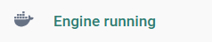
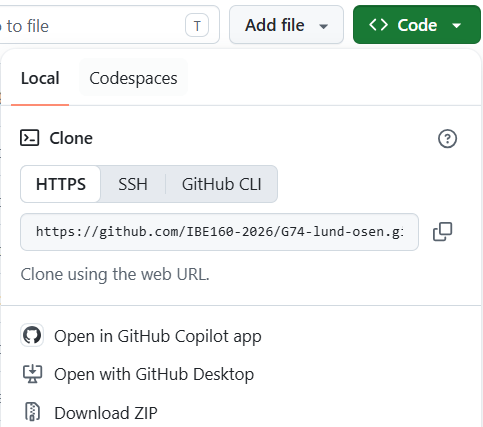
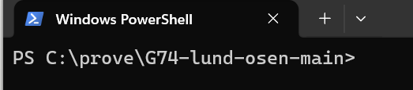

# OSE Signal

[](https://github.com/IBE160-2026/G74-lund-osen/actions/workflows/tester.yml)

Gruppe G74 (Ai Ai Ai) i IBE160 Programmering med KI, Høgskolen i Molde, høsten 2026.

OSE Signal viser 15 aksjer på Oslo Børs som omsettes mye, samlet i én oversikt. Tre enkle sjekker – trend, bevegelse og interesse – gir hver aksje en signalstyrke fra 0 til 3, så en vanlig sparer kan se hva som har endret seg, og hvorfor. Beregningene gjøres med vanlig programkode, og KI skal forklare signalet med ord. Appen gir ikke råd om å kjøpe eller selge. Den er under utvikling og ikke ferdig.

**Innhold:** [Kom i gang](#kom-i-gang) · [Status](#status) · [Tester](#tester) · [Dokumentene](#dokumentene) · [Mappestruktur](#mappestruktur) · [Medlemmer](#medlemmer)

Til faglærer:
- Se appen med oppdiktede tall, uten konto og nøkkel, etter [steg 1–4](#felles-for-begge): [demoen](#demoen)
- Ekte kurser, med en gratis nøkkel fra EODHD: [den ekte versjonen](#den-ekte-versjonen-anbefalt)
- De automatiske testene, med to kommandoer: [Tester](#tester)
- [Product Brief](_bmad-output/planning-artifacts/product-brief.md), arbeidskravet: versjon 8, laget etter [tilbakemeldingen 06.10](_bmad-output/planning-artifacts/tilbakemelding-product-brief.md) og låst i taggen `arbeidskrav-product-brief-v8`
- Plan og krav: [PRD](_bmad-output/planning-artifacts/prds/prd-G74-lund-osen-2026-09-20/prd.md), [arkitektur](_bmad-output/planning-artifacts/architecture/architecture-G74-lund-osen-2026-09-22/ARCHITECTURE-SPINE.md) og [epics og stories](_bmad-output/planning-artifacts/epics.md)
- [Leveranselista](docs/innlevering.md): kravene i emnet, og hvor hvert av dem står
- Prosessen og KI-bruken: [kvalitetssikringen](docs/kvalitetssikring.md), [refleksjonsloggen](docs/reflection-log.md) og [de lagrede KI-promptene](docs/ai-prompts/)
- [Vurderingsmatrisen for del 1](docs/vurderingsmatrise.md): status per kriterium, med bevis og neste tiltak

## Kom i gang

Appen finnes i to versjoner, med samme kode. Vi anbefaler den ekte versjonen. Vil du bare se hvordan appen virker, er demoen raskest. Første gang før kl. 21 på en børsdag, også på dagtid, er demoen veien for å se appen med en gang, fordi den ekte versjonen henter dagens kurser først etter kl. 21. Demoen står først i stegene under, fordi den er raskest.

| | Demoen | Den ekte versjonen (anbefalt) |
|---|---|---|
| Kurser | Oppdiktede selskaper og kurser («Eksempeltall») | Ekte sluttkurser fra Oslo Børs, hentet fra EODHD hver børsdag. Dagens vurdering lagres per aksje |
| Trenger | Bare Docker Desktop | Docker Desktop og en gratis nøkkel fra EODHD |
| Klar | Med en gang | Viser kurser etter første henting, etter kl. 21 på en børsdag, eller i helgen og andre dager børsen er stengt |

**Du trenger** en Windows-maskin eller en Mac, lov til å installere programmer, nett og noen GB ledig plass, men verken git eller Docker-konto. Første gang tar det en stund. På Linux bruker du Docker Engine med Compose i stedet for Docker Desktop. Vi prøvde 10.10 med Docker Desktop 4.91.0 (motor 29.8.0, Compose v5.5.1) på Windows, og imaget bruker Python 3.13.15. Mac er ikke prøvd ennå. Uten Docker trenger du bare [uv](https://docs.astral.sh/uv/), som henter Python 3.13 eller nyere hvis maskinen ikke har den, se «Uten Docker, med uv» under «Mer for den som vil». Står du fast, se [«Står du fast?»](#står-du-fast) lenger ned.

### Felles for begge

1. **Installer og start Docker Desktop** fra [docker.com](https://www.docker.com/products/docker-desktop/). Hopp over innloggingen. Det er klart når det står «Engine running» nederst i vinduet. La det være åpent.



*Slik ser det ut nederst i Docker Desktop når det er klart. Står det «Engine starting», venter du litt til.*

2. **Last ned koden.** Trykk den grønne knappen «Code» på [GitHub-siden](https://github.com/IBE160-2026/G74-lund-osen) og «Download ZIP» nederst i menyen. Windows: høyreklikk fila i Nedlastinger (Downloads) og velg «Pakk ut alle» (Extract All). Mac: dobbeltklikk fila. Det er klart når du har en mappe som heter `G74-lund-osen-main`. Har du fått koden som mappe eller ZIP-fil, pakker du den ut og går til steg 3.



*Menyen under den grønne knappen «Code». Trykk «Download ZIP» nederst. Adressen i boksen trenger du ikke.*

3. **Åpne PowerShell** (Windows: trykk Start, skriv PowerShell og velg «Windows PowerShell», ikke ISE) **eller Terminal** (Mac: trykk Cmd+mellomrom og skriv Terminal). Det er klart når et vindu venter på at du skriver.
4. **Skriv `cd` og et mellomrom**, dra mappa `G74-lund-osen-main` fra steg 2 (ikke ZIP-fila), der README og compose ligger (den innerste hvis det er to) fra Filutforsker eller Finder inn i vinduet, og trykk Enter. [Står det `.zip` til slutt?](docs/hjelp.md#står-det-zip-til-slutt-i-linja) Det er klart når mappenavnet står foran `>` eller `%`. Har mappa et annet navn, drar du den mappa der README og compose ligger.



*Slik ser det ut når steg 4 har gått bra. Stien blir en annen hos deg, men mappenavnet skal stå foran `>` (`%` på Mac).*

**Slik limer du inn en kommando.** Kopier kommandoen med ikonet til høyre i den grå boksen. Ikonet, som stegene kaller knappen, synes først når musa er over boksen. Du kan også markere den og trykke Ctrl+C eller Cmd+C, eller skrive den inn. Lim den inn i PowerShell-vinduet fra steg 4 (Terminal på Mac) med Ctrl+V eller Cmd+V, og trykk Enter.

### Demoen

5. **Start demoen.** Kopier kommandoen med knappen til høyre i boksen, lim den inn i PowerShell-vinduet fra steg 4 (Ctrl+V eller Cmd+V) og trykk Enter. Første gang tar det noen minutter. Demoen er klar når det står `Serving on http://0.0.0.0:8000`. Den linja betyr bare at demoen kjører. Den adressen skal du ikke åpne.

```
docker compose up --build demo
```

6. **Åpne http://127.0.0.1:8000** i en ny fane. Øverst står «Eksempeltall: oppdiktede selskaper og kurser, ikke data fra Oslo Børs.» Klikk på et selskapsnavn for å se en aksje.
7. **Stopp** med Ctrl+C i terminalvinduet, også på Mac, og lim så inn denne i PowerShell-vinduet fra steg 4. Det er klart når det står at containerne er fjernet (Removed).

```
docker compose --profile demo down
```

Vil du også prøve den ekte versjonen, går du videre til steg 5 under.

### Den ekte versjonen (anbefalt)

5. **Hent en nøkkel.** Lag en gratis bruker hos [EODHD](https://eodhd.com/register), og kopier API-nøkkelen din. Det er klart når du har nøkkelen.
6. **Legg inn nøkkelen, bare første gang.** Kopier kommandoene med knappen til høyre i boksen, lim dem inn i PowerShell-vinduet fra steg 4 én om gangen (Ctrl+V eller Cmd+V) og trykk Enter. Den første lager fila `.env`, og den neste åpner den (Windows eller Mac). Lim inn nøkkelen etter `EODHD_API_KEY=`, lagre og lukk. Det er klart når nøkkelen står etter `EODHD_API_KEY=`.

```
cp .env.example .env
```

Windows:

```
notepad .env
```

Mac:

```
open -e .env
```

7. **Start appen.** Lim inn denne i PowerShell-vinduet fra steg 4, og trykk Enter. Første gang tar det noen minutter. Det er klart når det står `Serving on http://0.0.0.0:8000`, som bare betyr at appen kjører. Åpne http://127.0.0.1:8000 i en ny fane. Første gang er oversikten tom og viser kommandoen som henter.

```
docker compose up --build
```

8. **Hent kursene** etter kl. 21 og før midnatt på en børsdag. Første gang går det også i helgen og andre dager børsen er stengt. Åpne et nytt terminalvindu i samme mappe (steg 3 og 4), og lim inn denne i det nye PowerShell-vinduet. Det er klart når utskriften sier hvilken børsdag vurderingene gjelder. Last siden på nytt når hentingen er ferdig.

```
docker compose run --rm hent
```

9. **Stopp** med Ctrl+C i vinduet med appen, og lim så inn denne i PowerShell-vinduet fra steg 4. Det er klart når det står at containerne er fjernet (Removed).

```
docker compose down
```

**Skriv aldri `docker compose down -v`.** Det sletter kursene og vurderingene, og vurderingene kan ikke lages på nytt.

### Står du fast?

Klikk på spørsmålet som passer.

<details>
<summary>«Engine running» kommer ikke, eller det står «Cannot connect to the Docker daemon» eller «error during connect».</summary>

Docker Desktop er ikke startet, eller motoren er ikke klar. Start Docker Desktop, vent til det står «Engine running» (steg 1), og prøv kommandoen igjen. Kommer det ikke etter noen minutter, avslutter du Docker Desktop helt: høyreklikk hvalen ved klokka (Windows) eller klikk den i menylinja øverst (Mac), og velg «Quit Docker Desktop». Åpne det igjen og vent. Hjelper ikke det, starter du maskinen på nytt.

</details>

<details>
<summary>ZIP-fila ser ut som en vanlig mappe.</summary>

Du må pakke ut. Står det «Komprimert størrelse» (Compressed size) som kolonne og «Pakk ut alle» (Extract All) øverst i vinduet, er du inne i ZIP-fila, og den er ikke pakket ut. Trykk «Pakk ut alle», og bruk mappa som lages. På Windows finner du Nedlastinger (Downloads) i Filutforsker (File Explorer), og etter «Pakk ut alle» trykker du «Pakk ut» (Extract).

</details>

<details>
<summary>«is not recognized as the name of a cmdlet» etter cd.</summary>

Det mangler mellomrom etter `cd`. Står `cd` klistret til stien i meldingen, for eksempel `'cdC:\...'`, skriver du `cd`, et mellomrom, og drar mappa inn i vinduet på nytt (steg 4). Står det `'docker'` i meldingen, er Docker Desktop ikke installert, eller vinduet ble åpnet før installasjonen: lukk det og åpne et nytt (steg 3).

</details>

<details>
<summary>«Cannot find path … because it does not exist».</summary>

Mappa ligger ikke der stien sier, for eksempel fordi den er flyttet, eller fordi ZIP-fila ble dratt inn i stedet for mappa. Skriv `cd` og et mellomrom, og dra mappa inn i vinduet på nytt (steg 4).

</details>

<details>
<summary>«no configuration file provided: not found».</summary>

Terminalvinduet står i feil mappe. Gjør steg 4 på nytt, og dra den mappa der fila compose ligger. Windows viser den uten filendelsen, som compose og ikke compose.yaml.

</details>

Flere spørsmål og svar står i [docs/hjelp.md](docs/hjelp.md).

### Mer for den som vil

<details>
<summary>Bytte mellom demoen og den ekte versjonen</summary>

Begge bruker port 8000, så bare én kan kjøre om gangen. `docker compose down` stopper ikke demoen, fordi demoen ligger i en egen profil. `docker compose --profile demo down` stopper begge.

Stopp demoen og den ekte versjonen:

```
docker compose --profile demo down
```

Start så den ekte versjonen:

```
docker compose up --build
```

eller demoen:

```
docker compose up --build demo
```

Volumene står når du bytter, også basen med vurderingene.

</details>

<details>
<summary>Uten Docker, med uv</summary>

Med Python 3.13 og [uv](https://docs.astral.sh/uv/). Først demoen.

**Demoen**

1. Installer avhengighetene:

```
uv sync
```

2. Lag demobasen, `data/db/demo.db`:

```
uv run python src/demo.py
```

3. Start demoen på http://127.0.0.1:8000:

```
uv run python src/app.py --demo
```

**Den ekte versjonen**

1. Bare første gang: kopier malen, og fyll inn `EODHD_API_KEY` i `.env`:

```
cp .env.example .env
```

2. Hent kurser:

```
uv run python src/fetch_prices.py
```

3. Start webserveren på http://127.0.0.1:8000:

```
uv run python src/app.py
```

Basen, demobasen og øyeblikksbildene ligger da i `data/` i mappa. Uten `--demo` åpner webserveren den ekte basen.

</details>

<details>
<summary>Den lokale modellen (KI-teksten)</summary>

Hentingen kan lage en KI-tekst for hver aksje, med en modell som kjører på maskinen: Gemma i Ollama, i Docker, med grafikkortet. Med adressen som står som standard, sendes ingenting ut. KI-teksten er av i `.env.example`, og hentingen går som før uten den.

Det trengs et grafikkort fra NVIDIA med driver, og at Docker Desktop kan bruke det. Uten det starter ikke Ollama, og KI-teksten bør stå av.

Bare første gang: start Ollama, og hent modellen til volumet `ose-ki-ollama`.

```
docker compose --profile ki up -d ollama
```

```
docker compose exec ollama ollama pull gemma4:e4b
```

Slå på KI-teksten: sett `OSE_KI_TJENESTE=lokal` i `.env`. Står variabelen ikke i `.env` i det hele tatt, er den også på.

Før hver henting med KI-tekst må Ollama kjøre:

```
docker compose --profile ki up -d ollama
```

Så hentes det som vanlig. Med uv når hentingen Ollama på http://127.0.0.1:11434, og i Docker på tjenestenavnet. Stopp Ollama etterpå:

```
docker compose --profile ki down
```

Hentingen sjekker først at Ollama svarer og har modellen. Gjør den ikke det, lages ingen KI-tekst, og utskriften sier hvorfor. Start Ollama og kjør samme kommando igjen samme kveld, før midnatt: da lages tekstene. Har basen dagens kurs for alle aksjene, gir det 0 kall til EODHD. Mangler noen aksjer dagens kurs, gjør samme kommando et nytt forsøk for dem, og det bruker kall. Svarer Ollama, men modellen feiler for en aksje, får aksjen en rad om det, og modellen kalles ikke for resten av aksjene den kvelden. De får en rad om at modellen ikke ble kalt. Radene står, så ingen av dem får tekst den dagen (FR-604).

Slå av KI-teksten: sett `OSE_KI_TJENESTE=av` i `.env`.

Modellen ble prøvd på en maskin med 15,7 GB minne og et grafikkort med 8 GB, der Docker Desktop hadde 8,2 GB (`malinger.md` §19).

</details>

## Status

Under arbeid, og ingenting er endelig.

**Ferdig**

- Hentingen av kurser fra kl. 21 på børsdager, med kontroll av børsdagen, og at hovedindeksen hentes i samme kjøring
- Nye forsøk med kallene som er igjen etter hentingen
- Docker, og demoen, som viser alle 10 fargekombinasjonene av de tre sjekkene på siste dag
- Denne README-en, med bilder i «Kom i gang» og demoen først, og hjelp bak «?» på sidene
- Tydeligere merking i tabellene, datoene og månedsmerkene i grafen, oversikten fra designforslaget, utseendet fra designforslaget, og sortering ved klikk i kolonneraden
- Hovedindeksen, som vises over tabellen på forsiden, med søylene under, og som en stiplet linje i kursgrafen på aksjesiden
- Den første delen av KI-laget: plassen for KI-teksten under regelforklaringen på aksjesiden, med en bryter som slår den av og på, loggen der tekstene lagres, kontrollen av teksten mot regelen, og at hentingen lager teksten med en lokal modell. Teksten lages når KI er slått på og den lokale modellen kjører under hentingen, og aksjesiden viser bare tekster som besto kontrollen
- Ruff, som finner feil og rot i koden og formaterer den, i CI og i testene, den oppdaterte kvalitetssikringen, og et ryddigere repo uten kopien av BMAD-skillene

**Neste**

- KI-tekstene i demoen
- Min liste
- Historikken og signaldagene i grafen
- Lenkene til selskapets side på NewsWeb og selskapets egen nettside
- Egen nøkkel til Gemini, Anthropic og OpenAI
- Innstillingene, med «Vis KI-tekst»
- Periodene i kursgrafen, og på forsiden periodevalget, børsometeret og KI-teksten om dagen
- Til slutt å velge og bytte aksjer

«Ferdig» betyr flettet til main. Det som bygges etter demoen, skal vises i begge versjonene. Børsmeldinger er ikke med i v1, fordi Euronext ikke ga tillatelse til automatisert henting (plan B). Detaljene står i [sprintstatusen](_bmad-output/implementation-artifacts/sprint-status.yaml) og i [planen](_bmad-output/planning-artifacts/epics.md).

## Tester

**På en ren maskin uten Docker** trenger du bare [uv](https://docs.astral.sh/uv/). Appen krever Python 3.13 eller nyere (`requires-python` i `pyproject.toml`), og uv henter den hvis maskinen ikke har den. Stå i mappa der README og `pyproject.toml` ligger, og kjør:

```
uv sync
```

```
uv run pytest
```

Alle testene skal bestå. Noen hoppes over, og knappen under sier hvorfor.

<details>
<summary>Hvorfor hoppes noen over?</summary>

Noen hoppes over, med grunnen i utskriften når du legger til `-rs`: på Windows testene som bytter tidssone, fordi `time.tzset` ikke finnes der (de kjøres i CI), og testen for Unix-sokler, som Python på Windows ikke har. På en maskin uten IPv6 (`::1`) hoppes testen for den over. I en mappe fra ZIP-fila, uten git, hoppes også testene som sjekker hva som er sporet i git, over.

</details>

- Ingen nettkall: `tests/conftest.py` sperrer nettverket i hver test.
- `data/` røres ikke: testene bruker en midlertidig mappe.
- CI kjører på hver push og pull request mot `main`, uten hemmeligheter og uten API-nøkkel.
- ruff kjøres før en commit: `uv run ruff check --fix`, som også sorterer importene, og så `uv run ruff format`. Reglene står i `pyproject.toml`: pyflakes, importene og bugbear, som finner feil og rot, ikke smak. CI kjører `ruff check` og `ruff format --check` før testene, og `tests/test_ruff.py` gjør det samme, så `uv run pytest` feiler hvis noe er glemt.

Hver story som endrer koden, leveres med tester. Det er vårt svar på hvordan KI-generert kode kvalitetssikres, og alt står i [`docs/kvalitetssikring.md`](docs/kvalitetssikring.md).

## Dokumentene

`docs/` viser hvordan vi kom fram til noe og hvilken rolle KI spilte, og `_bmad-output/` viser hva vi kom fram til.

**Plan og krav**

- [Product Brief](_bmad-output/planning-artifacts/product-brief.md): versjon 8, laget etter [tilbakemeldingen fra faglærer 06.10](_bmad-output/planning-artifacts/tilbakemelding-product-brief.md) på versjon 7 (taggen `arbeidskrav-product-brief-v7`), og låst i taggen `arbeidskrav-product-brief-v8` (commit `52023c9`)
- [PRD](_bmad-output/planning-artifacts/prds/prd-G74-lund-osen-2026-09-20/), med begrunnelser og målinger
- [Relevanseksperimentet](_bmad-output/planning-artifacts/prds/prd-G74-lund-osen-2026-09-20/relevanseksperiment.md)
- [Arkitektur](_bmad-output/planning-artifacts/architecture/architecture-G74-lund-osen-2026-09-22/ARCHITECTURE-SPINE.md)
- [Epics og stories](_bmad-output/planning-artifacts/epics.md)
- [Designregler](_bmad-output/planning-artifacts/designregler.md)
- [Utdrag fra designtavla 13.10](_bmad-output/planning-artifacts/designutdrag-2026-10-13.md): grunnlaget for planen til story 8.0d
- [Endringsforslag 28.09](_bmad-output/planning-artifacts/sprint-change-proposal-2026-09-28.md), godkjent samme dag
- [Endringsforslag 08.10](_bmad-output/planning-artifacts/sprint-change-proposal-2026-10-08.md): femten idéer inn i v1, godkjent samme dag
- [Endringsforslag 13.10](_bmad-output/planning-artifacts/sprint-change-proposal-2026-10-13.md): den samlede endringen fra samlelista, godkjent samme dag
- [Kilder og bruksvilkår](docs/kilder-og-rettigheter.md), med e-postene til [EODHD](docs/epost-til-eodhd.md) og [Euronext](docs/epost-til-euronext.md)
- [Leveranseliste](docs/innlevering.md)
- [Hjelp til «Kom i gang»](docs/hjelp.md): spørsmål og svar, sortert etter steg

**Arbeidsprosess og kvalitet**

- [Sprintstatus og story-spesifikasjoner](_bmad-output/implementation-artifacts/)
- [Kvalitetssikring](docs/kvalitetssikring.md)
- [Vurderingsmatrise for del 1](docs/vurderingsmatrise.md)
- [Kontrollrapport 22.09](docs/kontroll-2026-09-22.md), med [rettingsplanen](docs/kontroll-2026-09-22-plan.md)
- [Kontrollrapport 26.09](docs/kontroll-2026-09-26.md)
- [Refleksjonslogg](docs/reflection-log.md) og [lagrede KI-prompts](docs/ai-prompts/)

## Mappestruktur

- [`src/`](src/) og [`tests/`](tests/) — applikasjonen og testene
- [`docs/`](docs/) — arbeidsprosessen, og [`docs/hjelp.md`](docs/hjelp.md) med spørsmål og svar til «Kom i gang»
- [`docs/bilder/readme/`](docs/bilder/readme/) — de tre skjermbildene i «Kom i gang»: [`engine-running.png`](docs/bilder/readme/engine-running.png), [`github-download-zip.png`](docs/bilder/readme/github-download-zip.png) og [`powershell-mappa.png`](docs/bilder/readme/powershell-mappa.png)
- [`_bmad-output/`](_bmad-output/) — Product Brief, plan, krav og sprintstatus
- [`.github/`](.github/) — testkjøringen og morgensjekken
- [`Dockerfile`](Dockerfile), [`compose.yaml`](compose.yaml) og [`.dockerignore`](.dockerignore) — imaget og tjenestene: webserveren, hentingen og demoen
- [`_bmad/`](_bmad/) og [`.claude/skills/`](.claude/skills/) — BMAD-rammeverket, ikke skrevet av oss

Ikke i repoet: API-nøkkelen (`.env`), rådata, basen og demobasen (`data/`), lokale testskript (`local-tests/`) og den private arbeidsmappa (`_privat/`).

## Medlemmer

Joakim Lund og Marian Osen. Vi diskuterer og avgjør arbeidet sammen. Fra 25.09 har felles commits `Co-authored-by` for den av oss som ikke committet (regel 20 i `CLAUDE.md`).
