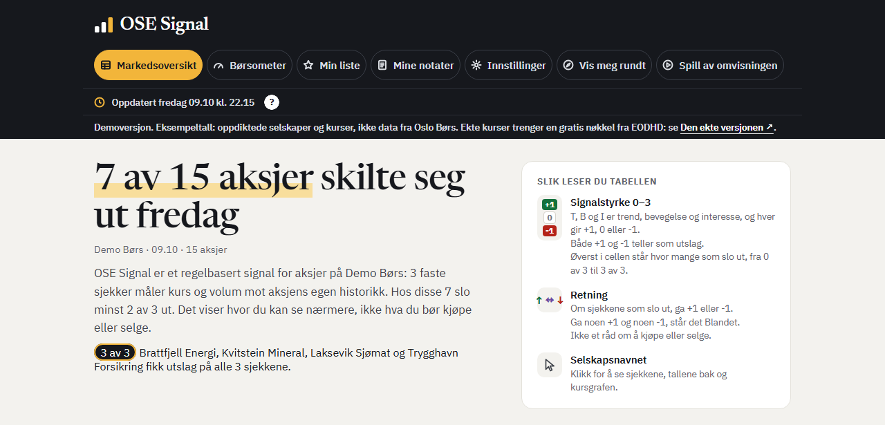
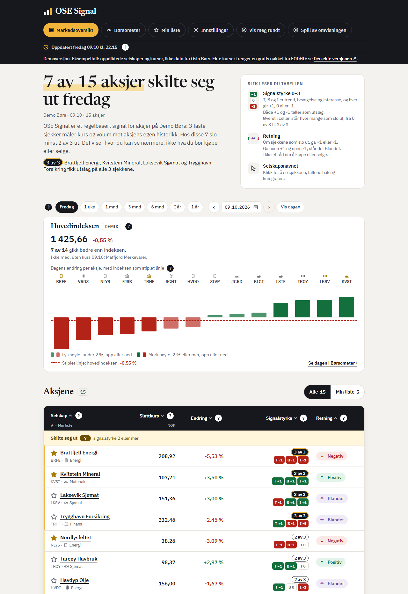
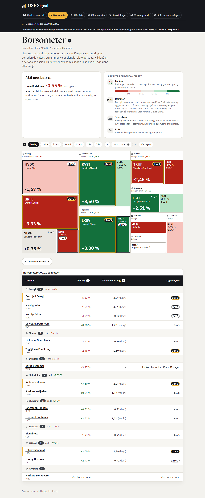
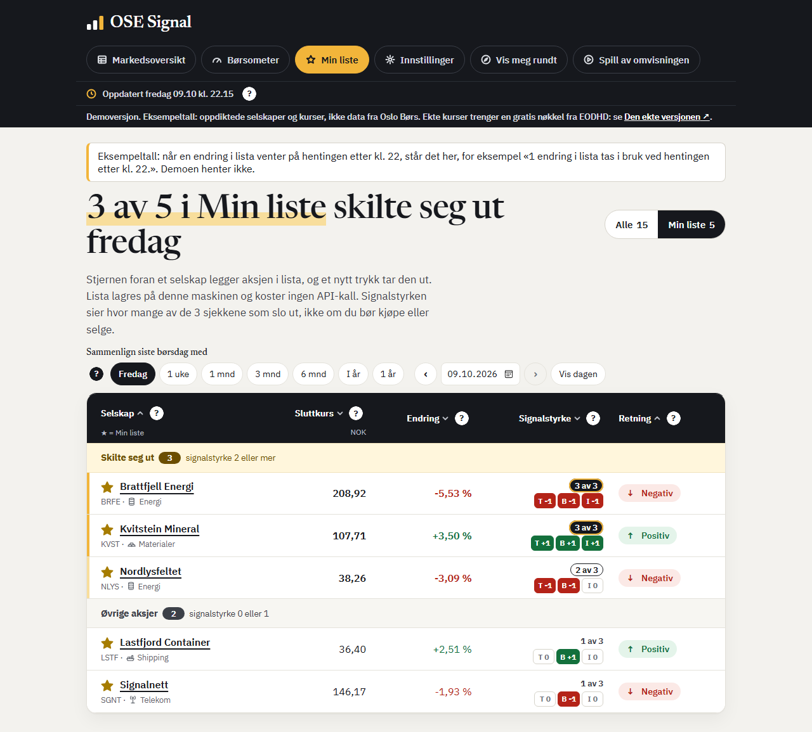
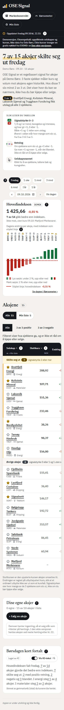
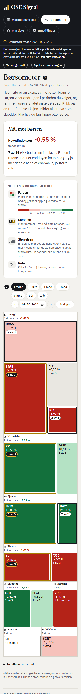
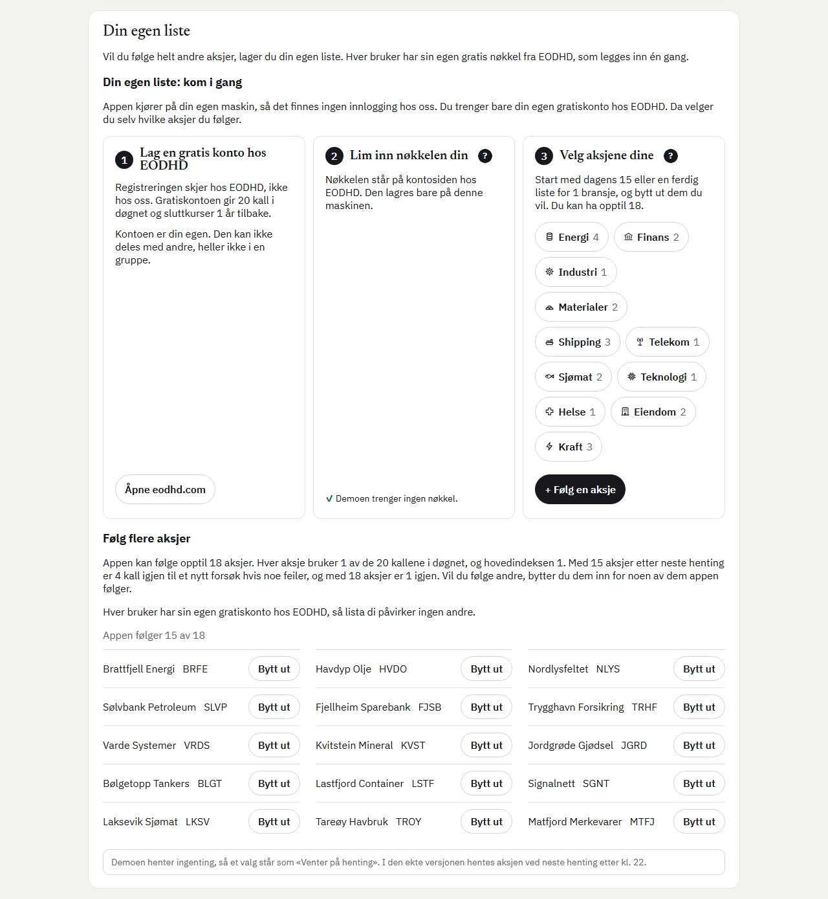
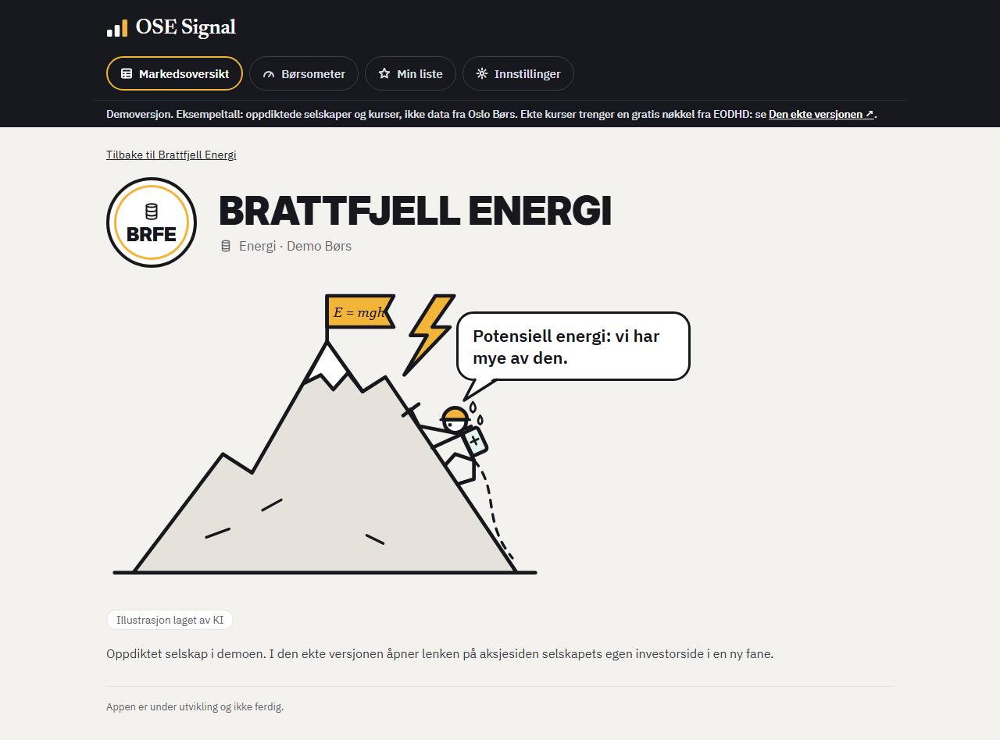

# OSE Signal

[](https://github.com/IBE160-2026/G74-lund-osen/actions/workflows/tester.yml)

Gruppe G74 (Ai Ai Ai) i IBE160 Programmering med KI, Høgskolen i Molde, høsten 2026.

OSE Signal viser 15 aksjer på Oslo Børs som omsettes mye, samlet i én oversikt. Tre enkle sjekker – trend, bevegelse og interesse (handelsvolum) – gir hver aksje en signalstyrke fra 0 til 3, så en vanlig sparer kan se hva som har endret seg, og hvorfor. Beregningene gjøres med vanlig programkode, og KI skal forklare signalet med ord. Appen gir ikke råd om å kjøpe eller selge. Den er under utvikling og ikke ferdig.


*Toppen av oversikten i demoen, med oppdiktede selskaper og kurser («Eksempeltall»).*

<details>
<summary>Bilder av appen (demoen)</summary>


*Oversikten i demoen, med oppdiktede selskaper og kurser («Eksempeltall»).*


*Aksjesiden for BRFE i demoen, med grafen og rammen «Signalet forklart», med setningene om dagene og om samme dag først og KI-teksten under, med oppdiktede tall («Eksempeltall»).*


*Børsometeret i demoen, med kortene «Mål mot børsen» og «Slik leser du børsometeret» øverst, antallet og snittet under hver bransje, og navnet og endringen i stor skrift i de største rutene, med oppdiktede tall («Eksempeltall»).*


*Min liste i demoen, med aksjene som har stjerne, med oppdiktede tall («Eksempeltall»).*


*Oversikten i demoen ved 390 px, som på en mobil, med «Dine egne aksjer» under tabellen og «Børsdagen kort fortalt» nederst, KI-teksten om hele børsdagen, med oppdiktede tall («Eksempeltall»).*


*Børsometeret i demoen ved 390 px, som på en mobil, med oppdiktede tall («Eksempeltall»).*


*«Din egen liste» i Min liste i demoen, med kallene lista bruker, «Bytt ut» ved hver aksje og «Start fra en ferdig liste» nederst, med én liste per bransje. På oversikten står «Dine egne aksjer» med «+ Følg en aksje», og lista kan ha opptil 18 aksjer, med oppdiktede selskaper («Eksempeltall»).*


*Investorsiden for BRFE i demoen, fra boblen nederst på aksjesiden, med «Illustrasjon laget av KI» under tegningen, med oppdiktede selskaper («Eksempeltall»).*

</details>

**Innhold:** [Kom i gang](#kom-i-gang) · [Status](#status) · [Tester](#tester) · [Dokumentene](#dokumentene) · [Mappestruktur](#mappestruktur) · [Medlemmer](#medlemmer)

<a name="demoen-og-den-ekte-versjonen"></a>

**Demoen og den ekte versjonen:**

| | Demoen | Den ekte versjonen |
|---|---|---|
| Kurser | Oppdiktede selskaper og kurser («Eksempeltall») | Ekte sluttkurser fra Oslo Børs, hentet fra EODHD hver børsdag. Dagens vurdering lagres per aksje |
| Trenger | Ingen konto og ingen nøkkel | En gratis nøkkel fra EODHD |
| Klar | Med en gang | Etter første henting, som kan startes når som helst. Før kl. 22 på en børsdag henter den forrige børsdag, og dagens kurser etter kl. 22 trenger da bonuskvote hos EODHD |

Til faglærer:
- Prøv appen: demoen med oppdiktede tall, uten konto og nøkkel, med et dobbeltklikk på «Start demoen» ([Enklest: dobbeltklikk](#enklest-dobbeltklikk-uten-docker)) eller med Docker Desktop etter [steg 1–4](docs/installasjon.md#med-docker-desktop) ([demoen](docs/installasjon.md#demoen)). Prøv gjerne ekte kurser etterpå, med en gratis nøkkel fra EODHD: [den ekte versjonen](#den-ekte-versjonen)
- Testene: de automatiske, med to kommandoer etter at uv er installert: [Tester](#tester)
- Dokumentene:
  - [Product Brief](_bmad-output/planning-artifacts/product-brief.md), arbeidskravet: versjon 8 etter [tilbakemeldingen 06.10](_bmad-output/planning-artifacts/tilbakemelding-product-brief.md), låst i taggen `arbeidskrav-product-brief-v8`
  - Plan og krav: [PRD](_bmad-output/planning-artifacts/prds/prd-G74-lund-osen-2026-09-20/prd.md) (ferdig 3.11, låst i taggen `prd-ferdig-2026-11-03`), med [«Kort fortalt»](_bmad-output/planning-artifacts/prds/prd-G74-lund-osen-2026-09-20/prd.md#kort-fortalt) først
  - [Arkitektur](_bmad-output/planning-artifacts/architecture/architecture-G74-lund-osen-2026-09-22/ARCHITECTURE-SPINE.md) og [epics og stories](_bmad-output/planning-artifacts/epics.md)
  - [Leveranselista](docs/innlevering.md): kravene i emnet og hvor de står
  - [Vurderingsmatrisen for del 1](docs/vurderingsmatrise.md): status per kriterium
- Prosessen og KI-bruken: [kvalitetssikringen](docs/kvalitetssikring.md), [refleksjonsloggen](docs/reflection-log.md) og [de lagrede KI-promptene](docs/ai-prompts/)

<a name="kom-i-gang"></a>

## Kom i gang: nedlasting og installasjon

<a name="enklest-dobbeltklikk-uten-docker"></a>

### Enklest: dobbeltklikk (anbefalt)

1. **Last ned koden** med [den direkte lenken](https://github.com/IBE160-2026/G74-lund-osen/archive/refs/heads/main.zip).
2. **Pakk ut.** Windows: høyreklikk fila i Nedlastinger og velg «Pakk ut alle». Mac: dobbeltklikk fila. Ikke start fra inne i ZIP-fila.
3. **Åpne `G74-lund-osen-main` og dobbeltklikk «Start demoen».** Bruk den innerste mappa, der README ligger. På Windows: den uten `.command`.
4. **Svar `j`** og trykk Enter hvis vinduet spør om uv. Nettleseren åpner appen når den er klar, første gang etter noen minutter.
5. **Lukk vinduet** for å stoppe appen.

**Første gang** kan Windows og Mac stoppe fila, fordi den er lastet ned fra nettet. Slik går du videre: [Windows](docs/hjelp.md#windows-advarer-mot-fila) og [Mac](docs/hjelp.md#mac-sier-at-fila-ikke-kan-åpnes).

<a name="den-ekte-versjonen"></a>**Ekte kurser:** dobbeltklikk «Start den ekte versjonen» i stedet for «Start demoen». Den spør etter en gratis nøkkel fra EODHD første gang, og starter bare i en kopi fra ZIP-fila, ikke i en klon. Docker, uv, Linux, hjelp når du står fast og mer for den som vil: [Installasjonen](docs/installasjon.md).

## Status

Prosjektet er under utvikling. Listene under viser hva som er ferdig på main, og hva som gjenstår.

**Ferdig**

- De tre sjekkene, trend, bevegelse og interesse, styrken for hver aksje hver børsdag, også fra 2027, og regelforklaringen på aksjesiden
- Hentingen: kursene og hovedindeksen fra kl. 22, første gang på dagtid, med børsdagskontroll og forsøk med kallene som er igjen
- Oversikten og utseendet fra designforslaget og skissene 06.11, med tydeligere merking, hjelp bak «?» og sortering ved klikk i kolonneraden
- Periodevalget på alle sidene, og hovedindeksen over tabellen på forsiden med søylene og som stiplet linje i kursgrafen
- På aksjesiden: periodene i kursgrafen med «Vis dagen», datoene og månedsmerkene, lenken til investorsiden og signalet dag for dag
- Min liste, med stjernen foran hvert selskap, og børsometeret som et kart, med knappene øverst og «Innstillinger» med «Vis hjelp»
- KI-teksten forklarer sjekkene og mønstrene, fra en lokal modell eller egen nøkkel, med bryter, bare tekster som besto kontrollen
- Docker for begge versjonene, og demoen med alle 10 fargekombinasjonene av de tre sjekkene, KI-tekst fra Gemma og investorsider

**Neste i v1**

- Brukertesten med én person, først med KI av
- Prøven av README-en på en ren maskin, når alt i v1 er bygget

**Ekstra, hvis tiden rekker**

- Signaldagene i kursgrafen
- Innstillingene, med «Vis KI-tekst»
- KI-teksten om dagen på forsiden
- Til slutt å velge og bytte aksjer

Det som står under «Ekstra», er ikke lovet i briefen og kommer bare med hvis det er ferdig og testet før README-prøven, senest én uke før innleveringen.

«Ferdig» betyr flettet til main. Rundt appen er dette også ferdig: README-en med demoen først og installasjonen med bilder i en egen fil, ruff i CI og i testene, den oppdaterte kvalitetssikringen og et ryddigere repo uten kopien av BMAD-skillene. Fra 29.10 går hentingen av seg selv hver kveld på en PC i gruppen, og etterpå måler den omsetningen for andre aksjer på Oslo Børs med kallene som er igjen av dagen. Det som bygges etter demoen, skal vises i begge versjonene. Børsmeldinger er ikke med i v1, fordi Euronext ikke ga tillatelse til automatisert henting (plan B). Detaljene står i [sprintstatusen](_bmad-output/implementation-artifacts/sprint-status.yaml) og i [planen](_bmad-output/planning-artifacts/epics.md).

## Tester

Testene kjøres med [uv](https://docs.astral.sh/uv/), uten Docker. Har du ikke uv, står installasjonen bak pila under.

<details>
<summary>Har du ikke uv? Slik installerer du den</summary>

**På en ren maskin uten Docker** trenger du bare [uv](https://docs.astral.sh/uv/). Appen krever Python 3.13 eller nyere (`requires-python` i `pyproject.toml`), og uv henter den hvis maskinen ikke har den. Installer uv først, etter [fremgangsmåten hos uv](https://docs.astral.sh/uv/getting-started/installation/).

Windows (PowerShell):

```
powershell -ExecutionPolicy ByPass -c "irm https://astral.sh/uv/install.ps1 | iex"
```

Mac (Terminal):

```
curl -LsSf https://astral.sh/uv/install.sh | sh
```

Blir `uv` ikke funnet etterpå («The term 'uv' is not recognized» eller «command not found: uv»), lukker du vinduet, åpner et nytt og går til mappa, som i [steg 4 med Docker](docs/installasjon.md#med-docker-desktop) i installasjonen.

</details>

Stå i mappa der README og `pyproject.toml` ligger, og kjør:

```
uv sync
```

```
uv run pytest
```

Første `uv sync` laster ned Python og pakkene. Hele testsettet tok mellom 10 og 14 minutter på maskinen vår 08.11.

Alle testene skal bestå. Noen hoppes over fordi de gjelder en annen type maskin, men alle kjøres minst ett sted.

<details>
<summary>Hvilke tester hoppes over, og hvorfor?</summary>

Grunnen står i utskriften når du legger til `-rs`.

**På Windows**, som PC-en vår: testene som bytter tidssone, fordi `time.tzset` ikke finnes der, testen for Unix-sokler, som Python på Windows ikke har, og testene for `start.sh`, skriptet bak dobbeltklikket på Mac, som krever bash, `lsof` og `ps`. De kjøres i CI ved hver push.

**På Linux og Mac:** testene for dobbeltklikket og kveldshentingen på Windows, som krever Windows PowerShell. De kjøres på PC-en vår før hver commit som endrer koden eller testene, og porten og kveldshentingen også i CI på Windows ved hver push.

**På alle maskiner, når noe mangler:**

- Uten Edge eller Chrome hoppes testene som åpner sidene i en nettleser, over. I CI feiler de i stedet.
- Uten IPv6 (`::1`) hoppes testen for den over.
- I en mappe fra ZIP-fila, uten git, hoppes testene som sjekker hva som er sporet i git, over.
- Er port 8000 i bruk, hoppes testene som starter appen på den porten, over.

De kjøres på PC-en vår før hver commit som endrer koden eller testene, og i CI ved hver push.

</details>

<details>
<summary>Slik er testene satt opp: ingen nettkall, ingen ekte data og CI ved hver push</summary>

- Ingen nettkall: `tests/conftest.py` sperrer nettverket i hver test.
- `data/` røres ikke: testene bruker en midlertidig mappe.
- CI kjører på hver push og pull request mot `main`, uten hemmeligheter og uten API-nøkkel.
- ruff kjøres før en commit: `uv run ruff check --fix`, som også sorterer importene, og så `uv run ruff format`. Reglene står i `pyproject.toml`: pyflakes, importene og bugbear, som finner feil og rot, ikke smak. CI kjører `ruff check` og `ruff format --check` før testene, og `tests/test_ruff.py` gjør det samme, så `uv run pytest` feiler hvis noe er glemt.

</details>

Hver story som endrer koden, leveres med tester. Det er vårt svar på hvordan KI-generert kode kvalitetssikres, og alt står i [`docs/kvalitetssikring.md`](docs/kvalitetssikring.md).

## Dokumentene

<details>
<summary>Dokumentlista: plan og krav, arbeidsprosess og kvalitet</summary>

`docs/` viser hvordan vi kom fram til noe og hvilken rolle KI spilte, og `_bmad-output/` viser hva vi kom fram til.

**Plan og krav**

- [Product Brief](_bmad-output/planning-artifacts/product-brief.md): versjon 8, laget etter [tilbakemeldingen fra faglærer 06.10](_bmad-output/planning-artifacts/tilbakemelding-product-brief.md) på versjon 7 (taggen `arbeidskrav-product-brief-v7`), og låst i taggen `arbeidskrav-product-brief-v8` (commit `52023c9`)
- [PRD](_bmad-output/planning-artifacts/prds/prd-G74-lund-osen-2026-09-20/), med begrunnelser og målinger
- [Relevanseksperimentet](_bmad-output/planning-artifacts/prds/prd-G74-lund-osen-2026-09-20/relevanseksperiment.md)
- [Arkitektur](_bmad-output/planning-artifacts/architecture/architecture-G74-lund-osen-2026-09-22/ARCHITECTURE-SPINE.md)
- [Epics og stories](_bmad-output/planning-artifacts/epics.md)
- [Designregler](_bmad-output/planning-artifacts/designregler.md)
- [Utdrag fra designtavla 13.10](_bmad-output/planning-artifacts/designutdrag-2026-10-13.md): grunnlaget for planen til story 8.0d
- [Utdrag fra designtavla 08.11](_bmad-output/planning-artifacts/designutdrag-2026-11-08.md): egne aksjer, KI-teksten om dagen og Innstillinger, til story 2.12, 8.10, 8.10b og 10.6
- [Endringsforslag 28.09](_bmad-output/planning-artifacts/sprint-change-proposal-2026-09-28.md), godkjent samme dag
- [Endringsforslag 08.10](_bmad-output/planning-artifacts/sprint-change-proposal-2026-10-08.md): femten idéer inn i v1, godkjent samme dag
- [Endringsforslag 13.10](_bmad-output/planning-artifacts/sprint-change-proposal-2026-10-13.md): den samlede endringen fra samlelista, godkjent samme dag
- [Endringsforslag 19.10](_bmad-output/planning-artifacts/sprint-change-proposal-2026-10-19.md): endelig v1 er det briefen v8 lover, og resten er ekstra, godkjent samme dag
- [Kilder og bruksvilkår](docs/kilder-og-rettigheter.md), med e-postene til [EODHD](docs/epost-til-eodhd.md) og [Euronext](docs/epost-til-euronext.md)
- [Leveranseliste](docs/innlevering.md)
- [Installasjonen](docs/installasjon.md): Docker, uv, Linux, «Står du fast?» og «Mer for den som vil», flyttet fra «Kom i gang»
- [Hjelp til «Kom i gang»](docs/hjelp.md): spørsmål og svar, sortert etter steg

**Arbeidsprosess og kvalitet**

- [Sprintstatus og story-spesifikasjoner](_bmad-output/implementation-artifacts/)
- [Kvalitetssikring](docs/kvalitetssikring.md)
- [Vurderingsmatrise for del 1](docs/vurderingsmatrise.md)
- [UX-loggen](docs/ux-logg.md): hva vi har sett og gjort for brukeropplevelsen fra starten, og funnene som står åpne før brukertesten
- [Brukertesten](docs/brukertest.md): skjemaet for story 8.1 og 10.4, ikke tatt ennå
- [Brukslogga](docs/brukslogg.md): dagene gruppen bruker appen fra 4.11, for «Adopsjon» og «Fortsatt bruk» i §7 i PRD-en
- [Kontrollrapport 22.09](docs/kontroll-2026-09-22.md), med [rettingsplanen](docs/kontroll-2026-09-22-plan.md)
- [Kontrollrapport 26.09](docs/kontroll-2026-09-26.md)
- [Refleksjonslogg](docs/reflection-log.md) og [lagrede KI-prompts](docs/ai-prompts/)

</details>

## Mappestruktur

<details>
<summary>Mappene og filene i repoet</summary>

- [`src/`](src/) og [`tests/`](tests/) — applikasjonen og testene
- [`docs/`](docs/) — arbeidsprosessen, [`docs/installasjon.md`](docs/installasjon.md) med Docker, uv og resten av installasjonen, og [`docs/hjelp.md`](docs/hjelp.md) med spørsmål og svar til «Kom i gang»
- [`docs/bilder/readme/`](docs/bilder/readme/) — de tre skjermbildene i [`docs/installasjon.md`](docs/installasjon.md): [`engine-running.png`](docs/bilder/readme/engine-running.png), [`github-download-zip.png`](docs/bilder/readme/github-download-zip.png) og [`powershell-mappa.png`](docs/bilder/readme/powershell-mappa.png)
- [`docs/bilder/investorsider/`](docs/bilder/investorsider/) — de 15 tegningene laget av KI til investorsidene i demoen, godkjent 24.10: SVG-ene, forhåndsvisningene, [`LESMEG.md`](docs/bilder/investorsider/LESMEG.md) og [`bobler.json`](docs/bilder/investorsider/bobler.json)
- [`docs/skisser/2026-11-06/`](docs/skisser/2026-11-06/) — skissene av aksjesiden og børsometeret laget av KI i chatten 06.11, etter gruppens gjennomgang, med oppdiktede selskaper og tall: fem PNG-er og [`docs/skisser/2026-11-06/LESMEG.md`](docs/skisser/2026-11-06/LESMEG.md) med svarene de bygger på. Bygget 07.11 i 8.20a, 8.20b og 3.4h
- [`docs/appen/`](docs/appen/) — bilder og senere video av appen, bare av demoen: [`oversikten-topp-demo.png`](docs/appen/oversikten-topp-demo.png), [`oversikten-demo.png`](docs/appen/oversikten-demo.png), [`aksjesiden-brfe-demo.png`](docs/appen/aksjesiden-brfe-demo.png), [`boersometeret-demo.png`](docs/appen/boersometeret-demo.png), [`min-liste-demo.png`](docs/appen/min-liste-demo.png), [`oversikten-390-demo.png`](docs/appen/oversikten-390-demo.png) og [`boersometeret-390-demo.png`](docs/appen/boersometeret-390-demo.png)
- [`_bmad-output/`](_bmad-output/) — Product Brief, plan, krav og sprintstatus
- [`.github/`](.github/) — testkjøringen og morgensjekken
- [`.logs/`](.logs/) — loggene fra øktene med Claude Code, én mappe per bruker, og issues.md i hver mappe med det som gjenstår
- [`Dockerfile`](Dockerfile), [`compose.yaml`](compose.yaml) og [`.dockerignore`](.dockerignore) — imaget og tjenestene: webserveren, hentingen og demoen
- [`start/`](start/) og [`.gitattributes`](.gitattributes) — start med dobbeltklikk, uten Docker: skriptene bak de fire filene Start demoen og Start den ekte versjonen i rota, for Windows og Mac, og linjeskiftene de trenger. Der står også jobben som henter hver kveld i Oppgaveplanlegging på Windows, og skriptene som legger den inn og tar den bort
- [`_bmad/`](_bmad/) og [`.claude/skills/`](.claude/skills/) — BMAD-rammeverket, ikke skrevet av oss, og skillen sesjonslogg, som kommer fra faglærer
- [`README.md`](README.md) — denne fila: hva appen er, hvordan den startes, status og testene
- [`CLAUDE.md`](CLAUDE.md) — reglene for KI-øktene i repoet, som Claude Code leser når en økt starter
- [`pyproject.toml`](pyproject.toml) og [`uv.lock`](uv.lock) — prosjektet for uv: Python-versjonen, avhengighetene og innstillingene for pytest og ruff, og de låste versjonene av avhengighetene, som uv sync og imaget installerer
- [`.env.example`](.env.example) — malen for .env, uten nøkkel, som den ekte versjonen kopierer første gang
- [`.gitignore`](.gitignore) og [`.mailmap`](.mailmap) — det git ikke skal spore, som nøklene, data/ og _privat/, og navnet og e-postadressen git log viser for hver av oss

Ikke i repoet: API-nøkkelen (`.env`), rådata, basen og demobasen (`data/`), lokale testskript (`local-tests/`) og den private arbeidsmappa (`_privat/`).

</details>

## Medlemmer

Joakim Lund og Marian Osen. Vi diskuterer og avgjør arbeidet sammen. Fra 25.09 har felles commits `Co-authored-by` for den av oss som ikke committet (regel 20 i `CLAUDE.md`).
