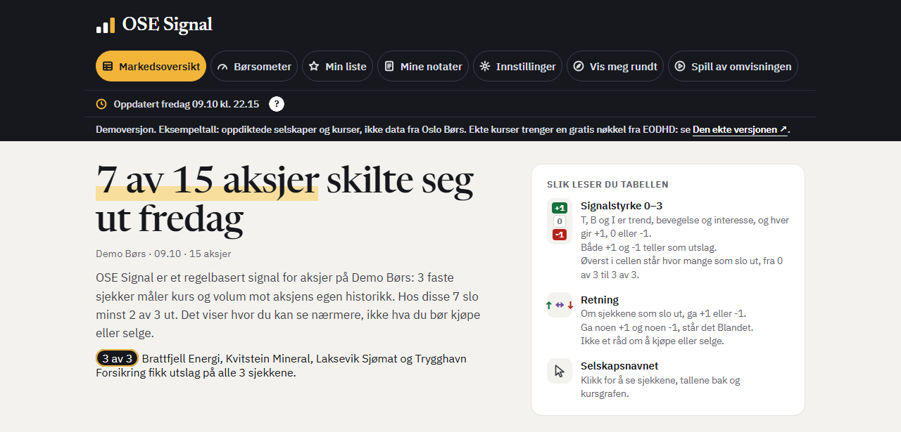
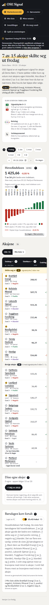
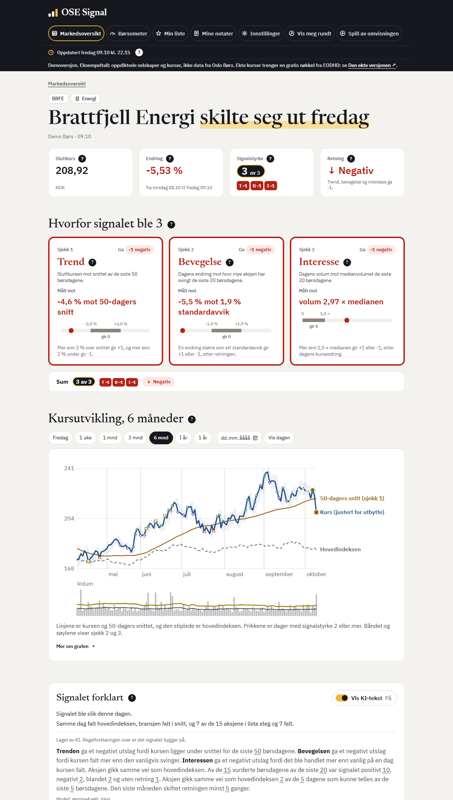
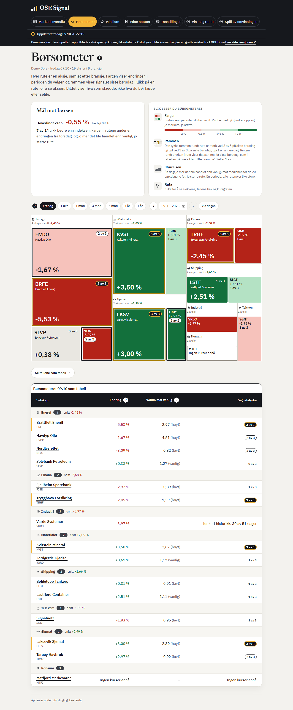
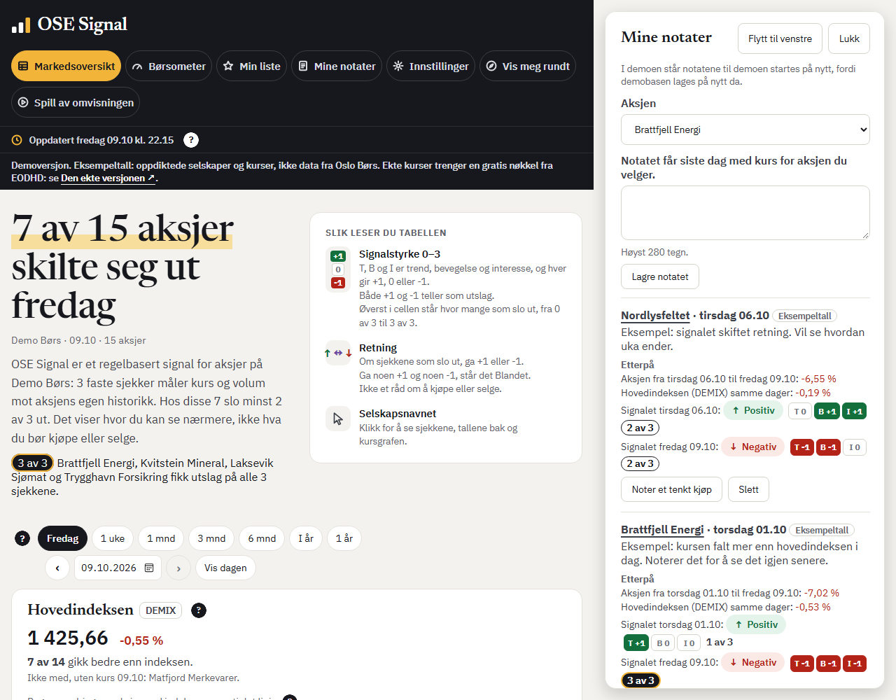
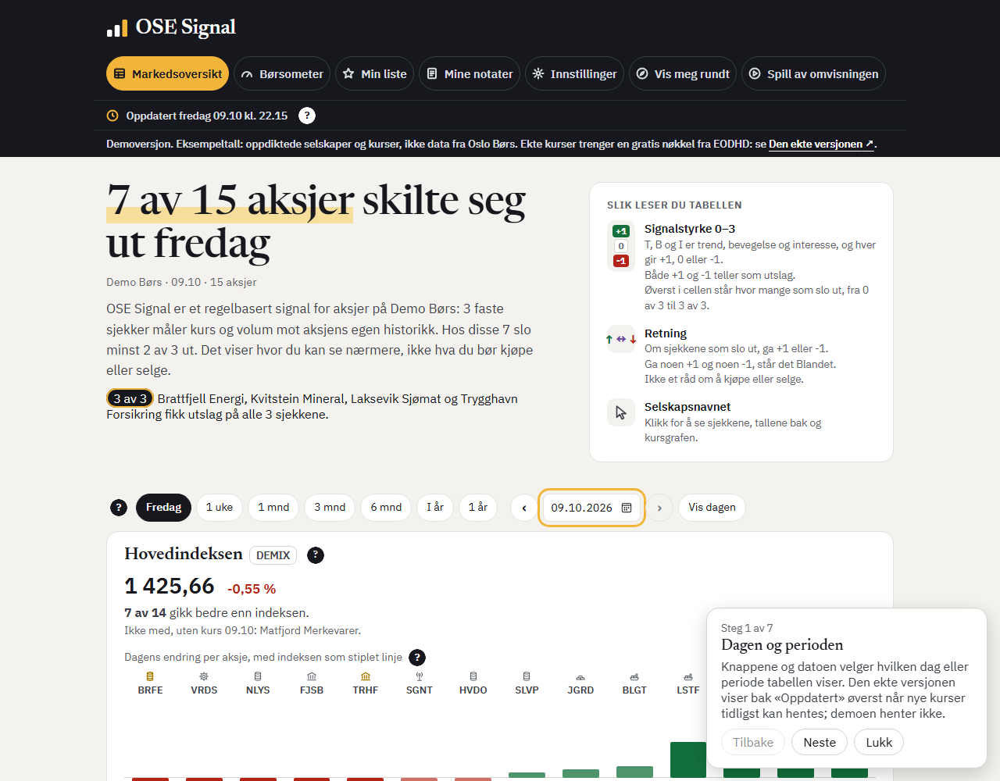

Dette dokumentet og `EXPERIENCE.md` i samme mappe er et par. `DESIGN.md` sier hvordan appen ser ut, og `EXPERIENCE.md` eier hvordan den virker: flyten, tastaturet, teksten og tilstandene. Dokumentet beskriver appen slik den er bygget på `2d8f4122`. Stemmer noe her ikke med koden eller testene, er det koden og testene som gjelder.

## Merkevare og stil (Brand & Style)

OSE Signal er en lokal nettside som viser hvilke aksjer i lista som skilte seg ut på siste børsdag, og hvorfor, med tre sjekker og en valgfri KI-tekst. Utseendet er rolig og lyst: en varm, grå bakgrunn, hvite kort med tynn strek og runde hjørner, en svart stripe øverst og overskrifter med avispreg. Tallene står i tabelltall, så de kan sammenlignes rad for rad.

Én farge skiller seg ut: oransje og gult ved en aksje betyr 3 av 3. Resten er svart, grått og de fire fargene for retningen. Fargen står aldri alene. Ordet bærer meningen, og symbol og farge forsterker (FR-103, `_bmad-output/planning-artifacts/prds/prd-G74-lund-osen-2026-09-20/prd.md:525`). Stilarket har ingen `transition` og ingen `animation`.

Designreglene begrunner skriftvalget slik: Newsreader «gir overskriftene et rolig avispreg, som passer en app som forklarer og ikke gir råd (NFR-06)» (`_bmad-output/planning-artifacts/designregler.md:23`). Skissene fra 06.11 har de samme fargene, skriftene og størrelsene som stilarket (`docs/skisser/2026-11-06/LESMEG.md:3`).

**Kilder:** `src/static/stil.css:1-9`, `_bmad-output/planning-artifacts/designregler.md:14-23`, `:164-168`. **Krav:** FR-103, NFR-05, NFR-06. Story 8.0d og 2.7a. **Tester:** `tests/test_utseende.py::test_skriften_er_den_i_appen`, `tests/test_utseende.py::test_ingenting_fra_nettet`, `tests/test_utseende.py::test_ingen_style_i_malene`.

## Farger (Colors)

All farge står som navn i `:root` og ingen andre steder: «Hver farge har ett navn i stilen, og ingen farge skrives fast i en mal.» (`_bmad-output/planning-artifacts/designregler.md:170`). Utenfor `:root` står bare `rgba` i skyggene, `transparent`, `currentColor`, `color-mix` med `--oransje` i omvisningen og systemfargene under tvungne farger (`src/static/stil.css:1602`). Ikonet `src/static/ikon.svg` har faste farger (se D10).

| Token | Betyr og brukes til | Brukes ikke til |
|---|---|---|
| `{colors.blekk}` | Hovedtekst, stripa, kolonneraden, fokus, `.knapp.hoved`, ramme 2 av 3 i børsometeret, knotten i en bryter som er på | |
| `{colors.tekst}` | Brødtekst, innledningen, KI-teksten, 0 og 1 av 3 som tekst, medianstreken i grafen | |
| `{colors.dempet}` | Etiketter, fotnoter, linja under navnet, aksetekst, bunnlinja, indekslinja (stiplet), retningen Ingen | Tekst på de lyse trinnene i børsometeret (under 4,5:1, `src/static/stil.css:1122-1123`) |
| `{colors.dempet-2}` | En sjekk som ga 0, kanten for «i ettertid», ledige plasser i plassstreken | |
| `{colors.bakgrunn}` | Bakgrunnen på siden, symbolfeltet i «Slik leser du tabellen» | |
| `{colors.kort}` | Alle kort, tabellboksen og cellene, figuren, kartet i børsometeret | |
| `{colors.hvit}` | Tekst på blekk, grønt og rødt; 0-brikken; pillen 2 av 3; knotten i en bryter som er av | |
| `{colors.strek}` | Kant på kort, linja mellom radene, periodeknappene, bunnlinja | |
| `{colors.strek-2}` | Kant på knapper og merker uten fyll, sporet i en bryter som er av, null-linja under søylene | Ledige plasser (1,34:1 på beige, `src/static/stil.css:1420-1421`) |
| `{colors.rutenett}` | De vannrette linjene i kursgrafen | |
| `{colors.opp}` / `{colors.opp-bakgrunn}` | Positiv: brikken +1, retningspillen, sjekkortets kant, trinnet opp, sterk søyle, signaldag | Alene uten ord eller fortegn (`_bmad-output/planning-artifacts/designregler.md:116`) |
| `{colors.ned}` / `{colors.ned-bakgrunn}` | Negativ: brikken -1, retningspillen, sjekkortets kant, trinnet ned, feiltekst | At lista er full: «rødt betyr negativ» (`src/static/stil.css:1405-1407`) |
| `{colors.blandet}` / `{colors.blandet-bakgrunn}` | Retningen Blandet, signaldag | |
| `{colors.ingen-bakgrunn}` | Retningen Ingen, resultatet 0 i sjekkortet | |
| `{colors.oransje}` | 3 av 3: ringen og streken på 4 px. Også logoens høye søyle, klokka, fokus i stripa, siden man er på, streken under sortert kolonne, en bryter som er på, en valgt valgbrikke, kanten i meldingene og omvisningens markering | Fokus på lys bakgrunn (testen). Se D3 og D4 |
| `{colors.gul-symbol}` | 3 av 3 der grafikken står på hvitt: bransjesymbolet over søylene (3,82:1), ramme 3 av 3 i børsometeret, signaldag 3 av 3. Også den merkede stjernen og grensestreken for interesse | Se D5 |
| `{colors.lys-oransje}` | Streken på 4 px ved 2 av 3, markeringen under det viktigste i h1 fra 60 % av høyden | Fet skrift i overskriften (`_bmad-output/planning-artifacts/designregler.md:233`) |
| `{colors.fyll}` | Fyllet i pillen 3 av 3, valgt «Alle / Min liste» | |
| `{colors.egen}` | Merket «Egen» | Se D1 og D2 |
| `{colors.trinn-noeytral}`, `{colors.trinn-lys-opp}`, `{colors.trinn-lys-ned}` | De tre lyse trinnene i børsometeret (de to sterke er `opp` og `ned`) | |
| `{colors.soeyle-lys-opp}`, `{colors.soeyle-lys-ned}` | Søyler under hovedindeksen under 2 %, minst 3:1 mot kort og bakgrunn | |
| `{colors.baand-ut}`, `{colors.baand-ut-kant}`, `{colors.brun}` | Båndet «Skilte seg ut»: flate, kant, tekst og pillen med antallet | Se D6 |
| `{colors.baand-oevrige}` | Båndet «Øvrige aksjer» | |
| `{colors.hjelp-bakgrunn}` | Merket «Hjelp» i hjelpevinduet, med `brun` | |
| `{colors.kurs}`, `{colors.snitt}` | Kurslinja og 50-dagers snittet med navnene; båndet for sjekk 2 er `kurs` med 8 % dekning | |
| `{colors.stripe-tekst}`, `{colors.stripe-kant}`, `{colors.stripe-strek}` | Teksten «Oppdatert …» og demolinja, kanten på sideknappene og streken mellom radene i stripa | |
| `{colors.stripe-tekst-2}` | Definert, men ingen regel bruker den | Se D9 |
| `{colors.kolonne-tekst-2}` | «NOK» under Sluttkurs og sorteringsvinkelen som ikke er valgt | |
| `{colors.spor}`, `{colors.felt}` | Sporet i sjekkortets skala og feltet der sjekken gir 0; `felt` er også kanten på en rute uten endring | |

`kort` og `hvit` har samme verdi, og `fyll` har samme verdi som `blekk`.

**Kontrast.** Tekst har minst 4,5:1 og streker, felt og fokus minst 3:1, regnet av en test fra fargene i stilen (`_bmad-output/planning-artifacts/designregler.md:190`, lista `KONTRAST` i `tests/test_utseende.py:146-204`).

**Tvungne farger.** Med `@media (forced-colors: active)` (Windows med høy kontrast) får «?» vanlig `outline: 3px solid`, fargeprøvene beholder fargen, KI-bryteren og dagsbryteren får kant og knott i `CanvasText` og `Highlight` når de er på, «i ettertid» får `CanvasText`, valgt valgbrikke får `2px solid Highlight`, plassstreken får kant, og omvisningens kolonne får `outline: 3px solid Highlight` (`src/static/stil.css:202-204`, `:456-459`, `:771-775`, `:1273-1278`, `:1346-1348`, `:1447`, `:1509-1513`, `:1607`). Bryteren i Innstillinger har ingen slik regel.

**Mørk modus.** Den finnes ikke. Stilarket har én `:root` og ingen `prefers-color-scheme`, og ingen fil i `src/`, `tests/` eller `docs/` nevner mørk modus eller `theme-color` (se D11).

**Kilder:** `src/static/stil.css:51-103`, `_bmad-output/planning-artifacts/designregler.md:59-84`, `:170-192`, `:230-247`. **Krav:** FR-103, FR-105, FR-106, FR-408. Story 8.0d, 8.6b, 8.23, 8.26, 8.30, 2.9b, 2.17. **Tester:** `tests/test_utseende.py::test_fargene_staar_bare_i_root`, `tests/test_utseende.py::test_kontrasten_regnet_fra_fargene_i_stilen`, `tests/test_utseende.py::test_ingen_farge_skrevet_fast_i_en_side`, `tests/test_utseende.py::test_fargene_fra_beslutningen`, `tests/test_boersometer.py::test_fargene_er_navn_i_root`, `tests/test_app.py::test_det_graa_feltet_har_fargen_fra_designreglene`, `tests/test_funnene_8_2b.py::test_de_lyse_soeylene_kan_ses`, `tests/test_plassstreken_8_30.py::test_ledig_mot_bakgrunnen_og_brukt_mot_ledig`, `tests/test_funnene_8_2b.py::test_bryteren_har_kant_med_hoey_kontrast`.

## Typografi (Typography)

To skrifter, begge lagret i appen med lisensen (OFL), uten noe fra nettet. IBM Plex Sans brukes til all tekst og alle tall. Newsreader brukes bare til overskrifter og titler, og de to store overskriftene bruker Newsreader i optisk størrelse 72pt. Kode står i `{typography.code}`. Demoselskapenes sider har tre skrifter til (Inter Display, Lora og Liberation Mono), bare i navnene (`src/static/stil.css:26-49`, `:1202-1207`).

| Rolle | Brukes i | Verdier |
|---|---|---|
| `{typography.display-oversikt}` | h1 på sidene med klassen `side-oversikt` | `clamp(34px, 4.5vw + 16px, 52px)`, 500, `1.06` |
| `{typography.display-aksje}` | h1 på aksjesiden | `clamp(34px, 4.5vw + 16px, 56px)`, 500, `1.1` |
| `{typography.logo}` | «OSE Signal» i stripa | `27px`, 600 |
| `{typography.section-aksje}` | Delene på aksjesiden | `36px`, 500 |
| `{typography.check-title}` | Navnet på en sjekk i sjekkortet | `30px`, 600 |
| `{typography.list-title}` | Tittelen over tabellen (`h2.aksjetittel`) | `28px`, 600 |
| `{typography.card-title}` | «Mål mot børsen» i børsometeret | `24px`, 600 |
| `{typography.panel-title}` | Hjelpevinduet og notatpanelet (hovedindeksen har samme størrelse, uten linjehøyde) | `23px`, 600, `1.2` |
| `{typography.step-title}` | Tittelen i stegkortene (`21px` i «Din egen liste») | `20px`, 600 |
| `{typography.lead}` | Innledningen og KI-teksten | `17px`, `1.55` |
| `{typography.help-text}` | Teksten i hjelpevinduet | `15px`, `1.55` |
| `{typography.eyebrow}` | Små overskrifter i versaler, som «Slik leser du tabellen» | `12.5px`, 700, `0.07em` |
| `{typography.key-figure}` | Nøkkeltallene på aksjesiden | `28px`, 600, `1.15` |
| `{typography.chip}` / `{typography.badge}` | Brikkene / merkene ved et navn | `12px` 700 / `12.5px` 600 |

Det viktigste i overskriften har en lys oransje markering fra 60 % av høyden og er ikke fet (`src/static/stil.css:319`, `:333-336`). Brødteksten har ingen `font-size` på `html` eller `body`, så den følger nettleseren. Tallene har `font-variant-numeric: tabular-nums`. Plex har ikke `tnum`, men sifrene er like brede i alle fire vektene (`_bmad-output/planning-artifacts/designregler.md:196`). Vektene i bruk er 400, 500, 600 og 700.

**Kilder:** `src/static/stil.css:11-49`, `:105-113`, `:130`, `:335-352`, `:655-670`, `:692`. `_bmad-output/planning-artifacts/designregler.md:14-29`, `:194-196`, `:237`. **Krav:** NFR-05. Story 8.0d. **Tester:** `tests/test_utseende.py::test_skriften_er_den_i_appen`, `tests/test_utseende.py::test_sifrene_er_like_brede`, `tests/test_utseende.py::test_tabelltall_i_tallcellene`, `tests/test_utseende.py::test_markeringen_under_tallene_i_overskriften`, `tests/test_utseende.py::test_de_smaa_overskriftene_er_i_plex`, `tests/test_designforslaget.py::test_overskriften_er_i_newsreader`.

## Layout og avstander (Layout & Spacing)

**Bredden.** `main`, radene i stripa og bunnlinja er høyst `{spacing.content-max}` med `{spacing.gutter}` luft på hver side innenfor (`box-sizing: border-box`). Med nettleserens standard skriftstørrelse er det 1040 px, med 1008 px innhold (`src/static/stil.css:975`, `:1679`; testen sier «65rem, 1040 px, med 16 px på hver side», `tests/test_boersometer.py:1823`). Ved 1280 px står boksen da 120 px fra kanten, og ved 390 px er luften 16 px, som i designreglene (`_bmad-output/planning-artifacts/designregler.md:210`). Noen deler er smalere: «Følg en aksje» `860px`, Innstillinger `720px`, notatfeltet `640px`.

**Avstander.** `{spacing.section-gap-oversikt}` mellom delene på oversikten og `{spacing.section-gap-aksje}` på aksjesiden. Kortene har `{spacing.card-padding}` luft, og `{spacing.card-gap}` mellom kort på rad. Knapperader har 8 px mellom knappene.

**Rutenett.** Toppen av oversikten er to kolonner, teksten og kortet «Slik leser du tabellen» på `{spacing.slik-leser-width}`. Nøkkeltallene er fire kolonner, sjekkortene tre, og en uke i historikken er `3.5rem`, fem dager og `6.5rem`. Tabellen ruller sidelengs i sin egen boks, så siden ikke gjør det.

| Brytepunkt | Hva endres |
|---|---|
| `{spacing.bp-1056}` og over | Hjelpen og notatpanelet står fast i høyre kant, `{spacing.side-panel}` brede, og siden får `{spacing.side-panel-space}` plass. Kortene i børsometeret står side om side. Sideknappene har mindre luft |
| `1055.98px` og under | Hjelpen åpnes rett under «?». Notatpanelet vises ikke |
| `{spacing.bp-900}` og over | Tickerne over søylene står vannrett |
| `{spacing.bp-860}` og under | Toppen av oversikten og sjekkortene i én kolonne |
| `{spacing.bp-760}` og under | Nøkkeltallene 2 og 2, dagene i historikken under hverandre, de smale plassene i børsometeret |
| `{spacing.bp-600}` og under | Plassstreken venstrestilt |

Fire beholdere måler seg selv (`@container`): tabellen viser styrken og retningen under navnet under `{spacing.container-tabell}` og bare retningen fra `{spacing.container-tabell-smal}`, kursgrafen bytter til den smale grafen under `{spacing.container-graf}`, og kartet i børsometeret velger tekstnivå ved `{spacing.container-kart-bred}` og `{spacing.container-kart-smal}`.

**Klikkflaten** er `{spacing.tap-target}` for sideknappene, «?», sorteringen, visvalget, brytere, `.knapp` og skjemafelt. Flere kontroller er lavere (se D8).

**Kilder:** `src/static/stil.css:112`, `:127`, `:167`, `:240-259`, `:330-332`, `:413-415`, `:512-521`, `:660-661`, `:674-675`, `:724-727`, `:852-853`, `:897-905`, `:976-1025`, `:1444-1446`, `:1631-1650`, `:1682-1685`. **Krav:** FR-109, FR-208. Story 8.0f, 8.2c, 8.27, 9.18, 9.19. **Tester:** `tests/test_utseende.py::test_kortet_slik_leser_staar_ved_siden_av_overskriften`, `tests/test_utseende.py::test_tabellen_ruller_i_sin_egen_boks`, `tests/test_rettingene_9_18.py::test_linja_vises_bare_paa_smal_skjerm`, `tests/test_kursgrafen_smal.py::test_stilarket_viser_den_smale_naar_figuren_er_smal`, `tests/test_boersometer.py::test_tekstnivaaet_fra_360_og_1080_px`, `tests/test_notatpanel_8_27.py::test_mindre_luft_fra_1056_px_og_samme_hoeyde`.

## Høyde og dybde (Elevation & Depth)

Sidene er flate. Kortene skilles fra bakgrunnen med fargen og en strek på 1 px, ikke med skygge. Fem ting har skygge:

| Hva | Skygge | Lag |
|---|---|---|
| Tabellboksen | `0 1px 2px rgba(22, 24, 29, 0.04), 0 10px 28px rgba(22, 24, 29, 0.05)` | i flyten |
| Hjelpevinduet | `0 24px 60px rgba(0, 0, 0, 0.30), 0 2px 6px rgba(0, 0, 0, 0.12)`, under 1056 px bare den lette | popover |
| Notatpanelet | `0 8px 24px rgba(0, 0, 0, 0.18)` | `z-index: 40` |
| Omvisningsboksen | `0 8px 24px rgba(0, 0, 0, 0.18)` | `z-index: 50` |
| Prikken i sjekkortets skala | `0 1px 3px rgba(0, 0, 0, 0.25)` | i kortet |

`box-shadow: inset` brukes ellers som strek, ikke som dybde: streken til venstre ved 2 og 3 av 3, streken under den sorterte kolonnen, rammen rundt en bransje i børsometeret og kolonnen omvisningen merker. Ingenting løfter seg ved hover.

**Kilder:** `src/static/stil.css:210`, `:257`, `:466`, `:481-485`, `:550`, `:707`, `:941`, `:1111`, `:1601-1604`, `:1613`, `:1634-1637`. **Krav:** FR-109, FR-208. Story 8.0d, 8.25, 8.27. Ingen test låser skyggene.

## Former (Shapes)

Hjørnene følger hva tingen er. Kort, tabellboksen, figuren, hjelpevinduet, notatpanelet og omvisningsboksen har `{rounded.card}`. Brikkene har `{rounded.chip}`. Merkene over h1 på aksjesiden, «Hjelp», dagene i historikken, meldingene og knappene i hjelpen og notatpanelet har `{rounded.md}`. Piller og knapper har `{rounded.full}`. «?», prikken, knotten og stegnummeret er sirkler (`{rounded.circle}`). Boblen til investorsiden har `{rounded.bubble}`. Rutene i børsometeret har `{rounded.sm}`, søylene og plassene `{rounded.xs}`. Noen kort har mindre hjørner: `{rounded.lg}` på stegkortene og tom liste, `{rounded.step}` i «Din egen liste», og `{rounded.field}` på notatfeltet, demoboksen og symbolfeltet.

Logoen er tre søyler med `rx="1.6"`, to hvite og den høyeste oransje (`src/templates/_ramme.html:43-47`).

**Kilder:** `src/static/stil.css:208`, `:264`, `:343`, `:355`, `:420`, `:585`, `:650`, `:862`, `:962`, `:1180`, `:1307`, `:1376`, `:1458`, `:1547`. `_bmad-output/planning-artifacts/designregler.md:210`. **Krav:** ingen eget krav. Story 8.0d, 8.29. **Tester:** `tests/test_utseende.py::test_brikkene_har_klassen_etter_verdien` (radius 6), `tests/test_funnene_8_23.py::test_knappen_ser_ut_som_en_knapp` (999px). Merkene ved et navn: se D7.

## Komponentene (Components)

**Toppstripa.** To rader på `{colors.blekk}` over hele bredden: logoen i `{typography.logo}` på den øverste raden (minst 72 px), og «Oppdatert …» med klokka i `{colors.oransje}` (minst 38 px), skilt med en strek i `{colors.stripe-strek}`. I demoen kommer en egen rad med «Demoversjon. …» i `{colors.stripe-tekst}`. Under står sideknappene: pille med kant i `{colors.stripe-kant}`, tekst i `{colors.stripe-tekst}` og et ikon på 16 px. Siden man er på, har fyll i `{colors.oransje}` og tekst i `{colors.blekk}`. På aksjesiden har «Markedsoversikt» bare kant i `{colors.oransje}`. Fokus er oransje. «Vis meg rundt» og «Spill av omvisningen» er sideknapper uten fyll. Kilde: `src/static/stil.css:125-165`, `:1590-1594`, `:1682-1685`; `src/templates/_ramme.html:40-70`. Story 8.3, 8.23, 8.26, 8.27. Tester: `tests/test_utseende.py::test_fokus_i_blekk_paa_lys_bakgrunn_og_lys_gul_i_stripa`, `tests/test_utseende.py::test_merket_staar_i_stripa_i_demoen`, `tests/test_funnene_8_23.py::test_siden_man_er_paa`, `tests/test_designforslaget.py::test_ikonene_er_16_px_med_strek_2_i_tekstfargen`.

**Hjelpen «?».** En sirkel med radius `10.5px` i `{colors.blekk}` med hvitt «?» i en klikkflate på `{spacing.tap-target}` × `{spacing.tap-target}`. På blekk (stripa og kolonneraden) er sirkelen hvit og «?» i blekk. Fokus er en ring tegnet i bakgrunnen, i blekk, og i `{colors.oransje}` på blekk. Vinduet er et `popover`: `{colors.kort}`, tekst i `{colors.tekst}`, tittel i `{typography.panel-title}`, merket «Hjelp» i `{colors.brun}` på `{colors.hjelp-bakgrunn}`, og knappene «Lukk» og «Flytt». Fra 1056 px står det fast i høyre kant, og «Flytt» setter det til venstre. Smalere står det rett under «?». Kilde: `src/static/stil.css:171-259`. Krav: FR-109. Story 8.0b, 8.0d, 8.0f. Tester: `tests/test_utseende.py::test_hjelpeknappen_og_vinduet`, `tests/test_utseende.py::test_hjelpeknappen_er_hvit_paa_blekk_med_oransje_fokus`, `tests/test_utseende.py::test_fokusringen_staar_rundt_sirkelen`.

**Brikkene og pillene for sjekkene og styrken.** T, B og I står i brikker på minst 34 × 24 px: +1 i `{colors.opp}` og -1 i `{colors.ned}` med hvit tekst, 0 hvit med tekst i `{colors.dempet-2}` og kant i `{colors.strek-2}`. På aksjesiden er de 36 × 26 px. Retningen står i en pille på 28 px med symbolet først, i paret for retningen (`{colors.opp}` på `{colors.opp-bakgrunn}` osv.); «Ukjent» er tekst uten pille. Styrken 3 av 3 er en pille med `{colors.fyll}`, hvit tekst og ring på 2 px i `{colors.oransje}`. 2 av 3 er en hvit pille med kant og tekst i `{colors.blekk}`. 1 og 0 av 3 er fet tekst i `{colors.tekst}`. Det samme gjelder i historikken, summen, nøkkeltallet og «Etterpå». Kilde: `src/static/stil.css:261-280`, `:601-611`, `:873-893`, `:1562-1568`. Krav: FR-103, FR-701, FR-703, FR-704. Story 8.0d, 8.0e, 8.20a, 8.29. Tester: `tests/test_utseende.py::test_brikkene_har_klassen_etter_verdien`, `tests/test_utseende.py::test_retningen_staar_i_en_pille`, `tests/test_utseende.py::test_to_av_tre_er_en_hvit_pille_og_en_av_tre_er_tekst`, `tests/test_app.py::test_tre_av_tre_har_svart_fyll_og_hvit_tekst`, `tests/test_app.py::test_kontrasten_paa_pillen_med_fyll`.

**Tabellen med båndene.** Et kort i `{colors.kort}` med topp i `{colors.blekk}` og en svak skygge. Kolonneraden er 64 px i blekk med hvit tekst i `{typography.column-header}` og «NOK» i `{colors.kolonne-tekst-2}`. Den sorterte kolonnen har feltet `{colors.stripe-kant}` og en strek på 3 px i `{colors.oransje}` nederst, og vinkelen er hvit. Båndet «Skilte seg ut» er `{colors.baand-ut}` med kant i `{colors.baand-ut-kant}` og tekst og antall i `{colors.brun}`. «Øvrige aksjer» er `{colors.baand-oevrige}` med `{colors.tekst}`. Båndene er 46 px. Radene er hvite, og en rad med utslag er 66 px og halvfet, med en strek på 4 px til venstre: `{colors.oransje}` ved 3 av 3 og `{colors.lys-oransje}` ved 2 av 3. Navnet er en understreket lenke, og under den står ticker og bransjesymbol i `{colors.dempet}`. Under 709 px står styrken og retningen også under navnet. Kilde: `src/static/stil.css:461-631`. Krav: FR-101, FR-102, FR-705. Story 8.0c, 8.0d, 8.15b, 9.18, 9.19. Tester: `tests/test_utseende.py::test_tabellen_ruller_i_sin_egen_boks`, `tests/test_utseende.py::test_strekene_og_ringen_i_oransje_bare_ved_2_og_3_av_3`, `tests/test_utseende.py::test_baandene_med_antallet_og_grensen_fra_parametre`, `tests/test_utseende.py::test_vinkelen_er_en_svg_dempet_eller_hvit`, `tests/test_utseende.py::test_fokus_er_oransje_paa_blekk_og_klikkflaten_44_px`.

**Sjekkortene.** Tre kort side om side, under hverandre fra 860 px. Hvert kort har en kant på 4 px i resultatfargen: `{colors.opp}`, `{colors.ned}` eller `{colors.dempet-2}`. Navnet på sjekken står i `{typography.check-title}`, resultatet i en pille på 26 px i retningsparet, og regnestykket i `22px` 600. Skalaen er et spor på 10 px i `{colors.spor}` med feltet for 0 i `{colors.felt}`, og en prikk på 20 px i resultatfargen med hvit kant på 3 px. Kilde: `src/static/stil.css:672-710`. Krav: FR-706. Story 8.0d, 8.23. Tester: `tests/test_funnene_8_23.py::test_kortene_har_klassen_og_kanten`, `tests/test_app.py::test_det_graa_feltet_har_fargen_fra_designreglene`.

**Kursgrafen med «i ettertid».** Et kort med SVG i full bredde. Kurslinja er `{colors.kurs}` på 2,5, snittet `{colors.snitt}` på 1,75 og heltrukket, og hovedindeksen `{colors.dempet}` på 1,5, stiplet `6 4`. Rutenettet er `{colors.rutenett}`, månedsstrekene `{colors.strek-2}` og aksene i `{typography.axis}`. Navnene ved linjene er `12px` 600 med hvit glorie. Båndet for sjekk 2 er `{colors.kurs}` med 8 % dekning, volumet `{colors.dempet}` med 45 %, medianen `{colors.tekst}` og grensen for interesse `{colors.gul-symbol}`. Signaldagene er prikker i retningsfargen med kant i `{colors.kort}`, og kanten er `{colors.gul-symbol}` ved 3 av 3. En dag med signalet regnet i ettertid har hvit midte og stiplet kant `2 1.5` i retningsfargen. Dagen som vises, har en strek og en lapp i blekk, og lappen ved musa er hvit med kant i `{colors.strek-2}`. Under 690 px vises en egen smal graf. Kilde: `src/static/stil.css:712-822`, `:1237-1260`. Krav: FR-201, FR-202, FR-206, FR-407, FR-408. Story 2.9c, 8.7, 8.8, 8.14, 8.20a, 8.2c, 2.17. Tester: `tests/test_kursgrafen_smal.py::test_stilarket_viser_den_smale_naar_figuren_er_smal`, `tests/test_ettertid_2_17.py::test_stilen_kanten_kontrasten_og_hoey_kontrast`.

**Historikken «Signalet dag for dag».** Én rad per uke med mandag til fredag og summen til høyre. Hver dag er en liten rute i `{colors.kort}` med kant i `{colors.strek}`, `{rounded.md}` og 13 px tekst. Ved 3 av 3 har dagen en strek på 4 px i `{colors.oransje}`, og en dag «i ettertid» har stiplet kant i `{colors.dempet-2}`. Tomme dager er gjennomsiktige. Månedsvelgeren er en pille med kant i `{colors.strek-2}` og piler på 44 px, og lenken tilbake til måneden er like høy. Ukehodet er `12.5px` 700 i versaler. Under 760 px står dagene under hverandre med ukedagen synlig. Kilde: `src/static/stil.css:824-905`, `:1269`. Krav: FR-203. Story 2.7b, 8.2b, 9.18, 2.17. Tester: `tests/test_historikken.py::test_3_av_3_har_stilen_fra_designreglene`, `tests/test_ettertid_2_17.py::test_stilen_kanten_kontrasten_og_hoey_kontrast`.

**Børsometeret.** Et kart på hvitt med én rute per aksje, gruppert etter bransje med en tynn ramme i `{colors.strek-2}`. Ruta er farget etter endringen i fem trinn: `{colors.trinn-noeytral}`, `{colors.trinn-lys-opp}`, `{colors.trinn-lys-ned}` og `{colors.opp}` og `{colors.ned}` med hvit tekst. En rute uten endring er hvit med kant i `{colors.felt}`. Rammen viser styrken: 4 px `{colors.blekk}` ved 2 av 3 og `{colors.gul-symbol}` ved 3 av 3, med en hvit linje innenfor. «I ettertid» er en stiplet `outline` i `{colors.dempet-2}`. Teksten i ruta er 14 px, og store ruter har tickeren i 22 px og endringen i 28 px. Over kartet står kortene «Mål mot børsen» og «Slik leser du børsometeret». Kilde: `src/static/stil.css:911-1170`, `:1272`. Krav: FR-106. Story 8.6, 8.6b, 8.20b, 8.23. Tester: `tests/test_boersometer.py::test_fargene_er_navn_i_root`, `tests/test_boersometer.py::test_kontrasten`, `tests/test_funnene_8_2b.py::test_skriften_og_rammen_i_boersometeret`.

**Merkene.** Alle er små piller med `{rounded.full}` og tekst som bærer meningen:

| Merke | Utseende | Kilde | Test |
|---|---|---|---|
| «Egen» | `{typography.badge}`, tekst og kant i `{colors.egen}` | `src/static/stil.css:1307-1309` | ingen test låser dette |
| «Utenfor målingen» | Samme form, tekst `{colors.dempet}`, kant `{colors.strek-2}` | `src/static/stil.css:1310`, `:1472-1473` | ingen test låser dette |
| «i ettertid» | `{typography.badge-ettertid}`, tekst `{colors.tekst}`, stiplet kant 1,5 px i `{colors.dempet-2}`, ingen fyll | `src/static/stil.css:1261-1266` | `tests/test_ettertid_2_17.py::test_stilen_kanten_kontrasten_og_hoey_kontrast` |
| «Eksempeltall» i notatene | `{typography.badge}`, tekst `{colors.dempet}`, kant `{colors.strek-2}` | `src/static/stil.css:1580-1581` | ingen test låser dette |
| «Demoversjon. …» i stripa | Egen rad, `{typography.stripe-meta}` i `{colors.stripe-tekst}`, uten kant | `src/static/stil.css:138-143` | `tests/test_utseende.py::test_merket_staar_i_stripa_i_demoen` |

Krav: FR-408, FR-411, FR-413, FR-415. Story 2.12, 2.17, 8.21, 8.26.

**Knappene og bryterne.** `.knapp` er en pille på `{spacing.tap-target}` i `{colors.kort}` med kant i `{colors.strek-2}` og tekst i `{colors.blekk}`; `.knapp.hoved` er blekk med hvit tekst. Periodeknappene er piller på `{spacing.control-compact}`, og den valgte er blekk med hvit tekst. Valgbrikkene i «Følg en aksje» er like høye, og den valgte er `{colors.oransje}` med tekst i blekk og «✓» foran; en tom bransje har `opacity: 0.55`. Alle bryterne er like: en pille på 44 px med et spor på 36 × 20 px og en knott på 16 px, `{colors.strek-2}` og hvit når den er av, `{colors.oransje}` og blekk når den er på, og «På» eller «Av» i `{colors.dempet}`. Stjernen er et omriss i `{colors.dempet}` og fylles i `{colors.gul-symbol}` når aksjen er i Min liste. Boblen til investorsiden har kant på 1,5 px i blekk og `{rounded.bubble}`. Hover finnes bare på tickeren over søylene, lappen i grafen, månedspilene og boblen. Kilde: `src/static/stil.css:290-311`, `:554-572`, `:756-768`, `:1172-1183`, `:1311-1314`, `:1326-1345`, `:1484-1508`. Krav: FR-101, FR-110, FR-111, FR-415, FR-601. Story 8.3, 8.16, 8.22, 8.23, 8.26, 8.29. Tester: `tests/test_vis_meg_rundt_8_26.py::test_samme_knott_og_farger`, `tests/test_vis_meg_rundt_8_26.py::test_samme_skrift_og_stoerrelse`, `tests/test_foelg_en_aksje_8_22.py::test_det_valgte_er_oransje_med_et_merke`, `tests/test_funnene_8_23.py::test_knappen_ser_ut_som_en_knapp`, `tests/test_min_liste.py::test_kontrasten_til_stjernen`, `tests/test_kom_i_gang_8_29.py::test_knappen_i_stilen`.

**Notatpanelet.** «Mine notater» er et kort som de andre, med et tekstfelt med `{rounded.field}` og knapper som hvite piller. Hvert notat har en strek over, dagen i fet skrift og «Etterpå» i 15 px `{colors.tekst}` med pillene fra tabellen. Linja for en tenkt handel (FR-209) har en venstrekant på 3 px i `{colors.strek-2}`. Fra 1056 px, med skriptet, åpnes notatene også i et panel fast i høyre kant: `{spacing.side-panel}` bredt, `{colors.kort}` med kant i `{colors.strek}`, `{rounded.card}`, skygge og tittel i `{typography.panel-title}`. Siden gir `{spacing.side-panel-space}` plass. Smalere vises panelet ikke. Kilde: `src/static/stil.css:1534-1589`, `:1625-1675`. Krav: FR-208, FR-209. Story 8.21, 8.27. Test: `tests/test_notatpanel_8_27.py::test_skriptet_og_stilen`.

**«Vis meg rundt».** Det omvisningen peker på, får en ramme på 3 px i `{colors.oransje}` med 4 px avstand. Et steg om en kolonne får oransje kanter og en svak oransje flate i cellene. Boksen står fast nederst til høyre, eller til venstre eller øverst når den ellers ville dekket det merkede: `{colors.kort}`, kant i `{colors.strek-2}`, `{rounded.card}`, skygge og fast bredde `min(360px, calc(100vw - 32px))`. Tittelen er 20 px blekk, telleren 13,5 px dempet, og knappene er hvite piller; en knapp som ikke kan brukes, har `opacity: 0.5`. Kilde: `src/static/stil.css:1590-1624`. Krav: FR-109. Story 8.9, 8.25, 8.26, 9.18. Test: `tests/test_rettingene_9_18.py::test_stilarket_gir_fast_bredde`.

## Gjør og ikke gjør (Do's and Don'ts)

Reglene under er de designreglene som stilarket følger i dag. Der kildene er uenige, står punktet under «Åpne spørsmål til gruppen».

| Gjør | Ikke gjør | Kilde |
|---|---|---|
| Skriv fargen som et navn i `:root` | Skriv en hex i en mal eller utenfor `:root` | `_bmad-output/planning-artifacts/designregler.md:170` |
| Bruk oransje og gult ved en aksje bare for 3 av 3 | Bruk gult for «Utenfor målingen» | `_bmad-output/planning-artifacts/designregler.md:63`, `:107` |
| Vis retningen med ord, symbol og farge | La fargen stå alene | FR-103; `_bmad-output/planning-artifacts/designregler.md:116` |
| Bruk stiplet linje for hovedindeksen og stiplet kant for «i ettertid» | Stiple kursen, snittet eller grensen | `_bmad-output/planning-artifacts/designregler.md:112`, `:214` |
| Fokus i blekk på 3 px med 2 px avstand, og oransje på blekk | Oransje fokus på lys bakgrunn | `_bmad-output/planning-artifacts/designregler.md:219` |
| Newsreader til overskrifter, Plex med tabelltall til tekst og tall | Hent en skrift fra nettet | `_bmad-output/planning-artifacts/designregler.md:18-20` |
| La rødt bety negativ | Bruk rødt for en vanlig beskjed, som at lista er full | `src/static/stil.css:1405-1407` |
| Skriv hva sjekkene slo ut på | Skriv hva brukeren skal gjøre med en aksje | NFR-06 |

## Det som ikke er godt nok ennå

De visuelle funnene som står åpne i den heuristiske evalueringen og UX-loggen. Funnene om navn, tekst og flyt hører til `EXPERIENCE.md`.

| Funn | Hva | Status | Kilde |
|---|---|---|---|
| HE4 / U117 | Stripa går over fire rader på 390 px, og innholdet begynner midt på skjermen (lav) | Venter til etter brukertest 2 | `docs/heuristisk-evaluering.md:66`, `:97`; `docs/ux-logg.md:754` |
| HE6 / U119 | «Vis meg rundt» og «Spill av omvisningen» står side om side, og forskjellen synes ikke (lav) | Venter til etter brukertest 2 | `docs/heuristisk-evaluering.md:68`; `docs/ux-logg.md:756` |
| HE7 / U120 | Steget «Dagen og perioden» merker bare datofeltet (lav) | Venter til etter brukertest 2 | `docs/heuristisk-evaluering.md:69`; `docs/ux-logg.md:757` |
| HE13 / U126 | Ukene etter siste demodag står som tomme rader i historikken (lav) | Venter til etter brukertest 2 | `docs/heuristisk-evaluering.md:75`; `docs/ux-logg.md:763` |
| HE16 / U129 | Omvisningsboksen bytter hjørne (lav). Fast bredde er rettet i 9.18 | Plasseringen tas etter testen | `docs/heuristisk-evaluering.md:78`; `docs/ux-logg.md:766` |
| U58 | Kolonneraden og plassen til «3 av 3» er ikke som på designtavla | Står, etter svaret 04.11 kl. 09:58 | `docs/ux-logg.md:683`, `:704` |
| U65 | Linjene i kursgrafen krysser navnene | Står, etter svaret 04.11 kl. 09:58 | `docs/ux-logg.md:551`, `:704` |
| U33, U46, U67 | KI-bryteren står ikke i stripa, som på tavla | Delvis bygget | `docs/ux-logg.md:704` |
| U43 | Siden flytter seg når man blar måned i historikken | Må ses på siden | `docs/ux-logg.md:678` |
| U61 | Aksjesiden har en tekstlenke tilbake, tavla en knapp | Står (8.0d valgte tekstlenke) | `docs/ux-logg.md:686`, `:702` |
| U96 | Hjelpefeltet skyver siden fra 1056 px | Ikke endret, etter gruppens svar 07.11 | `docs/ux-logg.md:582` |
| Ført fra før (H9) | En ukjent adresse gir Flasks engelske «Not Found» uten rammen | Ført fra før, avvist 19.10 | `docs/heuristisk-evaluering.md:100-102` |

## Åpne spørsmål til gruppen

Kildene er uenige eller tause her. Dokumentet beskriver det stilarket gjør, og tar ikke stilling.

- **D1. Blåfargen for «Egen».** Stilarket har `--egen: #1D4ED8` med kommentaren «utdraget 08.11 §1» (`src/static/stil.css:75-76`). Utdraget 08.11 §1 har ingen fargeverdi (`_bmad-output/planning-artifacts/designutdrag-2026-11-08.md:14-34`). Utdraget 13.10 har tre andre blåfarger (`_bmad-output/planning-artifacts/designutdrag-2026-10-13.md:44`). Designreglene har ingen blå verdi, og `--egen` står ikke i kontrastlista (`tests/test_utseende.py:146-204`).
- **D2. Blå strek ved en egen aksje.** Designreglene og utdraget 08.11 sier «blått merke «Egen» og blå strek» (`_bmad-output/planning-artifacts/designregler.md:105`, `_bmad-output/planning-artifacts/designutdrag-2026-11-08.md:34`). Stilarket bruker `--egen` bare i merket (`src/static/stil.css:1309`).
- **D3. Bryterne ved KI-teksten og «Børsdagen kort fortalt».** Designreglene sier at de «er i blekk som før» (`_bmad-output/planning-artifacts/designregler.md:181`), og det sier også kommentaren i `src/static/stil.css:733-734` og UX-loggen (`docs/ux-logg.md:704`). Stilarket gjør dem oransje når de er på (`src/static/stil.css:764-767`, `:1504-1507`, story 8.26), og `tests/test_vis_meg_rundt_8_26.py::test_samme_knott_og_farger` låser det.
- **D4. Oransje utenfor blekk.** Designreglene sier `#F2B53A` «bare på blekk», med unntak for bryteren og streken under sortert kolonne (`_bmad-output/planning-artifacts/designregler.md:180-181`, `:247`). Stilarket bruker den også på valgbrikkene, kanten i meldingene, omvisningens markering og demologoen (`src/static/stil.css:1193`, `:1297`, `:1334`, `:1409`, `:1597-1604`).
- **D5. Gult utenfor 3 av 3.** Designreglene sier «Gult betyr bare 3 av 3» (`_bmad-output/planning-artifacts/designregler.md:129`). Stilarket fyller den merkede stjernen og tegner grensestreken for interesse i `--gul-symbol` (`src/static/stil.css:563`, `:1247`).
- **D6. Eldre linjer i designreglene §5.** `_bmad-output/planning-artifacts/designregler.md:179` (ringen i `#a67c00`), `:182` (båndet «Skilte seg ut» i en grå farge med tekst i blekk) og `:194` (fet skrift i overskriften) er ikke rettet på stedet. `:230` sier at de ikke gjelder lenger «for oversikten», og stilarket følger `:233-235` overalt. Kontrastlista har fortsatt paret `("blekk", "baand-ut")` (`tests/test_utseende.py:162`).
- **D7. Hjørnene på merkene.** Designreglene sier «merker 8» (`_bmad-output/planning-artifacts/designregler.md:210`). «Egen», «Utenfor målingen», «i ettertid», «Eksempeltall» og «Laget av KI» har `999px` (`src/static/stil.css:1264`, `:1307`, `:1522`, `:1581`).
- **D8. Klikkflater under 44 px.** Designreglene og utdraget sier minst 44 px (`_bmad-output/planning-artifacts/designregler.md:210`, `_bmad-output/planning-artifacts/designutdrag-2026-10-13.md:148`). Stilarket har 36 px på periodeknappene, valgbrikkene og knappene i notatpanelet, 32 px på `.knapp.liten`, 30 px på brikkene i «Din egen liste», 40 px på stjernen og ingen minstehøyde på knappene i notatene og omvisningen (`src/static/stil.css:293`, `:558`, `:1305`, `:1326`, `:1466`, `:1548`, `:1619`, `:1657`). Kommentaren ved 30 px viser til WCAG 2.5.8 (`:1462`).
- **D9. Tekstfargene i stripa.** Designreglene og utdraget 13.10 har en tredje tekstfarge i stripa (`_bmad-output/planning-artifacts/designregler.md:186`, `_bmad-output/planning-artifacts/designutdrag-2026-10-13.md:41`). Den verdien finnes ikke i stilarket. `--stripe-tekst-2` er definert, men ingen regel bruker den (`src/static/stil.css:96`).
- **D10. Faste farger og sideklasser.** Designreglene sier at ingen farge skrives fast i en mal (`_bmad-output/planning-artifacts/designregler.md:170`), og `src/static/ikon.svg` har faste farger. Designreglene nevner tre sideklasser (`_bmad-output/planning-artifacts/designregler.md:188`), mens stilarket og testen har fire med `side-demoselskap` (`src/static/stil.css:1190`, `tests/test_utseende.py::test_hver_side_har_klassen_reglene_er_avgrenset_med`).
- **D11. Mørk modus.** Ingen kilde sier om appen skal ha mørk modus eller `theme-color`. Stilarket har bare det lyse temaet og tvungne farger.
- **D12. Rader under «Øvrige aksjer».** Designreglene og utdraget sier 54 px (`_bmad-output/planning-artifacts/designregler.md:200`, `_bmad-output/planning-artifacts/designutdrag-2026-10-13.md:115`). Ingen regel i stilarket setter høyden.
- **D13. Utdraget 13.10 der designreglene er tause.** Utdraget sier selv at det ikke er en regel før gruppen har godkjent teksten (`_bmad-output/planning-artifacts/designutdrag-2026-10-13.md:12`). Stilarket avviker fra det i nøkkeltallet, målingen i sjekkortet, innledningen på aksjesiden og overskriften der (`src/static/stil.css:656`, `:666`, `:698`, `:895`). Det er ikke avgjort om disse verdiene i utdraget fortsatt gjelder.
- **D14. Pilene.** Designreglene sier at pilene bare brukes for retningen (`_bmad-output/planning-artifacts/designregler.md:96`, `:111`). Stilarket setter «▾» og «▴» etter knappene som åpner tabellen og «Mer om grafen» (`src/static/stil.css:1161-1165`), og demolinja har «↗» (`src/templates/_ramme.html:90`).
- **D15. Kommentarene om stiplet.** Designreglene la til «i ettertid» som stiplet (`_bmad-output/planning-artifacts/designregler.md:214`). Kommentarene i `src/static/stil.css:1098-1099` og `:1246` sier fortsatt at stiplet bare er hovedindeksen.
