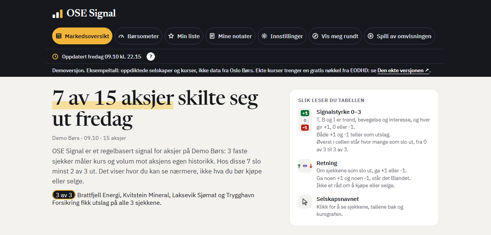
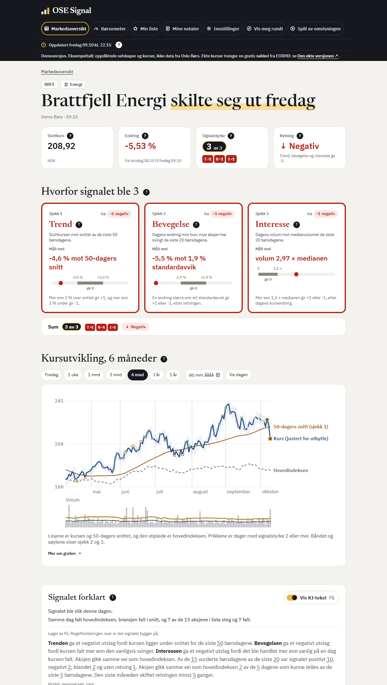
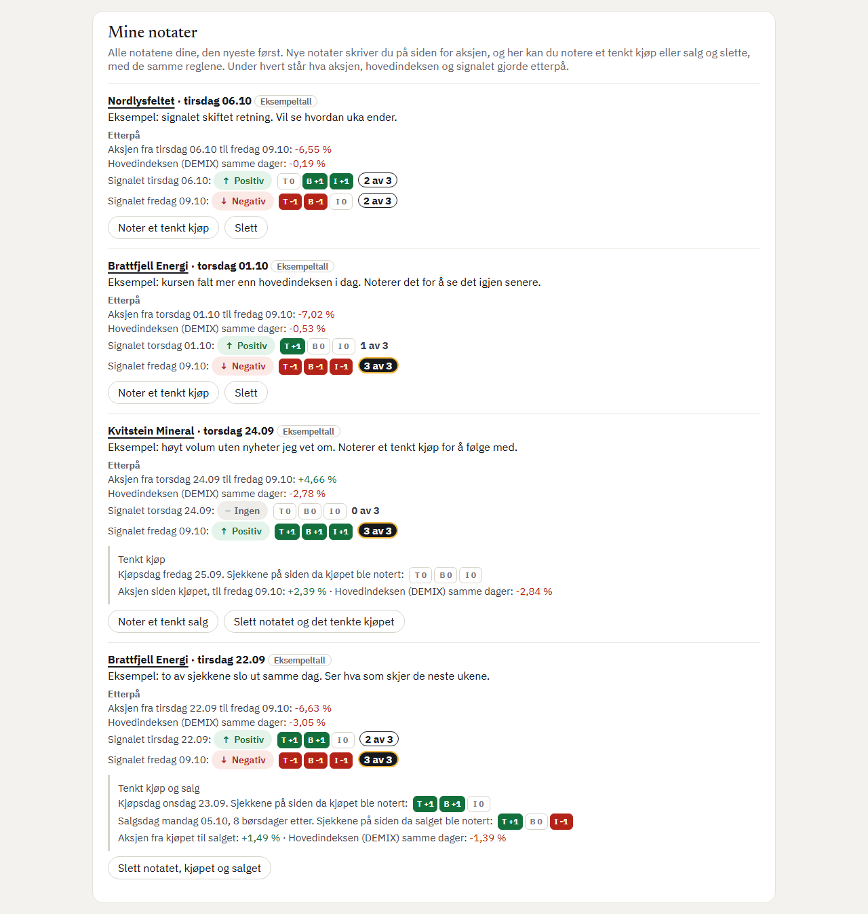
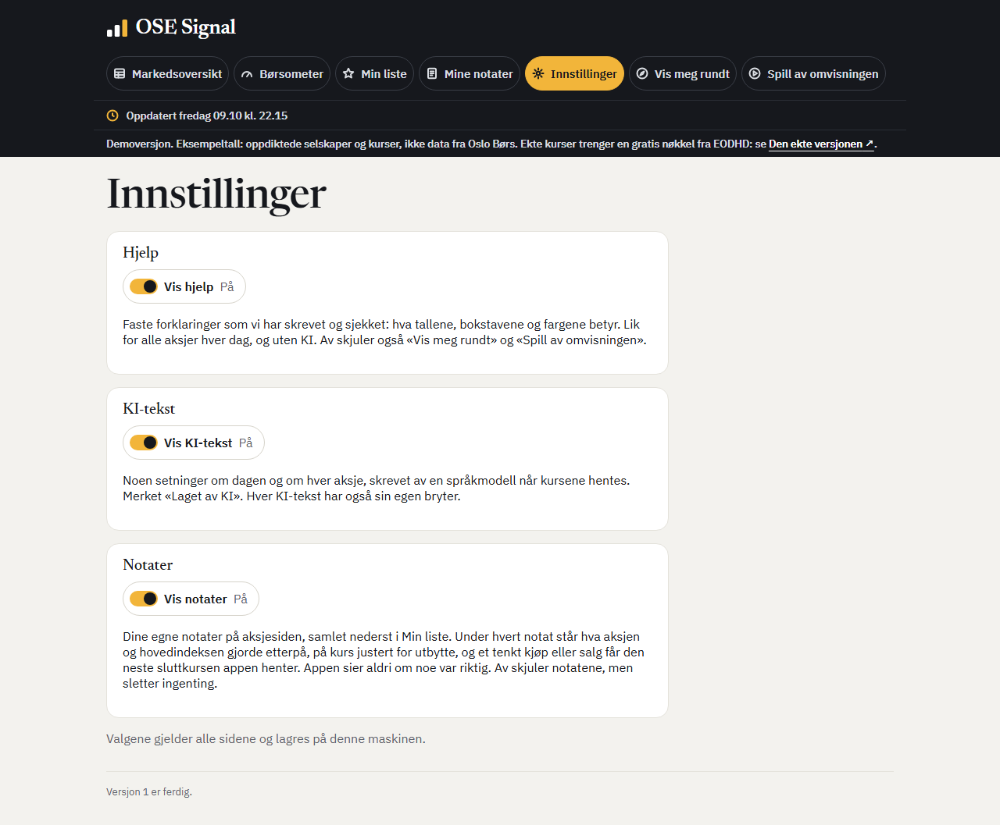

# OSE Signal: hvordan appen virker

Dokumentet beskriver appen slik den er bygget på commit `2d8f4122`, uten nye valg. Der kildene er uenige eller tause, står det et spørsmål til gruppen under «Åpne spørsmål til gruppen» (E1, E2 …). Stiene er fra roten av repoet. Malene ligger i `src/templates/`, så `index.html:52` betyr `src/templates/index.html:52`.

## Grunnlag (Foundation)

- **Form.** En webapplikasjon for PC, på norsk, som kjører lokalt. «Sidene virker også på smal skjerm, men en mobilapp er utenfor v1.» (`prd.md:293-294`, NFR-05).
- **Teknikk.** Flask med Jinja-maler og ett stilark, `src/static/stil.css`. Det finnes ikke noe UI-bibliotek. Sidene har ett skript, `hjelp.js`, lastet med `defer` (`_ramme.html:35-37`). Alle rutene står i `src/app.py`.
- **Webserveren henter aldri.** «Denne filen gjoer aldri API-kall, saa en nettleseroppdatering kan ikke bruke av kvoten» (`src/app.py:3-4`, FR-401, NFR-02). Kursene kommer fra hentingen om kvelden. Test: `tests/test_min_liste.py::test_ruta_henter_aldri`.
- **Demo og den ekte versjonen (FR-411).** Demoen leser `demo.db` med oppdiktede selskaper. Hver side fra demobasen har raden «Demoversjon. Eksempeltall: oppdiktede selskaper og kurser, ikke data fra Oslo Børs. …» i stripa (`_ramme.html:86-92`, `src/app.py:461`). Den ekte versjonen viser i stedet når nye kurser kan hentes (`_ramme.html:79-81`). Bare demoen har `/eodhd-demo` og `/investorside/<symbol>` (`src/app.py:2051-2077`). Tester: `tests/test_utseende.py::test_merket_staar_i_stripa_i_demoen`, `tests/test_neste_henting.py::test_demoen_viser_ikke_linja`.
- **Forholdet til DESIGN.md.** `DESIGN.md` i samme mappe eier utseendet: farger, skrift, avstander og hvordan komponentene ser ut. Fargene nevnes her med tokennavnet, for eksempel `{colors.blekk}`. Stemmer noe i dette dokumentet ikke med koden og testene, er det koden og testene som gjelder.

## Informasjonsarkitektur (Information Architecture)

### Flatene

| Rute | Mal | Formål | Kommer dit fra | Demo / ekte | Krav, test |
|---|---|---|---|---|---|
| `GET /` (`src/app.py:831`) | `index.html` | Oversikten: «{N} av {M} aksjer skilte seg ut», hovedindeksen og søylene, tabellen, «Dine egne aksjer», «Børsdagen kort fortalt» | «Markedsoversikt» i stripa (`_ramme.html:55`), lenken på aksjesiden (`aksje.html:18`) | Begge | FR-101–FR-105, FR-607; `tests/test_app.py::test_tom_base_gir_tom_tilstand_med_kommandoen` |
| `GET /min-liste`, `?vis=alle` (`src/app.py:836`) | `index.html` med `aktiv="min_liste"` | Samme tabell med bare de merkede, «Sammenlign siste børsdag med», «Din egen liste: kom i gang», «Mine notater» | «Min liste» i stripa (`_ramme.html:58`), «Mine notater» smalere enn 1056 px (`_ramme.html:63`) | Begge | FR-111, FR-112, FR-208; `tests/test_min_liste.py::test_den_tomme_lista_sier_hvordan_man_merker` |
| `GET /boersometer` (`src/app.py:851`) | `boersometer.html` | Én rute per aksje, samlet etter bransje, og tabellen «Se tallene som tabell» | «Børsometer» i stripa (`_ramme.html:57`), «Se dagen i Børsometer» eller «Se perioden i Børsometer» (`_hovedindeks.html:101`) | Begge | FR-106; `tests/test_boersometer.py::test_390_px_uten_vannrett_rulling_og_med_tastatur` |
| `GET /aksje/<symbol>` (`src/app.py:1351`) | `aksje.html` | Nøkkeltallene, «Hvorfor signalet ble N», kursgrafen, «Signalet forklart», «Signalet dag for dag», boblen til investorsiden, «Mine notater» | Selskapsnavnet i tabellen (`index.html:52`), rutene på børsometeret (`boersometer.html:101`), tickerne over søylene (`_hovedindeks.html:63`) | Begge | FR-201–FR-209, FR-706; `tests/test_app.py::test_ukjent_symbol_gir_404` |
| Samme rute, aksjen har ingen kurser (`src/app.py:1379-1399`) | `aksje_uten_kurser.html` | Navnet, bransjen og beskjeden om at kursene mangler, status 200 | Som over | Begge | FR-204; `tests/test_boersometer.py::test_aksjesiden_uten_kurser_svarer_200_med_beskjed` |
| `GET /folg` (`src/app.py:2636`) | `folg.html` | «Følg en aksje» med søk og filter, bekreftelsen «Følge {navn}?», «Bytt ut {navn}» | «+ Følg en aksje» (`_egne.html:47,120,141`), «Bytt ut» (`_egne.html:151`) | Begge | FR-415; `tests/test_foelg_en_aksje_8_22.py::test_soeket_uten_skript` |
| `GET /ferdig-liste` (`src/app.py:2769`) | `ferdig_liste.html` | «Er du sikker?» før en ferdig liste tas i bruk | Brikkene i steg 3 i «Din egen liste» (`_egne.html:103-110`) | Begge | FR-112, FR-412; `tests/test_ferdige_lister.py::test_ukjent_bransje_gir_404` |
| `GET /innstillinger` (`src/app.py:2937`) | `innstillinger.html` | Bryterne «Vis hjelp», «Vis KI-tekst» og «Vis notater» | «Innstillinger» i stripa (`_ramme.html:65`) | Begge | FR-110; `tests/test_innstillinger.py::test_vis_hjelp_av_tar_bort_hjelpen_paa_alle_sidene` |
| `GET /eodhd-demo` (`src/app.py:2051`) | `eodhd_demo.html` | Siden «Åpne eodhd.com» går til i demoen | Steg 1 i «Din egen liste» (`_egne.html:73`) | Bare demo, 404 i den ekte | FR-112; `tests/test_vis_meg_rundt_8_26.py::test_den_ekte_versjonen_lenker_til_registreringen` |
| `GET /investorside/<symbol>` (`src/app.py:2063`) | `investorside.html` | Siden for et oppdiktet selskap | Boblen nederst på aksjesiden (`_investorboble.html:9-11`) | Bare demo, 404 i den ekte | FR-203; `tests/test_investorsidene_demo.py::test_ruta_svarer_404_i_den_ekte_versjonen` |
| Svar på `POST /fjern` uten `bekreftet=1` (`src/app.py:2835-2842`) | `bekreft_fjern.html` | «Fjern {symbol}?» når aksjen har et åpent «tenkt kjøp» | «Fjern» i «Dine egne aksjer» (`_egne.html:35`) | Begge | FR-415, FR-209; `tests/test_notater.py::test_fjern_sier_foerst_at_kursene_stopper` |
| Svar på `POST /aksje/<symbol>/notat/slett` (`src/app.py:1926-1941`) | `bekreft_slett_notat.html` | «Slett notatet?» | «Slett» ved et notat (`_notat.html:80`) | Begge | FR-208; `tests/test_notater.py::test_avbryt_gaar_tilbake_og_lar_alt_staa` |
| Alle rutene som leser basen, når den ikke kan leses (`src/app.py:633-643`) | `basefeil.html`, status 503 | «Siden kan ikke vises» | – | Begge | NFR-03; `tests/test_app.py::test_basen_nyere_enn_koden_gir_503_med_grunnen` |

Panelet «Mine notater» er ingen egen side. Det er et `<aside>` i rammen, fylt fra en `<template>` (`_ramme.html:104-119`), og skriptet viser det bare fra 1056 px (`hjelp.js:934-962`). Test: `tests/test_notatpanel_8_27.py::test_bare_fra_1056_px_og_bare_aapent`.

404, 400 og 403 har ingen egen mal og gir Flasks standardside (`src/app.py:718-728`). Se E4. Test: `tests/test_app.py::test_andre_ruter_roerer_ikke_basen`.

### Navigasjonen

- **Stripa** (`_ramme.html:40-98`): logoen «OSE Signal», som ikke er en lenke. Så raden `<nav aria-label="Sidene">` med «Markedsoversikt», «Børsometer», «Min liste», «Mine notater» (bare med «Vis notater» på) og «Innstillinger». Etter dem kommer «Vis meg rundt» og «Spill av omvisningen» på sidene som har steg. Under raden står linja «Oppdatert …», og i demoen raden med «Eksempeltall». Test: `tests/test_utseende.py::test_stripa_og_bunnlinja_paa_alle_sidene`.
- **Siden man står på** er fylt og har `aria-current="page"`. Fra aksjesiden har «Markedsoversikt» `aria-current="true"` (`_ramme.html:55`). Bekreftelsessidene og feilsiden har ingen fylt knapp. Tester: `tests/test_min_liste.py::test_den_fylte_knappen_paa_hver_side`, `tests/test_funnene_8_2b.py::test_aksjesiden_hoerer_til_markedsoversikt_i_stripa`.
- **Ingen brødsmuler.** Veien tilbake er enkeltlenker: «Markedsoversikt» på aksjesiden (`aksje.html:18`), «Tilbake til siste børsdag» (`aksje.html:22-24`), «Til {måned}» i historikken (`aksje.html:452-456`), «Tilbake til {navn}» på investorsiden (`investorside.html:19`), og «Tilbake» eller «Avbryt» på bekreftelsene (`bekreft_fjern.html:19`, `bekreft_slett_notat.html:22`, `ferdig_liste.html:28`, `folg.html:36,63,135`). Test: `tests/test_historikken.py::test_lenken_vises_naar_en_annen_maaned_er_valgt`.
- **Bunnlinja** sier «Versjon 1 er ferdig.» (`src/app.py:476`).
- **Lenker ut av appen** åpnes i en ny fane, med den skjulte teksten «(åpnes i en ny fane)» (`_ramme.html:90`, `_investorboble.html:13`). Test: `tests/test_vis_meg_rundt_8_26.py::test_alle_lenker_ut_av_appen_i_ny_fane`.
- **Alle lenkene virker.** Test: `tests/test_utseende.py::test_hver_lenke_gaar_til_en_side_som_finnes`.

## Språk og tone (Voice and Tone)

Grensesnittet er på norsk, og KI-tekstene skrives på norsk (NFR-05, `prd.md:1778-1783`). Tonen er nøktern: siden sier hva den viser, og hvorfor noe mangler. Det visuelle uttrykket står i `DESIGN.md`.

### Ordlista

Ordene brukes slik ordlista i PRD-en sier (`prd.md:178-198`):

| Ord | Betyr i appen |
|---|---|
| Børsdag | Mandag–fredag som Oslo Børs ikke har stengt, i norsk tid |
| Henting | Kommandoen som henter kursene og skriver vurderingene og KI-tekstene. Kveldsjobben starter den «fra kl. 22:15». Webserveren henter aldri |
| Lista | Aksjene appen henter og vurderer, opptil 18 |
| Oversikten | Startsiden. Knappen heter «Markedsoversikt» |
| Min liste | Aksjene brukeren har merket med stjerne. Et utvalg, ikke en egen henting |
| Bransje | Det brukeren ser. Koden sier «sektor» |
| Aksjesiden | Siden for én aksje |
| KI-teksten | Teksten en språkmodell skriver. Den kontrolleres, logges og kan slås av |
| Sjekk | Trend, bevegelse og interesse. Hver gir +1, 0 eller -1 |
| Signal | Styrken 0–3 og retningen Positiv, Negativ, Blandet eller Ingen. En aksje skiller seg ut ved 2 eller mer |
| Vurdering | Den lagrede raden for én aksje og én børsdag, eller grunnen til at den mangler |

Der appen bruker «lista» om Min liste, se E2. Om «ticker» og «symbol», se E7.

### Tall (regel 21)

Sidene viser desimalkomma, hardt mellomrom som tusenskille og foran %, og vanlig bindestrek som minus (`CLAUDE.md:147-156`). Antallet desimaler for hver type tall bestemmes i `tall()` i `src/tallformat.py`, ikke i malene (`src/tallformat.py:1-40`). Et tall som rundes til null, får aldri fortegn, så «-0,00» står aldri på en side (`src/tallformat.py:7-9`). Der et tall mangler, står «–» med grunnen (NFR-08, `prd.md:1810-1811`). Tester: `tests/test_tallformat.py::test_minus_er_vanlig_bindestrek`, `tests/test_tallformat.py::test_over_tusen_har_hardt_mellomrom`, `tests/test_tallformat.py::test_rundes_til_null_faar_ikke_minus`. Malene har likevel `|round(2)` tre steder, se E6.

### NFR-06, ordrett

Fra `prd.md:1786-1796`:

> ### NFR-06 — Løsningen gir ikke investeringsråd
>
> Signalstyrke og retning beskriver hva sjekkene slo ut på, ikke hva brukeren bør
> gjøre. Ingen del av grensesnittet formuleres som en anbefaling om kjøp eller
> salg: ikke malene, ikke hjelpen og ikke KI-tekstene.
>
> *Konsekvenser:*
> - Ingen KI-tekst som vises, har et ord fra rådlista i FR-603. Kontrollen skjer når teksten lages og når den vises.
> - Hjelpetekstene og omvisningen har ingen ord fra rådordene testene for hjelpen bruker.
> - Ord som «råd», «kjøp» og «salg» står bare der en side sier at noe ikke er et råd, og i notatene om tenkte kjøp og salg.
> - En test går gjennom alle malene, hjelpetekstene og omvisningen etter ordene i rådlista i FR-603, og unntakene står i testen med grunn.

### Rådordene

- **Når KI-teksten lages:** lista `RAAD` i `src/ki_kontroll.py:873-899` (FR-603).
- **Når KI-teksten vises:** vakten `_VAKT` i `src/ki_visning.py:44`, en egen, kortere liste, slik FR-602 sier (`prd.md:1427-1435`). En tekst som stoppes, gir «Ingen KI-tekst for denne dagen: teksten ble stoppet, fordi den kunne leses som et råd.» (`src/ki_visning.py:76`). Test: `tests/test_ki_visning.py::test_vakten_stopper_raad`.
- **Alt appen viser:** `tests/test_raadordene_9_12.py::test_ingen_raad_i_det_appen_viser` går gjennom malene, hjelpetekstene, omvisningen og strengene i `hjelp.js`. Unntakene er en setning med «ikke» foran og ordene for «tenkte kjøp og salg» (`tests/test_raadordene_9_12.py::test_unntakene_brukes`).
- **Hjelpen:** `tests/test_hjelpetekster.py::test_ingen_tekst_kan_leses_som_et_raad`.
- **Notatene:** «Etterpå» viser bare fakta, med «ingen ord om at noe var riktig eller galt, ingen kronebeløp og ingen råd (NFR-06)» (`_notat.html:3-4`). Test: `tests/test_notater.py::test_ingen_ord_om_riktig_eller_galt_og_ingen_raad`.
- **Setningen om at signalet ikke er et råd** står på oversikten, på aksjesiden og på børsometeret (`index.html:243`, `aksje.html:421`, `boersometer.html:33`).

### Gjør og ikke gjør

Hentet fra endringer kildene har ført, ikke diktet opp:

| Gjør | Ikke gjør | Kilde |
|---|---|---|
| «Appen følger allerede 18 aksjer, som er taket. Fjern en for å følge en annen.» | «Lista er full. Fjern en aksje for å følge en annen.» | `src/valg.py:34-37`, story 8.26; `tests/test_vis_meg_rundt_8_26.py::test_full_sier_taket` |
| «mot 50-dagers snitt» | «… mot MA50» | HE8, `docs/heuristisk-evaluering.md:70,87` |
| «Lim inn nøkkelen i startskriptet» | «Lim inn nøkkelen din» (siden har ikke noe felt for nøkkelen) | HE10, `docs/heuristisk-evaluering.md:72,89`; `_egne.html:80` |
| Retningen som ordet «Positiv», «Negativ», «Blandet» eller «Ingen», med symbolet ved siden av | Ordene «Opp» og «Ned» ved retningen | FR-103, `prd.md:526-532`; `tests/test_app.py::test_retningen_vises_med_baade_tekst_og_symbol` |
| «–» med grunnen, for eksempel «– ikke vurdert» | Et anslag eller et reservetall | NFR-08, `prd.md:1810-1811`; `index.html:111-113` |
| Hjelpen i grått | Hjelpen i gult («Grått, aldri gult») | `_hjelp.html:6` |
| «Etterpå» i prosent, med aksjen og hovedindeksen | Kronebeløp, eller ord om at noe var riktig | `_notat.html:3-4`; `innstillinger.html:51` |

### Ordrette eksempler

| Slag | Tekst | Kilde |
|---|---|---|
| Overskrift | «{N} av {M} aksjer skilte seg ut {ukedag}» | `index.html:234` |
| Knapp | «+ Følg en aksje» | `_egne.html:47` |
| Knapp | «Noter et tenkt kjøp» / «Noter et tenkt salg» | `_notat.html:76,78` |
| Knapp | «Fjern likevel» / «Bruk denne lista» | `bekreft_fjern.html:17`, `ferdig_liste.html:29` |
| Status | «Venter på henting i kveld etter kl. 22.» | `_egne.html:32` |
| Status | «Appen følger {n} av 18, {m} plasser ledige.» | `_egne.html:132` |
| Tom | «Ingen notater ennå. Skriv et på siden for en aksje.» | `index.html:414` |
| Tom | «Ingen aksjer passer med søket og filteret.» | `folg.html:134` |
| Feil | «Notatene kan ikke leses fra basen nå.» | `aksje.html:519` |
| KI | «Laget av KI. Regelforklaringen over er det signalet bygger på.» | `aksje.html:412` |
| KI av | «KI-teksten er slått av. Tabellen over viser bare det reglene har regnet ut.» | `src/ki_visning.py:190` |
| Hjelp | «Lukk med «Lukk», Esc eller et nytt trykk på samme «?».» | `_hjelp.html:46` |
| Tilbud | «Første gang her? «Vis meg rundt» viser deg denne siden, ett steg om gangen.» | `hjelp.js:314` |
| Bekreftelse | «Notatet om {navn} fra {dato} slettes, og det kan ikke angres.» | `bekreft_slett_notat.html:12` |

## Komponentmønstre (Component Patterns)

Oppførselen. Utseendet står i `DESIGN.md`.

| Komponent | Bruk | Oppførselsregler som er bygget | Krav, test |
|---|---|---|---|
| Sjekkene som brikker (T, B, I) | Tabellen, aksjesiden, historikken, notatene | Én brikke per sjekk, som «T +1». Ikke klikkbare. På aksjesiden står hver sjekk også som et kort med «Ga», «Målt mot» og regelen (`_brikker.html:4-6`, `aksje.html:112-133`) | FR-701, FR-706; `tests/test_funnene_8_2b.py::test_kortet_retning_sier_hva_sjekkene_ga` |
| Styrken og retningen | Tabellen, aksjesiden, børsometeret | 3 av 3 og 2 av 3 som pille, under terskelen som tekst (`_brikker.html:25-29`). Retningen som ord, med symbolet skjult for skjermleseren og fargen `{colors.opp}`, `{colors.ned}` eller `{colors.blandet}` (`_brikker.html:8-10`) | FR-103, FR-703–FR-705; `tests/test_app.py::test_symbolet_er_skjult_for_skjermlesere` |
| «i ettertid» | Tabellen, aksjesiden, grafen, børsometeret | Merket ved styrken og stiplet kant. Aksjesiden forklarer det i en linje med `role="note"` (`_brikker.html:21-23`, `aksje.html:46-48`) | FR-408; `tests/test_ettertid_2_17.py::test_grafen_boersometeret_og_oversikten_merker_dagen` |
| Stjernen | Tabellen på oversikten og i Min liste | En knapp med `aria-pressed` i et eget POST-skjema. Et trykk merker, et nytt trykk tar merket bort, uten å spørre. 303 tilbake til samme rad og sortering (`index.html:52`, `src/app.py:2418-2457`) | FR-111; `tests/test_min_liste.py::test_merk_og_fjern_med_303_til_samme_side_med_sorteringen` |
| «Følg en aksje» | `/folg` | En side med skjema, ikke en dialog, «så den virker med tastatur og uten skript» (`folg.html:3-5`). Med skriptet filtreres radene mens man skriver. Sorteringen er aldri etter kursen eller signalet (`folg.html:70-75`) | FR-415; `tests/test_foelg_en_aksje_8_22.py::test_kortet_er_borte_og_ingen_rangering` |
| «Følg aksjen» | Bekreftelsen på `/folg` | Skriver bare ønsket og setter stjernen i samme transaksjon. 303 til `/#dine-egne-aksjer`. Raden sier «Venter på henting i kveld etter kl. 22.» (`src/app.py:2739-2766`, `_egne.html:32`) | FR-415; `tests/test_valg.py::test_foelg_en_aksje_fra_siden` |
| «Fjern» | «Dine egne aksjer» | Med et åpent «tenkt kjøp» spør siden først (`bekreft_fjern.html`). Ellers skrives ønsket med en gang (`src/app.py:2825-2848`) | FR-415; `tests/test_notater.py::test_bekreftelsen_sier_fra_og_med_i_kveld` |
| «Angre» | «Dine egne aksjer» | Står ved hver aksje som venter eller fjernes. Sletter ønsket, og stjernen som «Følg» satte. Et bytte angres helt (`_egne.html:36`, `src/valg.py:345-372`) | FR-415; `tests/test_valg.py::test_angre_sletter_et_oenske_som_venter`, `tests/test_valg.py::test_et_bytte_angres_helt` |
| «Bytt ut» | Min liste | En lenke til `/folg?bytt=…`. Knappen på bekreftelsen heter «Bytt inn {navn}» (`_egne.html:151`, `folg.html:65`) | FR-415; `tests/test_valg.py::test_bytte_fra_min_liste` |
| Notatet med «Etterpå» | Aksjesiden, Min liste, panelet | «Lagre notatet» gir 303 til `#mine-notater`. De to nyeste står, resten bak «Vis alle (N)» (`aksje.html:526-547`). «Etterpå» viser aksjen og hovedindeksen i prosent og signalet begge dagene (`_notat.html:37-47`) | FR-208; `tests/test_notater.py::test_siste_dag_sier_at_det_ikke_er_dager_etter` |
| «Noter et tenkt kjøp» / «Noter et tenkt salg» | Ved et notat | Bare fra siden for siste dag med kurser, ellers 400. Et dobbeltklikk skriver ikke noe nytt (`src/app.py:1987-2011`) | FR-209; `tests/test_notater.py::test_bekreftet_sletter_notatet_og_kjoepet` |
| Periodevelgeren | Aksjesiden, oversikten, Min liste, børsometeret | Lenker per periode, et datofelt med «Vis dagen» og piler for forrige og neste børsdag. Beskjeden om valget står i `role="status"` (`_perioder.html:28-67`) | FR-201; `tests/test_app.py::test_velg_dag_er_et_skjema_uten_skript` |
| Hjelpen «?» | Ved det den forklarer | Et popover. Med skriptet et fast felt fra 1056 px. Ett vindu om gangen. Lukkes med «Lukk», Esc eller et nytt trykk (`_hjelp.html:11-47`, `hjelp.js:92-141`) | FR-109; `tests/test_hjelpefeltet.py::test_et_nytt_trykk_paa_samme_knapp_lukker` |
| «Vis meg rundt» / «Spill av omvisningen» | Stripa | En boks med «Steg {i} av {n}», «Tilbake», «Neste»/«Ferdig» og «Lukk». Omvisningen går gjennom oversikten, aksjesiden, børsometeret, Min liste, «Følg en aksje» og Innstillinger (`hjelp.js:209-216`, `hjelp.js:614-675`). Tilbudet første gang har «Vis meg rundt» og «Nei takk» (`hjelp.js:714-737`) | FR-109; `tests/test_omvisningen_8_25.py::test_skriptet_har_knappene_tastaturet_og_rollen`, `tests/test_vis_meg_rundt_8_26.py::test_tilbudet_starter_vis_meg_rundt_for_oversikten` |
| Bryteren «Vis KI-tekst» | Aksjesiden, oversikten, Innstillinger | `role="switch"` med `aria-checked`. POST `/ki` lagrer valget og går tilbake til teksten. Bryteren ved teksten og den i Innstillinger er samme valg (`aksje.html:389-393`, `src/app.py:2315-2346`) | FR-601, FR-110; `tests/test_innstillinger_ki.py::test_innstillinger_slaar_av_bryteren_ved_teksten` |
| Bryterne i Innstillinger | `/innstillinger` | Tre brytere, hver i sitt eget POST-skjema. `disabled` når basen ikke kan lagre valgene (`innstillinger.html:16-52`) | FR-110; `tests/test_innstillinger.py::test_teksten_og_steget_sier_at_av_ogsaa_skjuler_omvisningen` |
| Bekreftelsene | Fjern, slett, ferdig liste, følg og bytt | Egne sider med skjema, ingen `<dialog>`. Ingenting skrives før man bekrefter (`bekreft_fjern.html:2-4`, `bekreft_slett_notat.html:2-6`) | FR-208, FR-415; `tests/test_notater.py::test_avbryt_gaar_tilbake_og_lar_alt_staa` |
| Børsometerets ruter | `/boersometer` | Hver rute er en lenke til aksjesiden. Tab følger kartet, den største bransjen først. Tabellen står åpen fra start (`boersometer.html:80-136`) | FR-106; `tests/test_boersometer.py::test_390_px_uten_vannrett_rulling_og_med_tastatur` |
| Panelet «Mine notater» | Alle sidene fra 1056 px | Åpnes av knappen i stripa, med «Flytt til venstre» og «Lukk». Henter ingenting. Om det er åpent, huskes i nettleseren (`_ramme.html:108-119`, `hjelp.js:886-891`) | FR-111; `tests/test_notatpanel_8_27.py::test_skriptet_henter_ingenting` |

## Tilstandsmønstre (State Patterns)

| Tilstand | Flate | Det som vises (ordrett, kort) | Kilde, test |
|---|---|---|---|
| Hvor gamle dataene er | Alle sidene med basen | «Oppdatert {ukedag dd.mm kl. tt.mm}» | `_ramme.html:74-85`; `tests/test_utseende.py::test_stripa_og_bunnlinja_paa_alle_sidene` |
| Neste henting (ekte) | Stripa | « · nye kurser fra kl. 22 i kveld» og varianter | `_ramme.html:79-81`, `src/markedsoversikt.py:706-733`; `tests/test_neste_henting.py::test_den_ekte_versjonen_viser_linja` |
| Tom base | Oversikten, børsometeret | «Ingen kurser i basen ennå. Hent dem med `{kommando}`.» | `index.html:453`, `boersometer.html:186`; `tests/test_app.py::test_tom_base_gir_tom_tilstand_med_kommandoen` |
| Demobasen mangler | Oversikten, Min liste, børsometeret | «Demobasen finnes ikke ennå. Lag den med `{kommando}`.» | `index.html:448`; `tests/test_demo.py::test_bryteren_uten_demobase_viser_kommandoen` |
| Basen kan ikke leses | Alle sidene med basen | «Siden kan ikke vises» … «Siden henter aldri data selv.», status 503 | `basefeil.html:6-15`; `tests/test_min_liste.py::test_knapperaden_ogsaa_paa_feilsiden` |
| Ingen skilte seg ut | Oversikten | «Ingen aksjer skilte seg ut: ingen fikk {terskel} av 3 eller mer.» | `index.html:350`; `tests/test_app.py::test_setningen_naar_ingen_skilte_seg_ut` |
| Rad uten signal | Tabellen | «–» og grunnen, for eksempel «ikke vurdert», «ikke børsdag», «ikke i lista» | `index.html:111-113`, `src/markedsoversikt.py:72-121`; `tests/test_app.py::test_ikke_vurdert_med_fotnoten` |
| Aksje uten kurser | Tabellen, aksjesiden | «–» med «ingen kurser ennå», og «Ingen kurser ennå: EODHD har ikke gitt kurser for aksjen. …» | `src/markedsoversikt.py:452`, `aksje_uten_kurser.html:27-28`, `src/hjelpetekster.py:159-162`; `tests/test_demoproeven.py::test_aksjen_uten_kurser_har_en_rad_nederst_og_ingen_fotnote` |
| Venter på henting | Tabellen | «–» med «venter på henting», og navnet uten lenke | `src/markedsoversikt.py:455`, `index.html:52`; `tests/test_vis_meg_rundt_8_26.py::test_den_ekte_versjonen_viser_dem_som_venter` |
| Eldre rad | Tabellen | «hentet {tid}» og «siste kurs {ukedag} {dato}» under navnet | `index.html:73-77`; `tests/test_app.py::test_den_eldste_raden_viser_sin_egen_tid_under_navnet` |
| Min liste uten stjerner | Min liste | «Ingen aksjer i Min liste ennå. Trykk på stjernen ☆ foran et selskap, …» | `index.html:212`; `tests/test_min_liste.py::test_den_tomme_lista_sier_hvordan_man_merker` |
| Full liste | «Dine egne aksjer», `/folg` | «Appen følger allerede 18 aksjer, som er taket. …» | `src/valg.py:37`, `folg.html:31-32`; `tests/test_valg.py::test_den_nittende_avvises` |
| Endringer venter | Oversikten, Min liste | «{N} endringer i lista tas i bruk ved hentingen etter kl. 22.» | `index.html:149` (`role="status"`); `tests/test_funnene_8_23.py::test_med_en_endring_som_venter` |
| Ingen treff | `/folg` | «Ingen aksjer passer med søket og filteret.» | `folg.html:134`; ingen egen test funnet |
| Feil fra POST | `/folg` | Feilen med `role="alert"` | `folg.html:26`; `tests/test_valg.py::test_full_liste_sier_det` |
| KI på | Aksjesiden | «Laget av KI. …», teksten og «Modell: {modell}, {tjeneste}» | `aksje.html:411-414`, `src/ki_visning.py:126`; `tests/test_ki_visning.py::test_ki_teksten_under_regelforklaringen` |
| KI av | Aksjesiden | Bryteren, appens setninger og linja om grunnlaget. Ingen melding om KI, slik FR-601 sier | `aksje.html:400-421`, `prd.md:1406-1412`; `tests/test_ki_visning.py::test_med_ki_av_ingen_ki_tekst_og_bryteren_sier_vis` |
| KI av | Oversikten | «KI-teksten er slått av. Tabellen over viser bare det reglene har regnet ut.» | `src/ki_visning.py:190`, FR-601; `tests/test_ki_dagen.py::test_bryteren_slaar_av_begge_ki_tekstene` |
| KI mangler, ingen modell (ekte) | Oversikten, aksjesiden | «… Den lages når kursene hentes, på en maskin med en språkmodell.» og «Slik slår du den på» | `src/ki_visning.py:78,188`; `tests/test_ki_dagen.py::test_uten_rad` |
| KI stoppet av vakten | Aksjesiden | «Ingen KI-tekst for denne dagen: teksten ble stoppet, fordi den kunne leses som et råd.» | `src/ki_visning.py:76`; `tests/test_ki_visning.py::test_vakten_paa_siden` |
| Dag i ettertid | Aksjesiden | «… KI-teksten lages bare samme kveld som kursene hentes, så dagen har ingen KI-tekst.» | `aksje.html:404-405`; `tests/test_ettertid_2_17.py::test_med_ki_av_ingen_melding_om_ki_for_dagen` |
| Ingen notater | Aksjesiden, Min liste, panelet | «Ingen notater for {navn} ennå.» / «Ingen notater ennå. …» / «Ingen notater ennå.» | `aksje.html:549`, `index.html:414`, `_notatpanel.html:64`; `tests/test_notater.py::test_uten_notater`, `tests/test_notatpanel_8_27.py::test_uten_notater` |
| Notatene kan ikke leses | Aksjesiden, panelet | «Notatene kan ikke leses fra basen nå.» | `aksje.html:519`; `tests/test_notater.py::test_notatene_som_ikke_kan_leses` |
| «Etterpå» uten dager etter | Notatet | «Ingen børsdager med kurs etter notatdagen ennå.» | `_notat.html:40`; `tests/test_notater.py::test_siste_dag_sier_at_det_ikke_er_dager_etter` |
| «Vis notater» av | Alle sidene | Notatene, knappen og panelet er borte. Ingenting er slettet | `_ramme.html:63`, `innstillinger.html:51`; `tests/test_notater.py::test_av_skjuler_notatene_og_sletter_ingenting` |
| «Vis hjelp» av | Alle sidene | Ingen «?», og ingen knapper for omvisningen | `_hjelp.html:9-14`, `_rundtur.html:11-12`; `tests/test_omvisningen_8_25.py::test_vis_hjelp_av_tar_bort_omvisningen` |
| 404, 400, 403 | Alle rutene | Flasks engelske standardside, uten rammen | `src/app.py:718-728`; `tests/test_app.py::test_andre_ruter_roerer_ikke_basen`. Se E4 |

## Samspill (Interaction Primitives)

- **Lenker går et sted, knapper i POST-skjemaer skriver.** Stripa, perioden, sorteringen, «Følg», «Bytt ut» og «Avbryt» er lenker. Stjernen, «Fjern», «Angre», «Følg aksjen», notatene og bryterne er knapper i POST-skjemaer. `type="button"` brukes bare for det som virker i siden: «?», «Lukk», «Flytt» og knappene for omvisningen (`_hjelp.html:13`, `_rundtur.html:15-17`).
- **POST med redirect.** Hver skrivende rute svarer 303 til et anker, så siden står ved det som ble endret: `#rad-{symbol}`, `#ki-teksten`, `#mine-notater` eller `#dine-egne-aksjer` (`src/app.py:2449-2457`, `src/app.py:2337-2338`, `src/app.py:1833-1855`, `src/app.py:2621`). Unntakene er de to bekreftelsessidene og feilsiden.
- **Bare fra samme side.** En POST med `Origin` fra en annen vert gir 403 (`src/app.py:2624-2629`). Tester: `tests/test_valg.py::test_en_annen_side_kan_ikke_velge`, `tests/test_ki_visning.py::test_en_annen_side_kan_ikke_slaa_bryteren`.
- **Angring.** Et notat spør før det slettes, og sletting «kan ikke angres» (`bekreft_slett_notat.html:12`). Stjernen angres med et nytt trykk, og ønskene med «Angre».
- **Tastatur.** Ingen egne hurtigtaster. Enter og Mellomrom følger nettleseren. Rullboksene rundt tabellene har `tabindex="0"`, `role="region"` og et navn, så de kan rulles med tastaturet (`index.html:309`, `boersometer.html:138`, `docs/ux-logg.md:248`).
- **Esc** lukker hjelpevinduet, omvisningen og panelet. Ett trykk lukker bare det øverste, og omvisningen lukkes ikke når et hjelpevindu er åpent (`hjelp.js:137-141`, `hjelp.js:511-516`, `hjelp.js:1001-1011`). Tester: `tests/test_omvisningen_8_25.py::test_esc_lukker_men_ikke_over_et_hjelpevindu`, `tests/test_notatpanel_8_27.py::test_esc_lukker_bare_den_oeverste`.
- **Fokus.** Tester: `tests/test_hjelpefeltet.py::test_esc_og_lukk_lukker_og_fokus_gaar_tilbake`, `tests/test_vis_meg_rundt_8_26.py::test_ferdig_gaar_til_skilte_seg_ut`.

  | Hendelse | Fokus går til | Kilde |
  |---|---|---|
  | Hjelpevinduet åpnes | vinduet | `hjelp.js:120-126` |
  | Hjelpevinduet lukkes | «?» som åpnet det | `hjelp.js:129-133` |
  | Omvisningen åpnes eller bytter steg | boksen | `hjelp.js:675` |
  | Omvisningen lukkes | det som hadde fokus før, ellers «Spill av omvisningen» | `hjelp.js:503-508` |
  | «Ferdig» på oversikten | første navn under «Skilte seg ut», ellers tabellen | `hjelp.js:557-572` |
  | Panelet åpnes / lukkes | panelet / knappen «Mine notater» | `hjelp.js:950-955` |

- **Uten skript virker:** alle skjemaene som skriver, periodevalget (`_perioder.html:1-4`), filteret i «Følg en aksje» med «Vis» (`folg.html:92`), hjelpen som vanlig popover, «Mine notater» som lenke til Min liste, bekreftelsessidene og lappen i grafen. Tester: `tests/test_hjelpetekster.py::test_uten_skriptet_er_hjelpen_som_foer`, `tests/test_foelg_en_aksje_8_22.py::test_soeket_uten_skript`.
- **Trenger skript:** «Vis meg rundt», «Spill av omvisningen» og tilbudet, panelet «Mine notater», det faste hjelpefeltet og filtreringen mens man skriver. Uten skript er knappene for omvisningen skjult (`_rundtur.html:8`). Test: `tests/test_omvisningen_8_25.py::test_uten_skriptet_er_knappen_skjult`. Se E1.
- **Ingen bevegelse.** Stilarket har ingen `transition` eller `animation`. Omvisningen blar bare når det merkede ikke synes helt (`hjelp.js:329-338`).

## Tilgjengelighet (Accessibility Floor)

Kontrasten og fokusfargene står i `DESIGN.md`. Her står oppførselen.

### Det som er bygget

- `<html lang="no">` (`_ramme.html:24`, NFR-05). Ingen test låser det.
- Én `<h1>` per side, ingen i stripa. Min liste har nivåene h2, h3 og h4 i «Din egen liste». Tester: `tests/test_utseende.py::test_en_h1_paa_hver_side_og_ikke_i_stripa`, `tests/test_kom_i_gang_8_29.py::test_overskriftene_gaar_h2_h3_h4`.
- Retningen leses som ord, og symbolet er skjult (FR-103). Test: `tests/test_app.py::test_symbolet_er_skjult_for_skjermlesere`.
- Den sorterte kolonnen har `aria-sort`, og lenken sier retningen i skjult tekst (`index.html:18-33`). Test: `tests/test_app.py::test_skjermleseren_hoerer_kolonnen_og_retningen`.
- Søylene, grafen og børsometeret har tallene i skjult tekst eller i en tabell. Kursgrafen har `role="img"` med et navn (`aksje.html:196-197`). Tester: `tests/test_app.py::test_skjermleseren_faar_alle_tallene`, `tests/test_boersometer.py::test_390_px_uten_vannrett_rulling_og_med_tastatur`.
- Stjernen har `aria-pressed` og navnet «Min liste: {navn}». Bryterne har `role="switch"` og `aria-checked`. Test: `tests/test_min_liste.py::test_stjernen_er_en_knapp_med_aria_pressed_og_navnet`.
- «?» har `aria-label="Hjelp: …"`, og hvert vindu har «Lukk». Test: `tests/test_hjelpetekster.py::test_knappen_virker_med_tastatur_og_skjermleser`.
- Omvisningen er en boks med `role="dialog"`, `aria-modal="false"` og et navn (`hjelp.js:614-625`).
- Fokus er synlig: `outline: 3px solid` i `{colors.blekk}`, og i `{colors.oransje}` i stripa (`src/static/stil.css:115-123`). Flere kontroller har en klikkflate på minst 44 px. Tester: `tests/test_utseende.py::test_fokus_i_blekk_paa_lys_bakgrunn_og_lys_gul_i_stripa`, `tests/test_utseende.py::test_fokus_er_oransje_paa_blekk_og_klikkflaten_44_px`, `tests/test_utseende.py::test_kontrasten_regnet_fra_fargene_i_stilen`.
- Stilarket har regler for `forced-colors: active` på åtte steder (`src/static/stil.css:202` og videre).
- Skjemafeltene har `<label>`, eller `fieldset` med `legend` (`folg.html:95-117`, `aksje.html:529`, `_perioder.html:50`).
- Beskjeder: `role="status"` ved periodevalget og ved endringene som venter, `role="alert"` ved feilen i «Følg en aksje» (`folg.html:26`).

### Det som mangler

- **«?» i overskrifter.** «?» står inne i `<th>` og `<h2>`, så overskriften får et lengre navn for skjermleseren. UX-loggen førte det 13.10 som «Utsatt til 8.0d; ikke rettet.» (`docs/ux-logg.md:179`). Det står fortsatt slik (`index.html:314-320`, `aksje.html:101`), unntatt hovedindeksen (`_hovedindeks.html:12-15`).
- **Like knappenavn.** «Fjern», «Angre» og «Noter et tenkt kjøp» / «Noter et tenkt salg» har ikke aksjen eller datoen i navnet (`_egne.html:35-36`, `_notat.html:76,78`). «Følg», «Bytt ut» og «Slett» har det (`folg.html:85`, `_notat.html:80`).
- **Ingen `aria-live`.** Antallet som endres mens man filtrerer i «Følg en aksje», står i vanlige `` (`folg.html:123`, `hjelp.js:850-851`).
- **Lappen i grafen** vises bare med musa og nås ikke med tastaturet. Tallene står i kortene (`aksje.html:270-274`).
- **Ingen regel for `prefers-reduced-motion`** i `stil.css`. Stilarket har heller ingen animasjon.
- **404-siden** er Flasks engelske side uten rammen og uten vei tilbake (`docs/heuristisk-evaluering.md:101-103`).
- **Ingen test** for `lang="no"`.
- Den heuristiske evalueringen så ikke på tilgjengelighet. Den hadde Nielsens ti heuristikker som målestokk (`docs/heuristisk-evaluering.md:17-30`).

## Skjermbredder (Responsive & Platform)

Appen er laget for PC. Sidene virker på smal skjerm, men en mobilapp er utenfor v1 (`prd.md:293-294`). Brytepunktene er 600, 760, 860, 900 og 1056 px, og noen regler måler beholderen i stedet for vinduet (`@container`).

| Brytepunkt | Hva endres | Kilde | Test |
|---|---|---|---|
| fra 1056 px | Hjelpen står som et fast felt i høyre kant, med «Flytt» | `stil.css:240-252` | `tests/test_hjelpefeltet.py::test_knappen_staar_bare_paa_bred_skjerm` |
| fra 1056 px | Panelet «Mine notater» kan åpnes. Smalere er knappen en lenke til Min liste | `stil.css:1625-1650`, `hjelp.js:934-946` | `tests/test_notatpanel_8_27.py::test_bare_fra_1056_px_og_bare_aapent` |
| fra 1056 px | Mindre luft mellom knappene i stripa | `stil.css:1682-1685` | `tests/test_notatpanel_8_27.py::test_mindre_luft_fra_1056_px_og_samme_hoeyde` |
| fra 1056 px | Børsometerets to kort side om side | `stil.css:922` | `tests/test_boersometeret_8_20b.py::test_kortene_under_hverandre_smalere` |
| fra 900 px | Tickerne over søylene står vannrett | `stil.css:413-415` | ingen egen test funnet |
| til 860 px | Toppen av oversikten i én kolonne. Sjekkortene under hverandre | `stil.css:332`, `stil.css:675` | ingen egen test funnet |
| til 760 px | Nøkkeltallene to og to. Historikken som blokker per uke. Børsometeret med de smale plassene. Datoen i periodevalget på egen linje | `stil.css:312`, `stil.css:661`, `stil.css:897-905`, `stil.css:996-1002` | `tests/test_periodevalget_oversikten.py::test_ingen_vannrett_rulling_paa_390_px` |
| til 600 px | Plassstreken venstrestilt | `stil.css:1444-1446` | ingen egen test funnet |
| tabellboksen under 709 px | Styrken og retningen under selskapsnavnet, bare retningen fra 573 px | `stil.css:515-521` | `tests/test_rettingene_9_18.py::test_hver_rad_har_styrken_og_retningen_under_navnet` |
| grafen under 690 px | Den smale kursgrafen | `stil.css:724-727` | `tests/test_kursgrafen_smal.py::test_stilarket_viser_den_smale_naar_figuren_er_smal` |
| alle bredder | Raden med sideknappene brytes i stedet for å rulle | `stil.css:152-153` | `tests/test_min_liste.py::test_den_fylte_knappen_er_fylt_i_stilen_og_raden_brytes` |

Tabellen på oversikten og i Min liste står i en rullboks som er minst 709 px bred (`stil.css:512-513`). Bilder fra 390 px: [oversikten](../../../../docs/appen/mobil/oversikten-390-demo.png), [børsometeret](../../../../docs/appen/mobil/boersometeret-390-demo.png), [«Følg en aksje»](../../../../docs/appen/mobil/folg-en-aksje-390-demo.png), [notatene](../../../../docs/appen/mobil/notatene-brfe-390-demo.png) og [investorsiden](../../../../docs/appen/mobil/investorsiden-brfe-390-demo.png).

## Brukerreisene (Key Flows)

Reisene er UJ-1, UJ-2 og UJ-3 i §1 i PRD-en (`prd.md:113-176`). Personene er oppdiktet. Stegene følger PRD-en, med flatene der de skjer.

### Brukerreisen UJ-1 (Kari, følger 12 aksjer ved siden av studiene, om kvelden)

Krav: FR-101, FR-102, FR-109, FR-201, FR-202, FR-401, FR-402, FR-602, FR-706 og NFR-03. Måles av SM-1 (`prd.md:129-130`).

1. Kari åpner appen om kvelden, etter at hentingen er gjort. Oversikten (`/`) viser «Oppdatert …» i stripa.
2. Første gang tilbyr oversikten «Vis meg rundt». Hun kan si «Nei takk», og tilbudet kommer ikke igjen (`hjelp.js:714-737`).
3. Overskriften sier hvor mange som skilte seg ut. To aksjer med 3 av 3 står øverst under «Skilte seg ut» (`index.html:344`).
4. Hun klikker selskapsnavnet og kommer til aksjesiden (`/aksje/<symbol>`).
5. Under «Hvorfor signalet ble 3» står de tre sjekkene, hver med verdien den ga og målingen bak (`aksje.html:101-133`).
6. I kursgrafen ser hun volumsøylene og 50-dagerssnittet.
7. Med KI på står en kort tekst i rammen «Signalet forklart», under sjekkene, som sier det samme i hele setninger (`aksje.html:384-421`).
8. **Høydepunkt:** «hun kan forklare hvorfor aksjen skiller seg ut, med tallene, uten å ha lest noe annet sted.» (`prd.md:123-124`)

**Feilsti:** hentingen mangler i dag. Oversikten viser siste kjente børsdag med dato og tidspunktet dataene ble hentet. En aksje som mangler dagens kurs, har «siste kurs {ukedag} {dato}» under navnet (`index.html:73-77`). «Ingenting ser ut som dagens tall.» (`prd.md:127`). Test: `tests/test_app.py::test_den_eldste_raden_viser_sin_egen_tid_under_navnet`.

### Brukerreisen UJ-2 (Sindre, har merket tre aksjer med stjernen, et par kvelder i uka)

Krav: FR-110, FR-111, FR-203, FR-208, FR-209 og NFR-06. Måles av SM-10 (`prd.md:151-152`).

1. Sindre trykker «Min liste» i stripa. Overskriften sier hvor mange av de merkede som skilte seg ut siste børsdag (`index.html:174-180`).
2. Nederst, under «Mine notater», står alle notatene, det nyeste først, med navnet på aksjen som lenke (`index.html:402-416`). Test: `tests/test_notater.py::test_alle_notatene_samlet_nyeste_foerst_med_lenke`.
3. Under hvert notat står «Etterpå»: hva aksjen og hovedindeksen gjorde fra notatdagen til siste dag med kurs, og signalet begge dagene (`_notat.html:37-47`).
4. Ved et notat med «Tenkt kjøp og salg», når den siste sluttkursen er hentet, står begge dagene, sjekkene da hver av dem ble notert, og hva aksjen og hovedindeksen gjorde mellom dem (`_notat.html:48-71`).
5. Han trykker på navnet og skriver et nytt notat på aksjesiden med «Lagre notatet» (`aksje.html:526-533`).
6. På en bred skjerm åpner «Mine notater» i stripa de samme notatene i et panel ved siden av siden (`_ramme.html:108-119`).
7. **Høydepunkt:** «han ser hva som skjedde etter et notat, med tallene, og appen sier ikke om han hadde rett.» (`prd.md:145-146`)

**Feilsti:** notatet er fra siste dag med kurs, og «Etterpå» sier «Ingen børsdager med kurs etter notatdagen ennå.» (`_notat.html:40`). Med «Vis notater» av er notatene borte fra sidene, men ingenting er slettet. Tester: `tests/test_notater.py::test_siste_dag_sier_at_det_ikke_er_dager_etter`, `tests/test_notater.py::test_av_skjuler_notatene_og_sletter_ingenting`.

### Brukerreisen UJ-3 (Ingrid, vil vite hva KI-teksten tilfører før hun stoler på den)

Krav: FR-110, FR-203, FR-601, FR-602, FR-607 og FR-706. Måles av SM-11 (`prd.md:175-176`).

1. Ingrid åpner en aksje med 3 av 3. Under «Hvorfor signalet ble 3» står de tre sjekkene med verdiene og målingene.
2. Lenger ned, i rammen «Signalet forklart», står appens setninger om dagene, og under dem KI-teksten med «Laget av KI» og modellen (`aksje.html:396-414`).
3. Hun slår «Vis KI-tekst» av ved teksten, og siden kommer tilbake til rammen (`src/app.py:2315-2346`). Sjekkene står som før. I rammen står bryteren, appens setninger og linja om at signalet bygger bare på kurs og volum i sjekkene, ikke på KI-teksten (`aksje.html:421`).
4. I Innstillinger viser «Vis KI-tekst» også «Av». Test: `tests/test_innstillinger_ki.py::test_innstillinger_slaar_av_bryteren_ved_teksten`.
5. På oversikten står bryteren og «KI-teksten er slått av. …» under «Børsdagen kort fortalt» (`src/ki_visning.py:190`). Test: `tests/test_ki_dagen.py::test_bryteren_slaar_av_begge_ki_tekstene`.
6. Hun slår KI-teksten på igjen ved teksten på aksjesiden, og den står der igjen.
7. **Høydepunkt:** «hun ser at KI-teksten ikke endrer signalet, fordi sjekkene er de samme med KI-teksten av og på.» (`prd.md:167-168`)

**Feilsti:** i den ekte versjonen har maskinen ingen språkmodell. For siste børsdag sier oversikten med KI på «Dagen er uten KI-tekst. Den lages når kursene hentes, på en maskin med en språkmodell.», med lenken «Slik slår du den på» (`src/ki_visning.py:188`). På aksjesiden står sjekkene som før. Test: `tests/test_ki_dagen.py::test_uten_rad`.

## Forbilder og det vi har valgt bort (Inspiration & Anti-patterns)

Kildene nevner ingen andre apper som forbilder. Dette er valgt bort:

- **Ingen råd og ingen spådommer, verken fra appen eller fra KI** (NFR-06). Signalet sier hva sjekkene slo ut på. I brukertest 1 ønsket testpersonen at appen skulle «spå», og funnet står med «Endres ikke (NFR-06)» (`docs/brukertest.md:237`, U112).
- **Ingen sortering etter kurs eller signal i «Følg en aksje».** Siden «sorterer aldri etter kursen eller signalet (NFR-06)» (FR-415, `prd.md:1317-1318`). Test: `tests/test_foelg_en_aksje_8_22.py::test_kortet_er_borte_og_ingen_rangering`.
- **KI-teksten erstatter aldri regelforklaringen.** Den står under sjekkene, og sjekkene er de samme med KI av og på (FR-602).
- **Ingen mobilapp i v1** (`prd.md:293-294`).
- **Ingen henting fra sidene.** En nettleseroppdatering kan ikke bruke av kvoten (`src/app.py:3-4`, NFR-02).
- **Ingen kronebeløp og ingen dom i notatene.** «Appen sier aldri om noe var riktig.» (`innstillinger.html:51`, FR-208).
- **Ingen `<dialog>` for bekreftelser.** Bekreftelsene er egne sider med skjema, så de virker med tastatur og uten skript (`folg.html:3-5`, `bekreft_fjern.html:2-4`).
- **Ingen innlogging.** Valgene gjelder maskinen (FR-110, `prd.md:671`).
- **Filter på signalet** (FR-108) er tatt bort 11.11 (`prd.md:234`).
- **Skissene fra 06.11** var forslag. Det som ble bygget av dem, kom i 8.20a, 8.20b og 3.4h (`docs/skisser/2026-11-06/LESMEG.md:30`).

## Det som ikke er godt nok ennå

### Åpne funn fra den heuristiske evalueringen 17.11

Ingen funn er høye (`docs/heuristisk-evaluering.md:56`). Disse står åpne (`docs/heuristisk-evaluering.md:97`, `docs/ux-logg.md:771`):

| HE | U | Grad | Side | Funnet | Når |
|---|---|---|---|---|---|
| HE1 | U114 | middels | Min liste og oversikten | «Min liste» og «Dine egne aksjer» / «Din egen liste» har nesten like navn | Spørsmål i brukertest 2 |
| HE4 | U117 | lav | Stripa på 390 px | Knappene går over fire rader | Etter testen |
| HE6 | U119 | lav | Stripa | «Vis meg rundt» og «Spill av omvisningen» står side om side | Etter testen |
| HE7 | U120 | lav | «Vis meg rundt» | Steget om dagen og perioden merker bare datofeltet | Etter testen |
| HE11 | U124 | lav | Hjelpevinduene | Ingen lenke til `docs/hjelp.md` | Etter testen |
| HE12 | U125 | lav | Aksjesiden, periodevalget | Siden åpner på en periode, og datofeltet er tomt | Etter testen |
| HE13 | U126 | lav | Aksjesiden, «Signalet dag for dag» | Ukene etter siste demodag står som tomme rader | Etter testen |
| HE16 | U129 | lav | Omvisningen | Boksen bytter hjørne. Fast bredde er rettet, plasseringen tas etter testen | Etter testen |

HE-fila har 18 funn, og vurderingsmatrisen sier 17. Se E9.

### Åpne rader i UX-loggen

Gruppert etter det loggen selv sier. Tellingen er vår egen: 45 av U1–U132 står uten en linje som lukker dem.

| Gruppe | U | Hva loggen sier | Kilde |
|---|---|---|---|
| Står etter 8.2b, med grunnen | U1, U4, U17, U23, U38, U40, U43, U58, U60, U61, U65 | «Disse står, med grunnen» og «står, etter svaret kl. 09:58» | `docs/ux-logg.md:702,704` |
| Delvis bygget | U33, U46, U67 (KI-bryteren og rammen) | «delvis bygget: bryteren står i rammen, i blekk og ikke i stripa» | `docs/ux-logg.md:704` |
| Uten lukkende linje | U18, U30, U32, U34, U42, U48, U50 | «Tas i» står som da raden ble ført | `docs/ux-logg.md:504-536` |
| Idéer, ikke avgjort | U27, U49, U56 | «ikke avgjort, ny idé» | `docs/ux-logg.md:513,535,542` |
| Står etter gruppens svar | U91 (utbyttemerket i grafen), U96 (hjelpefeltet dytter siden) | «Ikke endret …» | `docs/ux-logg.md:577,582` |
| Brukertest 1 | U103–U112 | Se under | `docs/ux-logg.md:726-735` |
| Story 2.17 | U113 | 2.17 er flettet, men loggen har ingen lukkende linje | `docs/ux-logg.md:743` |
| Den heuristiske evalueringen | U114, U117, U119, U120, U124, U125, U126, U129 | Se tabellen over | `docs/ux-logg.md:771` |

Flere av radene ser ut til å være bygget i koden. Se E10.

### Tilgjengeligheten

Det som mangler, står under «Tilgjengelighet»: «?» i overskrifter (`docs/ux-logg.md:179`), like knappenavn, ingen `aria-live`, lappen i grafen uten tastatur, ingen regel for `prefers-reduced-motion`, 404-siden og ingen test for `lang="no"`.

### Brukertest 1, 10.11

Testen ble tatt 10.11 med én testperson, i den ekte versjonen (`docs/brukertest.md:18`). Personen forklarte hvorfor en aksje skilte seg ut, men brukte over 5 minutter, så SM-1 er ikke nådd (`docs/brukertest.md:60-61`, `prd.md:1913`).

| U | Funnet | Det som ble gjort |
|---|---|---|
| U103 | «Han forsto ikke alt og ville ha mer KI-hjelp.» | «Rikere KI-tekster» |
| U104 | «Siden hoppet, og han gikk seg vill på noen sider.» | Del A, story 8.23, flettet 11.11 med PR #142 (`_bmad-output/planning-artifacts/epics.md:4810,4832`) |
| U105 | «Min liste fikk flest merknader.» | Del A, og del B i story 8.22 (`_bmad-output/planning-artifacts/epics.md:4776`) |
| U106 | Kursgrafen med uker og måneder, og overblikket | «Ingen endring» |
| U107 | «Hjelpen måtte lukkes med «Lukk».» | Del A |
| U108 | «Følg en aksje» kunne ikke brukes uten å kjenne navnene | Del B |
| U109 | «Det hakket enkelte steder.» | «Ført som funn» |
| U110 | «Feiltolkninger på grunn av feil i appen.» | Del A |
| U111 | «Han ville notere.» | Notatene og «Tenkt kjøp», story 8.21 (`_bmad-output/planning-artifacts/epics.md:4747`) |
| U112 | Ønsket at appen skulle «spå» | «Endres ikke (NFR-06)» |

Kilde: `docs/brukertest.md:226-237`, `docs/ux-logg.md:726-735`.

### Brukertest 2

Gruppen skrev 22.11 kl. 14:46 at brukertest 2 tas tirsdag 24.11 eller onsdag 25.11. Dagsfila 20.11 sier søndag 22.11 (`docs/ai-prompts/2026-11-20.md:32`), og datofeltet i `docs/brukertest.md:118` er tomt.

Testen tas med en ny person, med oppgavene A–G og et spørsmål etter G (`docs/brukertest.md:99-110`). Den skal vise:

- **SM-1** i oppgave A: forklarer personen uoppfordret hvorfor en aksje skiller seg ut, på under 5 minutter og uten hjelp (`prd.md:1846`)?
- **SM-11** i oppgave B: svarer personen ja på «Er signalet og sjekkene de samme som før du slo på KI?» (`prd.md:1856`, `docs/brukertest.md:104`)?
- **SM-10** i oppgave G: finner personen et notat i Min liste og sier hva aksjen og hovedindeksen har gjort siden (`prd.md:1855`)?
- **HE1:** svaret på «Hva er forskjellen på «Min liste» og «Dine egne aksjer»?», og om personen skilte stjernen fra Følg (`docs/brukertest.md:215-220`).
- **Punkt 28 i §8:** om terskelen «under 5 minutter» i SM-1 står, eller appen endres, avgjøres etter brukertest 2 (`prd.md:1913`).

Oppgave C, D, E og F ser på omvisningen, «Følg en aksje», notatet og «i ettertid» (`docs/brukertest.md:105-108`).

## Åpne spørsmål til gruppen

Ingen svar er foreslått. Hvert spørsmål har kildene på begge sider.

- **E1. Omvisningen uten skript.** FR-109 sier «Hver side har en liste med stegene på siden.» (`prd.md:637`), og `hjelp.js:203` sier «Uten skriptet står lista fra 8.9 som før». Malen sier at den nummererte lista fra 8.9 er borte, og at knappene er skjult til skriptet viser dem (`_rundtur.html:3-8`). Uten skript har sidene ingen omvisning. Hvilken kilde gjelder?
- **E2. «lista» om Min liste.** Ordlista skiller «Lista», aksjene appen henter, fra «Min liste», aksjene med stjerne (`prd.md:188,190`), og `src/valg.py:34-36` sier at «lista» om alle aksjene er byttet ut med «appen følger». Min liste sier «Stjernen foran et selskap legger aksjen i lista» (`index.html:193`) og «for å legge det i lista» (`index.html:212`). Skal ordene være like?
- **E3. «kl. 22» står to steder.** Stripa regner klokkeslettet av `TIDSGRENSE` (`src/boersdag.py:33`, `src/markedsoversikt.py:699-703`, testen `tests/test_neste_henting.py::test_klokkeslettet_kommer_fra_tidsgrensen`). Malene har «kl. 22» skrevet inn (`_egne.html:32-33`, `folg.html:56`, `index.html:149`, `ferdig_liste.html:31`). Ordlista sier at kveldsjobben starter «fra kl. 22:15» (`prd.md:187`). Verdien er den samme i dag.
- **E4. 404, 400 og 403.** Appen viser Flasks engelske standardside (`src/app.py:718-728`). UX-loggen har raden som «Står åpent: en egen feilside er ny funksjonalitet.» (`docs/ux-logg.md:182`). Den heuristiske evalueringen sier at den «ble utsatt 14.10 og avvist 19.10» (`docs/heuristisk-evaluering.md:101-103`). Er punktet åpent eller avvist?
- **E5. Modellnavnet skrives ulikt.** Aksjesiden har «Modell: {modell}, {tjeneste}» (`src/ki_visning.py:126`), oversikten «Skrevet av {modell} ({tjeneste}) da kursene ble hentet.» (`src/ki_visning.py:233`, `index.html:436`). Kommentaren i `src/ki_visning.py:232` sier «som paa aksjesiden (FR-602)».
- **E6. Avrunding i malene.** Regel 21 sier at antallet desimaler bestemmes i én funksjon, ikke i hver mal (`CLAUDE.md:147-156`). Fargen ved endringen bruker `|round(2)` i `index.html:83`, `index.html:127` og `aksje.html:72`, mens andre maler bruker `|avrundet('endring')` fra `src/tallformat.py` (`_hovedindeks.html:27`, `_notat.html:20`).
- **E7. «Ticker» eller «symbol».** Søkefeltet sier «Søk på ticker eller navn» (`folg.html:95`), og FR-415 sier «søk på ticker eller navn» (`prd.md:1315`). Steget i omvisningen ved samme felt sier «Skriv navnet eller symbolet for å finne aksjen.» (`src/hjelpetekster.py:1053`). Ordlista har ingen av ordene.
- **E8. Omvisningen i Innstillinger.** Siden har tre brytere (FR-110, `innstillinger.html:16-52`), men «Vis meg rundt» har steg bare for «Hjelp» og «KI-tekst» (`src/hjelpetekster.py:1039-1048`). Kildene sier ikke om «Notater» skal ha et steg der.
- **E9. Antallet HE-funn (regel 12).** `docs/heuristisk-evaluering.md:63-80` har 18 funn, HE1–HE18, og HE18 er «Funnet av gruppen 17.11 kl. 13:32». `docs/vurderingsmatrise.md:47` sier «17 funn» og U114–U130. Kildene er enige om HE1–HE17.
- **E10. U-rader som ser bygget ut, men står åpne i loggen.** U60 (neste henting i stripa) er bygget i 8.19 (`_ramme.html:76-81`). U40 svarer til FR-206, som står som bygget (`prd.md:248`), og U33, U46 og U67 til bryteren i rammen (`aksje.html:389-393`). U18, U30 og U50 svarer til «Din egen liste» (FR-112), U48 til investorsidene i 3.4h, og U103–U113 til storyene over. `docs/ux-logg.md` har ingen linje som lukker dem. Skal de lukkes med en datert linje?
