# Skjermene i OSE Signal

Siden har 10 epics, 142 storyer og 53 bilder. 42 av storyene har ett eller to bilder. De andre har én linje: hvorfor storyen ikke har skjerm, eller hvilket bilde som viser det den ga. Alle bildene er fra demoen, med oppdiktede selskaper og kurser («Eksempeltall»), ikke data fra Oslo Børs. De er 1280 px brede og tatt 22.11 av koden på main etter story 9.25 (`c0192467`), av hele siden eller av delen storyen ga. Et utsnitt av en del har 16 px over og under, så kanten av delene ved siden av kan synes.

Bildene viser appen slik den er nå, så et bilde kan også vise det senere storyer la til, for eksempel knappene øverst, «i ettertid» og den rikere KI-teksten. Teksten under sier hva storyen ga, og nevner det senere der det kan forveksles.

Epicene står i rekkefølgen i [epics og stories](../_bmad-output/planning-artifacts/epics.md), der Epic 10 står etter Epic 5, fordi den het Epic 5B og er plan B for KI-laget, utløst 28.09. Storyene står i rekkefølgen der, og 8.28 står i Epic 8. Delstoryer som 2.3c, 3.3b–3.3k og 3.5a–3.5i står under storyen sin i epics og har ikke egen overskrift her. Under hvert bilde står hva det viser og hva kontrollen sjekket, og under det siste står lenken til spesifikasjonen. Har storyen flere spesifikasjoner, går lenken til den bildet bygger på, og har den ingen, eller er den delt i mange, går lenken til storyen i epics.

Bildene er et bilde av appen på én commit og følger ikke hver endring, så de har ikke avtrykk som bildene i [`docs/appen/`](appen/). Grunnen står i spesifikasjonen [9.26](../_bmad-output/implementation-artifacts/spec-9-26-skjermene.md).

## Epic 1: Dataene overlever en omstart

### 1.1 Migrasjonsløperen og `skjema_versjon`

Ingen skjerm: migrasjonsløperen og versjonstabellen i basen. [Storyen](../_bmad-output/planning-artifacts/epics.md#story-11-migrasjonsløperen-og-skjema_versjon)

### 1.2 `Kursrad` og `Kurslager`-porten

Ingen skjerm: datatypen for kursradene og porten mot kurslageret. [Storyen](../_bmad-output/planning-artifacts/epics.md#story-12-kursrad-og-kurslager-porten)

### 1.3 SQLite-adapteren og `kurs`-tabellen

Ingen skjerm: lagringen av kursene i basen. [Storyen](../_bmad-output/planning-artifacts/epics.md#story-13-sqlite-adapteren-og-kurs-tabellen)

### 1.4a Lesegrensen — `Kursleser` og oversetteren fra øyeblikksbildet

Ingen skjerm: lesegrensen og oversetteren fra øyeblikksbildet. [Spesifikasjonen](../_bmad-output/implementation-artifacts/spec-1-4a-lesegrensen-kursleser-og-oversetteren.md)

### 1.4b Konsumentene leser `Kursrad`

Ingen skjerm: kjernen leser kursrader i stedet for ordbøker, og sidene viser det samme som før. [Spesifikasjonen](../_bmad-output/implementation-artifacts/spec-1-4b-konsumentene-leser-kursrad.md)

### 1.4c Rydding — `Kurskilde` ut, `sist_hentet` inn

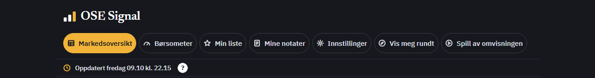

Stripa øverst på oversikten, med linja «Oppdatert» og tidspunktet for hentingen i norsk tid. Kontrollen sjekket at siden viser det eldste tidspunktet blant aksjene som vises, ikke det nyeste, så en side med én fersk rad og resten foreldet ikke ser fersk ut. [Spesifikasjonen](../_bmad-output/implementation-artifacts/spec-1-4c-rydding-kurskilde-ut-sist-hentet-inn.md)

### 1.5 `SnapshotKilde` ut av `kursdata.py`

Ingen skjerm: lesingen av øyeblikksbildet er flyttet ut av portmodulen. [Spesifikasjonen](../_bmad-output/implementation-artifacts/spec-1-5-snapshotkilde-ut-av-kursdata-py.md)

### 1.5b Migrasjonsløperen og SQLite-adapteren herdes

Ingen skjerm: herdingen av migrasjonsløperen og SQLite-adapteren. [Spesifikasjonen](../_bmad-output/implementation-artifacts/spec-1-5b-migrasjonsloeperen-og-sqlite-adapteren-herdes.md)

### 1.6 `Vurderingslager` med datoavvisning

Ingen skjerm: lageret for vurderingene, som avviser en eldre dato. [Spesifikasjonen](../_bmad-output/implementation-artifacts/spec-1-6-vurderingslager-med-datoavvisning.md)

### 1.7 De tre tilstandene skilles

Ingen skjerm: skillet mellom tilstandene ligger i koden og synes på sidene først med 2.2b og 2.7. [Spesifikasjonen](../_bmad-output/implementation-artifacts/spec-1-7-de-tre-tilstandene-skilles.md)

### 1.8 Hentingen godtar bare det leseren kan lese

Ingen skjerm: hentingen og leseren bruker samme regel for en gyldig serie. [Spesifikasjonen](../_bmad-output/implementation-artifacts/spec-1-8-hentingen-godtar-bare-det-leseren-kan-lese.md)

### 1.9 Aksjene i basen, og tabellene peker på dem

Ingen skjerm: aksjetabellen og fremmednøklene i basen. [Spesifikasjonen](../_bmad-output/implementation-artifacts/spec-1-9-aksjene-i-basen-og-tabellene-peker-paa-dem.md)

## Epic 2: Ferske data uten at kvoten sprenges

### 2.0 Hentingen lekker ikke nøkkelen og skriver ikke over et øyeblikksbilde

Ingen skjerm: hentingen holder nøkkelen ute av feilmeldingene og skriver ikke over et øyeblikksbilde. [Spesifikasjonen](../_bmad-output/implementation-artifacts/spec-2-0-hentingen-lekker-ikke-noekkelen.md)

### 2.1 Børsdag i Oslo, tidsstempel i UTC

Ingen skjerm: børsdagen og tidsstemplene i hentingen. [Spesifikasjonen](../_bmad-output/implementation-artifacts/spec-2-1-boersdag-i-oslo-tidsstempel-i-utc.md)

### 2.1b Basen åpnes ett sted, og hentingen skriver kursene dit

Ingen skjerm: basen åpnes ett sted, og hentingen skriver kursene dit. [Spesifikasjonen](../_bmad-output/implementation-artifacts/spec-2-1b-basen-aapnes-ett-sted-og-hentingen-skriver-kursene-dit.md)

### 2.1c Vurderingen lagrer målingene bak de tre sjekkene

Ingen egen skjerm: målingene den lagrer, står i sjekkortene på aksjesiden, i bildet for 8.0c. [Spesifikasjonen](../_bmad-output/implementation-artifacts/spec-2-1c-vurderingen-lagrer-maalingene-bak-de-tre-sjekkene.md)

### 2.2 Hentekommandoen som egen inngang

Ingen skjerm i demoen: den tomme siden vises bare når basen er tom, og resten er hentekommandoen som egen inngang. [Spesifikasjonen](../_bmad-output/implementation-artifacts/spec-2-2-hentekommandoen-som-egen-inngang.md)

### 2.2b Sidene leser dagens vurdering

En rad i oversikten der aksjen har en grunn i stedet for en vurdering, vist med «–» og grunnen. Kontrollen sjekket at sidene leser dagens vurdering fra basen, og at signalet aldri regnes på siden når raden mangler. [Spesifikasjonen](../_bmad-output/implementation-artifacts/spec-2-2b-sidene-leser-dagens-vurdering.md)

### 2.3 Børsdagskontroll før kvoten brukes

Ingen skjerm: kontrollen i hentekommandoen før kvoten brukes. [Spesifikasjonen](../_bmad-output/implementation-artifacts/spec-2-3-boersdagskontroll-foer-kvoten-brukes.md)

### 2.3b Kallene som er igjen, brukes på nye forsøk

Ingen skjerm: nye forsøk i hentingen med kallene som er igjen. [Spesifikasjonen](../_bmad-output/implementation-artifacts/spec-2-3b-kallene-som-er-igjen-brukes-paa-nye-forsoek.md)

### 2.3d Hentingen går av seg selv hver kveld

Ingen skjerm: den planlagte jobben som henter hver kveld. [Spesifikasjonen](../_bmad-output/implementation-artifacts/spec-2-3d-hentingen-hver-kveld.md)

### 2.4 Etterfylling av hull i kursserien

Ingen skjerm: hullene i kursserien fylles i hentingen. [Spesifikasjonen](../_bmad-output/implementation-artifacts/spec-2-4-etterfylling-av-hull-i-kursserien.md)

### 2.5 Vurderingen skrives i samme kjøring

Ingen skjerm: hentingen skriver vurderingene i samme kjøring som kursene. [Spesifikasjonen](../_bmad-output/implementation-artifacts/spec-2-5-vurderingen-skrives-i-samme-kjoering.md)

### 2.6 Utbyttedager merkes

Ingen skjerm i demoen: de oppdiktede kursene har ingen justeringsdager, så merket vises ikke (spørsmål 6 i spesifikasjonen). [Spesifikasjonen](../_bmad-output/implementation-artifacts/spec-2-6-justeringsdager.md)

### 2.7 Historikken i aksjedetaljen

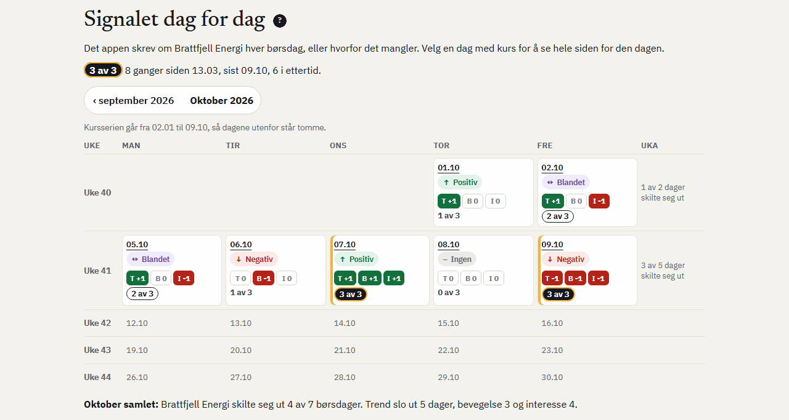

«Signalet dag for dag» nær bunnen av aksjesiden, én måned om gangen, med styrke og retning for hver børsdag, eller grunnen når dagen har en. Kontrollen sjekket at historikken leses fra de lagrede vurderingene og ikke regnes på nytt, og at styrke 0, en grunn og en dag uten rad aldri ser like ut. [Spesifikasjonen](../_bmad-output/implementation-artifacts/spec-2-7b-signalet-dag-for-dag.md)

### 2.8 Hovedindeksen hentes i samme kjøring

Ingen skjerm: hovedindeksen hentes og lagres i hentingen, og vises med 2.9 og 2.9c. [Spesifikasjonen](../_bmad-output/implementation-artifacts/spec-2-8b-indekskallet-i-hentingen.md)

### 2.9 Hovedindeksen i markedsoversikten

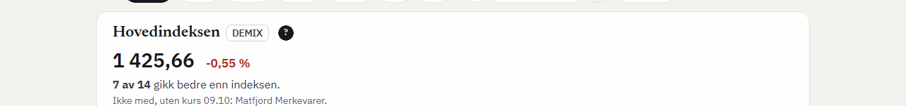

«Hovedindeksen» over tabellen på oversikten, med dagens endring og hvor mange av aksjene som gikk bedre enn indeksen. Kontrollen sjekket at antallet regnes av aksjene som har kurs den dagen, ikke et fast tall, og at en aksje som ikke er med, navngis. [Spesifikasjonen](../_bmad-output/implementation-artifacts/spec-2-9-hovedindeksen-paa-forsiden.md)

### 2.9b Søylene under hovedindeksen

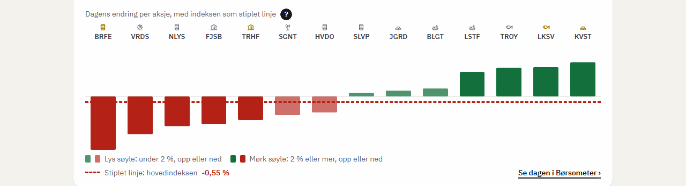

Søylene under hovedindeksen, én per aksje fra største fall til største stigning, med indeksens endring som stiplet linje. Kontrollen sjekket antallet søyler med en kortere liste, og at teksten for skjermleser har alle tallene. [Spesifikasjonen](../_bmad-output/implementation-artifacts/spec-2-9b-soeylene-under-hovedindeksen.md)

### 2.9c Hovedindeksen som stiplet linje i kursgrafen

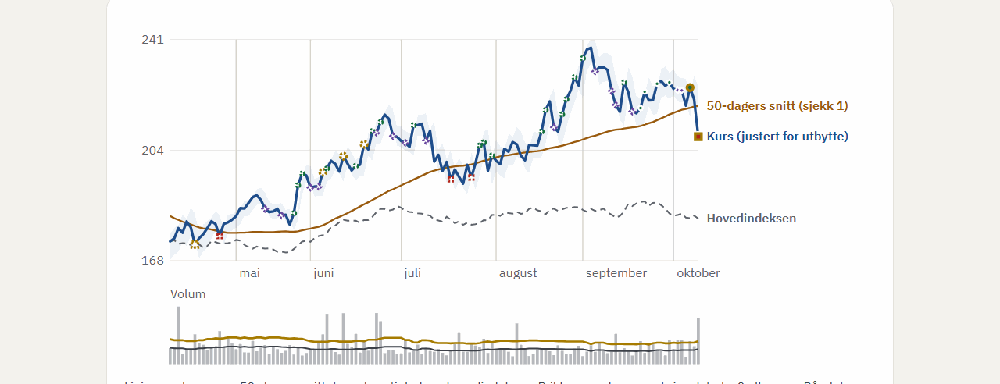

Kursgrafen på aksjesiden med hovedindeksen som stiplet linje, regnet om så den starter på aksjens kurs første dag i grafen. Kontrollen sjekket at linja bare bruker dager indeksen har, uten nye kall, og at grafen sier fra når indeksen mangler. [Spesifikasjonen](../_bmad-output/implementation-artifacts/spec-2-9c-hovedindeksen-i-kursgrafen.md)

### 2.10 Høy og lav lagres med kursene

Ingen skjerm: høy og lav lagres i basen, og aksjesiden viser dem ikke. [Spesifikasjonen](../_bmad-output/implementation-artifacts/spec-2-10-hoey-og-lav.md)

### 2.11 Lista leses fra basen

Ingen skjerm i demoen: lista leses fra basen, og ingen av de oppdiktede aksjene er tatt ut av den. [Spesifikasjonen](../_bmad-output/implementation-artifacts/spec-2-11-lista-leses-fra-basen.md)

### 2.12 Velge og bytte aksjer

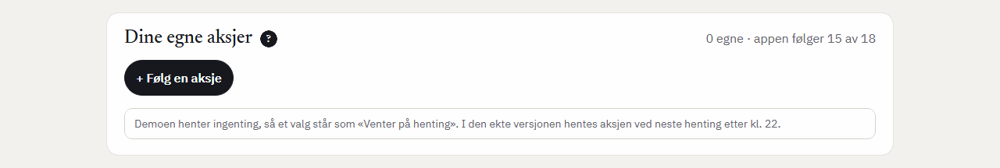

«Dine egne aksjer» under tabellen på oversikten, med hvor mange aksjer appen følger av taket på 18, og knappen «Følg en aksje». Kontrollen sjekket at en nittende aksje avvises med en forklaring, og at et valg på siden bare lagres som et ønske og aldri starter et kall.

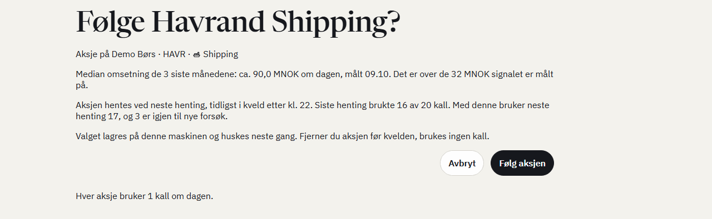

Steget før en aksje følges, med omsetningen som er målt fra før og hva valget koster i kall ved neste henting. Kontrollen sjekket at omsetningen vises før brukeren velger, og at demoen ikke henter noe. [Spesifikasjonen](../_bmad-output/implementation-artifacts/spec-2-12-velge-og-bytte-aksjer.md)

### 2.13 Kommandoen som måler omsetning

Ingen skjerm: kommandoen som måler omsetningen; tallene vises i steget før en aksje følges (2.12). [Spesifikasjonen](../_bmad-output/implementation-artifacts/spec-2-13-maalingen-av-omsetning.md)

### 2.14 Eks.datoer føres inn for hånd

Ikke bygget: står i backlog som «Ekstra, hvis tiden rekker». [Storyen](../_bmad-output/planning-artifacts/epics.md#story-214-eksdatoer-føres-inn-for-hånd)

### 2.16 Børskalenderen for alle år

Ingen skjerm i demoen: kalenderen regnes ut i koden, og alle demodagene ligger innenfor den. [Spesifikasjonen](../_bmad-output/implementation-artifacts/spec-2-16-boerskalenderen-for-alle-aar.md)

### 2.17 Signalet regnet i ettertid

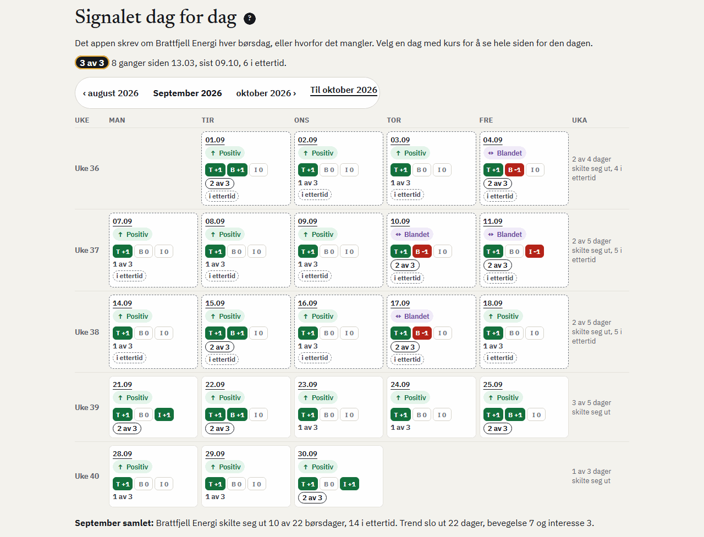

Historikken for en måned der dagene før vurderingene startet har signalet regnet i ettertid, merket «i ettertid» med stiplet kant. Kontrollen sjekket at signalet bare regnes med kursene til og med dagen, at en kveldsrad aldri skrives over, og at en rad i ettertid ikke ser ut som en kveldsrad. [Spesifikasjonen](../_bmad-output/implementation-artifacts/spec-2-17-signalet-regnet-i-ettertid.md)

### 2.18 Setningen om KI-teksten for en dag i ettertid bare med KI på

Ingen skjerm: endringen er at en setning er borte når KI-teksten er av, og et bilde kan ikke vise at noe mangler. [Spesifikasjonen](../_bmad-output/implementation-artifacts/spec-2-18-ki-setningen-i-ettertid.md)

### 2.19 Høy og lav mot sluttkursen

Ingen skjerm: hentingen lagrer raden uten høy og lav når de ikke passer med sluttkursen. [Spesifikasjonen](../_bmad-output/implementation-artifacts/spec-2-19-hoey-og-lav-mot-slutt.md)

### 2.20 Aksjene utenfor lista har ferske kurser når de følges

Ikke bygget: skrevet 22.11 og bygges etter kodegjennomgangen. [Storyen](../_bmad-output/planning-artifacts/epics.md#story-220-aksjene-utenfor-lista-har-ferske-kurser-når-de-følges)

## Epic 3: Løsningen kan kjøres av andre enn oss

### 3.1 Dockerfile med to innganger

Ingen skjerm: Dockerfilen og compose-fila. [Spesifikasjonen](../_bmad-output/implementation-artifacts/spec-3-1-dockerfile-med-to-innganger.md)

### 3.2 To volumer, og ingenting uerstattelig i imaget

Ingen skjerm: volumene for basen og øyeblikksbildene. [Spesifikasjonen](../_bmad-output/implementation-artifacts/spec-3-2-to-volumer-og-ingenting-uerstattelig-i-imaget.md)

### 3.2b Port 8000 i stedet for 5000

Ingen skjerm: porten appen bruker. [Spesifikasjonen](../_bmad-output/implementation-artifacts/spec-3-2b-port-8000.md)

### 3.3 README — «Slik kjører du den»

Ingen skjerm: README-en; den tomme siden med hentekommandoen vises ikke i demoen. [Spesifikasjonen](../_bmad-output/implementation-artifacts/spec-3-3-readme-slik-kjoerer-du-den.md)

### 3.4 Demoversjonen

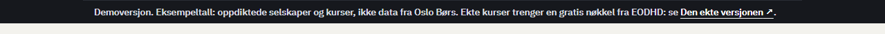

Demolinja øverst på siden, som sier at tallene er eksempeltall om oppdiktede selskaper. Kontrollen sjekket at merket leses fra basen, så hver side med demobasen viser det og ingen side med en ekte base gjør det.

Fotnoten for «ikke vurdert» på aksjesiden for en tidlig dag uten signal, med demoteksten. Setningen om dagene i ettertid kom med 2.17. Kontrollen sjekket at demoteksten bare står for dager før startdagen, og at den ekte versjonen har sin egen tekst. [Spesifikasjonen](../_bmad-output/implementation-artifacts/spec-3-4e-fotnoten-etter-startdag.md)

### 3.4b KI-tekstene i demoen

Ingen egen skjerm: KI-teksten i demoen står i bildet for 10.3. [Spesifikasjonen](../_bmad-output/implementation-artifacts/spec-3-4b-ki-tekstene-i-demoen.md)

### 3.4h Investorsidene i demoen

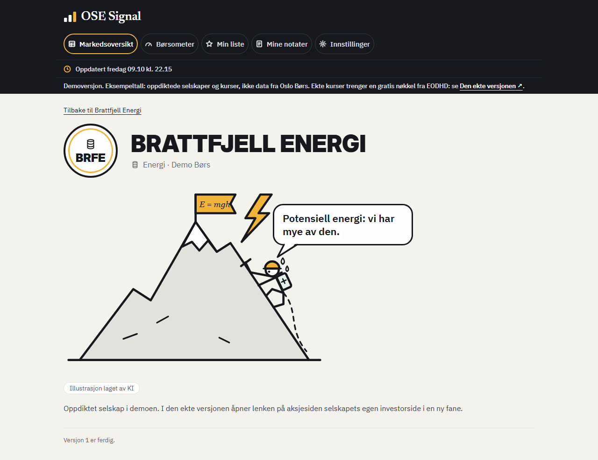

Investorsiden for et oppdiktet selskap i demoen, med logoen, navnet i selskapets egen skrift, tegningen merket «Illustrasjon laget av KI» og lenken tilbake. Kontrollen sjekket at hvert av de oppdiktede selskapene har en slik side, at siden ikke finnes i den ekte versjonen, og at den verken har kurs, prosent eller ord om kjøp og salg. [Spesifikasjonen](../_bmad-output/implementation-artifacts/spec-3-4h-investorsidene-i-demoen.md)

### 3.5 Start med dobbeltklikk

Ingen skjerm: startskriptene for dobbeltklikk. [Spesifikasjonen](../_bmad-output/implementation-artifacts/spec-3-5a-dobbeltklikk-med-uv.md)

### 3.6 Ikonet og snarveien

Ingen skjerm: ikonet synes i fanen og på snarveien, ikke på selve siden. [Spesifikasjonen](../_bmad-output/implementation-artifacts/spec-3-6-ikonet-og-snarveien.md)

### 3.7 Snarveien spør før nettleseren, og KI-teksten på en ny PC

Ingen skjerm i demoen: snarveien spør i startvinduet, og linja om KI-teksten står bare i den ekte versjonen uten modell. [Spesifikasjonen](../_bmad-output/implementation-artifacts/spec-3-7-snarveien-spoer-foer-nettleseren.md)

## Epic 4: KI kan tas i bruk uten å bryte godkjenningen

### 4.0 Nettsperren dekker hele testkjøringen

Ingen skjerm: nettsperren i testene. [Spesifikasjonen](../_bmad-output/implementation-artifacts/spec-4-0-nettsperren-dekker-hele-testkjoeringen.md)

### 4.1 Velg modelltjeneste og dokumentér betingelse 4

Ingen skjerm: vilkårene for modelltjenestene står i dokumentene. [Storyen](../_bmad-output/planning-artifacts/epics.md#story-41-velg-modelltjeneste-og-dokumentér-betingelse-4)

### 4.2 `KILogg`-porten med minneimplementasjon

Ingen skjerm: porten for KI-loggen. [Spesifikasjonen](../_bmad-output/implementation-artifacts/spec-4-2-kilogg-porten-med-minneimplementasjon.md)

### 4.3 SQLite-adapter for `KILogg`

Ingen skjerm: KI-loggen lagres i basen. [Spesifikasjonen](../_bmad-output/implementation-artifacts/spec-4-3-sqlite-adapter-for-kilogg.md)

## Epic 5: KI-laget i drift 🔒

### 5.1 Av/på-bryteren i grensesnittet 🔒

Ikke bygget: epicen er ute av v1 fra 28.09, da plan B (Epic 10) ble utløst, og står som plan for en senere versjon. Bryteren for KI-teksten i demoen kom med 10.3 og 8.10b. [Storyen](../_bmad-output/planning-artifacts/epics.md#story-51-avpå-bryteren-i-grensesnittet-)

### 5.2 Visningen når laget er av 🔒

Ikke bygget: epicen er ute av v1 fra 28.09, da plan B (Epic 10) ble utløst, og står som plan for en senere versjon. [Storyen](../_bmad-output/planning-artifacts/epics.md#story-52-visningen-når-laget-er-av-)

### 5.3 Usikkerhet som forbehold 🔒

Ikke bygget: epicen er ute av v1 fra 28.09, da plan B (Epic 10) ble utløst, og står som plan for en senere versjon. [Storyen](../_bmad-output/planning-artifacts/epics.md#story-53-usikkerhet-som-forbehold-)

### 5.4 Relevansskalaen med tre verdier 🔒

Ikke bygget: epicen er ute av v1 fra 28.09, da plan B (Epic 10) ble utløst, og står som plan for en senere versjon. [Storyen](../_bmad-output/planning-artifacts/epics.md#story-54-relevansskalaen-med-tre-verdier-)

## Epic 10: KI forklarer signalet (plan B) 🔀

### 10.1 Grunnlaget som sendes — bare utledede verdier

Ingen skjerm: en ren funksjon som bestemmer hva som sendes til modellen. [Spesifikasjonen](../_bmad-output/implementation-artifacts/spec-10-1-grunnlaget-som-sendes-bare-utledede-verdier.md)

### 10.2 Teksten lages i hentekommandoen og lagres i `KILogg`

Ingen egen skjerm: teksten lages i hentekommandoen og lagres i KI-loggen, og den vises i bildene for 10.3 og 10.9. [Storyen](../_bmad-output/planning-artifacts/epics.md#story-102-teksten-lages-i-hentekommandoen-og-lagres-i-kilogg)

### 10.3 Visningen i aksjedetaljen

Visningen står i bildet for 10.9: KI-teksten i rammen «Signalet forklart», merket «Laget av KI» og med modellen under, i formen fra 10.9 og 10.10. [Spesifikasjonen](../_bmad-output/implementation-artifacts/spec-10-3-visningen-i-aksjedetaljen.md)

### 10.4 Måle bidraget — egen brukertest, etter 8.1

Ingen skjerm: en brukertest med KI av og på og en telling av KI-loggen for én uke. [Spesifikasjonen](../_bmad-output/implementation-artifacts/spec-10-4-loggdelen.md)

### 10.5 Lenke til selskapets side på NewsWeb

Knappen til investorsiden under «Signalet dag for dag» på aksjesiden, med selskapets navn. I demoen går den til en side i appen (3.4h), og høyden er fra 8.29. Kontrollen sjekket at lenken gjelder aksjen siden viser, og at ingen mal lenker til Euronexts nettsteder. [Spesifikasjonen](../_bmad-output/implementation-artifacts/spec-10-5-investorsiden.md)

### 10.6 KI-teksten om dagen på forsiden

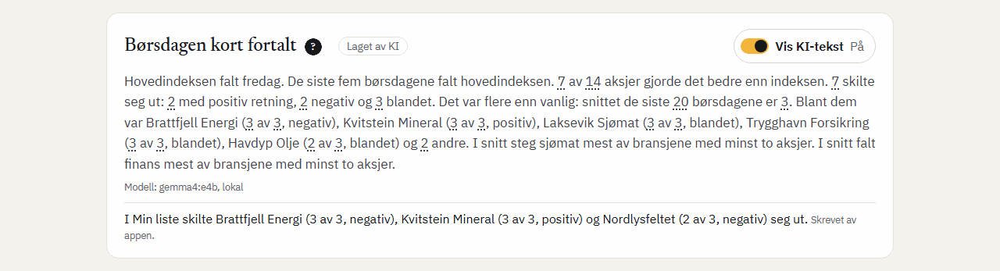

«Børsdagen kort fortalt» under tabellen på oversikten, merket «Laget av KI», med modellnavnet og bryteren «Vis KI-tekst». Kontrollen sjekket at teksten lages i hentingen, aldri når siden vises, og at en tekst som ikke består kontrollen, ikke vises. Teksten i bildet har den rikere formen fra 10.10 og 10.11, og linja om Min liste kom med 10.10. [Spesifikasjonen](../_bmad-output/implementation-artifacts/spec-10-6-ki-teksten-om-dagen-paa-forsiden.md)

### 10.7 Egen nøkkel til Gemini, Anthropic og OpenAI

Ingen skjerm: tjenesten og nøkkelen settes i miljøvariabler, og nøkkelen står aldri på en side. [Spesifikasjonen](../_bmad-output/implementation-artifacts/spec-10-7-egen-noekkel-til-gemini-anthropic-og-openai.md)

### 10.8 ChatGPT med «Sign in with ChatGPT»

Ikke bygget: blir liggende etter gruppens svar 08.11, av etiske grunner og etter reglene. [Storyen](../_bmad-output/planning-artifacts/epics.md#story-108-chatgpt-med-sign-in-with-chatgpt)

### 10.9 KI-teksten forklarer det siden viser

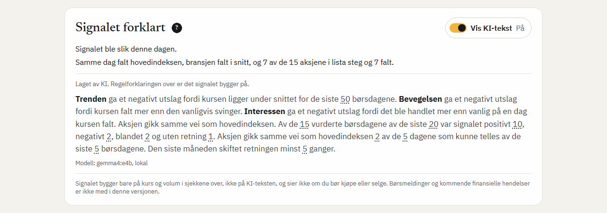

Rammen «Signalet forklart» med appens setninger om dagene og om samme dag øverst, så KI-teksten med én setning per sjekk og mønstrene appen har regnet ut, og bryteren øverst til høyre. Kontrollen sjekket at appens setninger står før KI-teksten, og at bryteren står på samme sted med KI på og av. [Spesifikasjonen](../_bmad-output/implementation-artifacts/spec-10-9-ki-teksten-forklarer-det-siden-viser.md)

### 10.10 Rikere KI-tekster

Den rikere teksten om børsdagen og linja om Min liste, merket «Skrevet av appen.», står i bildet for 10.6. [Spesifikasjonen](../_bmad-output/implementation-artifacts/spec-10-10-rikere-ki-tekster.md)

### 10.11 «mest av bransjene med minst to aksjer» i teksten om børsdagen

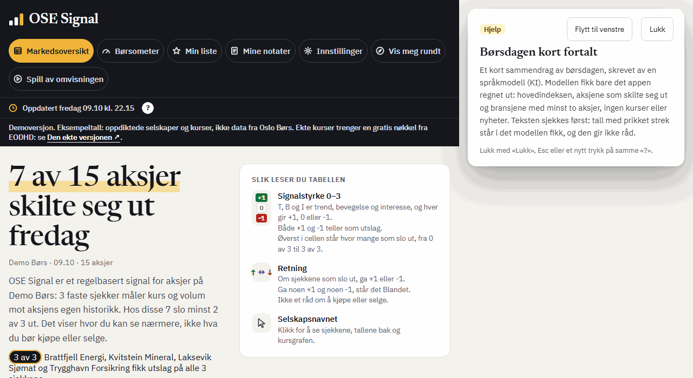

Hjelpen ved «Børsdagen kort fortalt», som sier at modellen bare fikk det appen regnet ut, også bransjene med minst to aksjer. Kontrollen sjekket at bare formene med «mest av bransjene med minst to aksjer» godtas, og at en bransje med én aksje aldri blir «mest». [Spesifikasjonen](../_bmad-output/implementation-artifacts/spec-10-11-mest-av-bransjene-med-minst-to-aksjer.md)

## Epic 6: Børsmeldinger i oversikten 🔒

### 6.1 Meldingslageret som port 🔒

Ikke bygget: epicen er blokkert og ute av v1 fra 28.09 (plan B). [Storyen](../_bmad-output/planning-artifacts/epics.md#story-61-meldingslageret-som-port-)

### 6.2 Etterfylling med avkortingsvakt 🔒

Ikke bygget: epicen er blokkert og ute av v1 fra 28.09 (plan B). [Storyen](../_bmad-output/planning-artifacts/epics.md#story-62-etterfylling-med-avkortingsvakt-)

### 6.3 Deduplisering av språkdubletter 🔒

Ikke i bruk: logikken for dedupliseringen står i `src/meldinger.py` med testene i `tests/test_meldinger.py`, men ingen modul i `src/` bruker den. Storyen står i backlog, og epicen er ute av v1 fra 28.09 (plan B). [Storyen](../_bmad-output/planning-artifacts/epics.md#story-63-deduplisering-av-språkdubletter-)

### 6.4 Kategorifilteret i tre bøtter 🔒

Ikke i bruk: logikken for kategorifilteret står i `src/meldinger.py` med testene i `tests/test_meldinger.py`, men ingen modul i `src/` bruker den. Storyen står i backlog, og epicen er ute av v1 fra 28.09 (plan B). [Storyen](../_bmad-output/planning-artifacts/epics.md#story-64-kategorifilteret-i-tre-bøtter-)

### 6.5 Meldinger i aksjedetaljen 🔒

Ikke bygget: epicen er blokkert og ute av v1 fra 28.09 (plan B). [Storyen](../_bmad-output/planning-artifacts/epics.md#story-65-meldinger-i-aksjedetaljen-)

## Epic 7: Kommende finansielle hendelser 🔒

### 7.1 Kalenderkilden og koblingen til selskap 🔒

Ikke bygget: epicen er blokkert og ute av v1 fra 28.09 (plan B). [Storyen](../_bmad-output/planning-artifacts/epics.md#story-71-kalenderkilden-og-koblingen-til-selskap-)

### 7.2 Hendelser innenfor horisonten 🔒

Ikke bygget: epicen er blokkert og ute av v1 fra 28.09 (plan B). [Storyen](../_bmad-output/planning-artifacts/epics.md#story-72-hendelser-innenfor-horisonten-)

### 7.3 Når kalenderen ikke svarer 🔒

Ikke bygget: epicen er blokkert og ute av v1 fra 28.09 (plan B). [Storyen](../_bmad-output/planning-artifacts/epics.md#story-73-når-kalenderen-ikke-svarer-)

## Epic 8: Tydelig for den som ikke har bygget den

### 8.0 De rene feilene i de to skjermbildene

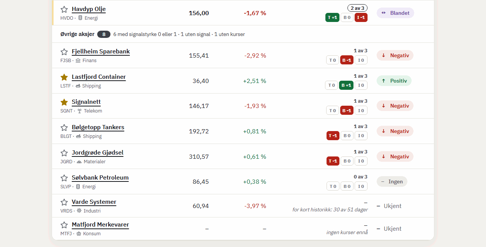

Nederst i tabellen i markedsoversikten, med tallene skrevet på norsk og selskapsnavnene som lenker. Kontrollen sjekket at tallene har desimalkomma og aldri står som «-0,00», at en aksje som skiller seg ut, er merket med tekst og ikke bare med farge, og at tabellen fortsatt har fem kolonner. [Spesifikasjonen](../_bmad-output/implementation-artifacts/spec-8-0-de-rene-feilene-i-de-to-skjermbildene.md)

### 8.0b Hjelp bak et spørsmålstegn

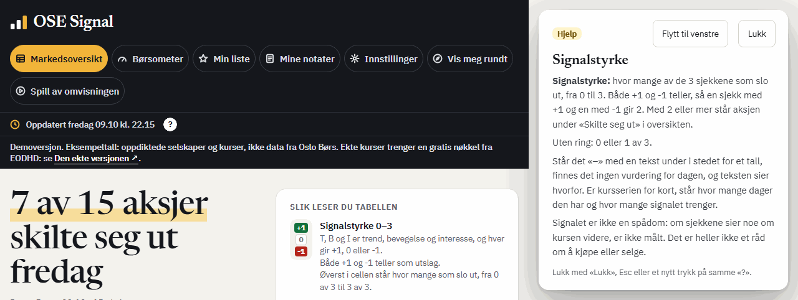

Hjelpen bak «?» ved Signalstyrke, åpnet i feltet i høyre kant, som kom med 8.0f. Kontrollen sjekket at hver tekst malene ber om, finnes i hjelpefila, at tallene i teksten kommer fra parameterne, og at ingen tekst sier noe koden ikke gjør eller kan leses som et råd. [Spesifikasjonen](../_bmad-output/implementation-artifacts/spec-8-0b-hjelp-bak-et-spoersmaalstegn.md)

### 8.0c Tydelig merking, ord ved sjekkene og datoer på grafen

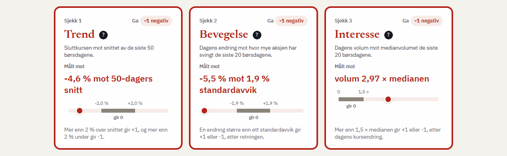

De tre sjekkortene på aksjesiden, der det hver sjekk ga, står som tall og ord: positiv, negativ eller ingen utslag. Kontrollen sjekket at ordene er positiv og negativ, aldri opp og ned.

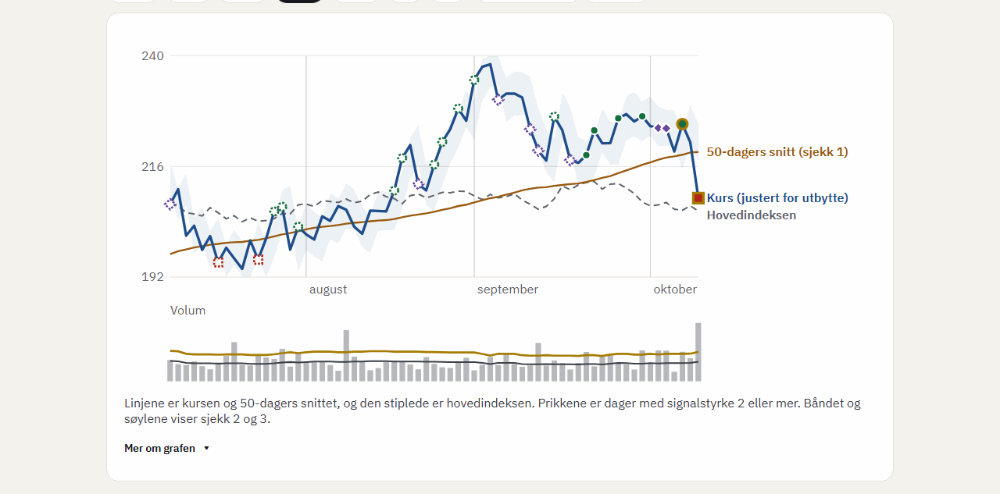

Kursgrafen for 3 måneder, med et merke og et norsk månedsnavn ved første børsdag i hver måned. Kontrollen sjekket at merket står over punktet for den dagen i kurslinja, og ikke er spredd etter kalenderen. [Spesifikasjonen](../_bmad-output/implementation-artifacts/spec-8-0c-tydelig-merking-ord-ved-sjekkene-og-datoer-paa-grafen.md)

### 8.0e Oversikten fra designforslaget

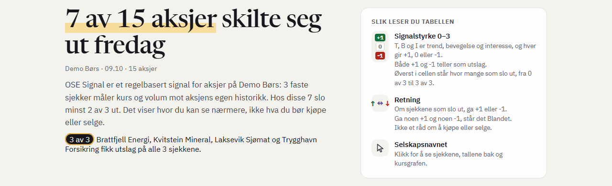

Toppen av markedsoversikten: overskriften med hvor mange aksjer som skilte seg ut og ukedagen, innledningen, linja om dem som fikk 3 av 3, og «Slik leser du tabellen». Kontrollen sjekket at antallene telles og ikke er skrevet fast, og at ukedagen er børsdagen vurderingene gjelder, ikke dagen siden ble åpnet.

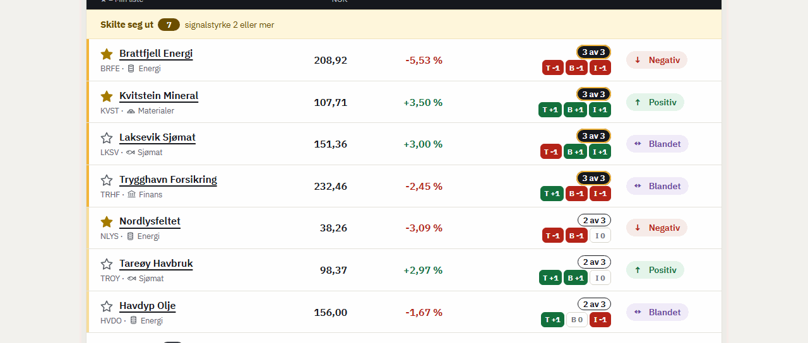

Delen «Skilte seg ut» i tabellen, med T, B og I under «N av 3» i cellen for signalstyrke. Kontrollen sjekket at bare rader med styrke på terskelen eller mer står her, at verdiene leses fra den lagrede vurderingen, og at tabellen fortsatt har fem kolonner. [Spesifikasjonen](../_bmad-output/implementation-artifacts/spec-8-0e-oversikten-fra-designforslaget.md)

### 8.0d Utseendet fra designforslaget

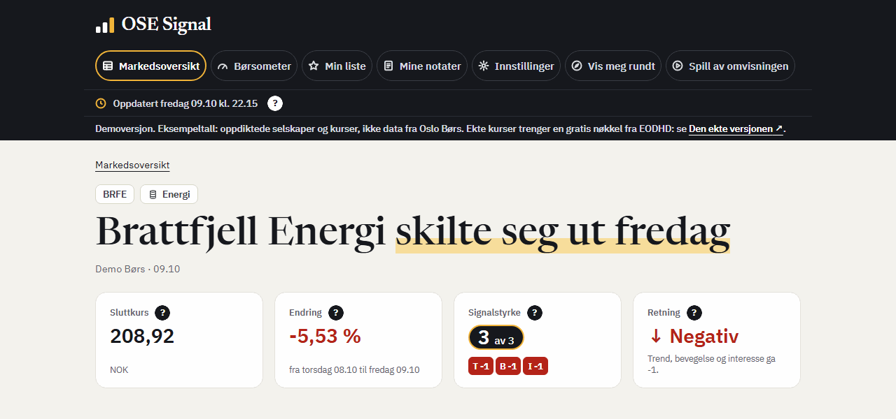

Toppen av aksjesiden i utseendet fra designforslaget: stripa, skriften, fargene og nøkkeltallene, med tilbakelenken som tekst uten pil. Kontrollen sjekket at skriften ligger i appen og ingenting hentes fra nettet, at sifrene i tallcellene er like brede, at teksten har kontrast på minst 4,5:1, og at piler bare står ved retningen. [Spesifikasjonen](../_bmad-output/implementation-artifacts/spec-8-0d-utseendet-fra-designforslaget.md)

### 8.1 Brukertest rett etter Epic 2

Ingen skjerm: brukertesten med én person utenfor gruppen 10.11, ført i `docs/brukertest.md` og `docs/ux-logg.md`. [Spesifikasjonen](../_bmad-output/implementation-artifacts/spec-8-1-brukertesten.md)

### 8.2 UX-gjennomgang av de to skjermbildene med `[CU] bmad-ux`

Ingen egen skjerm: storyen er gjennomgangen av de to skjermbildene, og rettingene fra den (8.2a og 8.2b) synes blant annet i bildet for 2.9. [Storyen](../_bmad-output/planning-artifacts/epics.md#story-82-ux-gjennomgang-av-de-to-skjermbildene-med-cu-bmad-ux)

### 8.2c Kursgrafen på smal skjerm

Ikke synlig ved 1280 px: den smale kursgrafen vises bare når grafen er smalere enn 690 px. [Spesifikasjonen](../_bmad-output/implementation-artifacts/spec-8-2c-kursgrafen-paa-smal-skjerm.md)

### 8.3 Min liste: eget skjermbilde med stjerne og filter

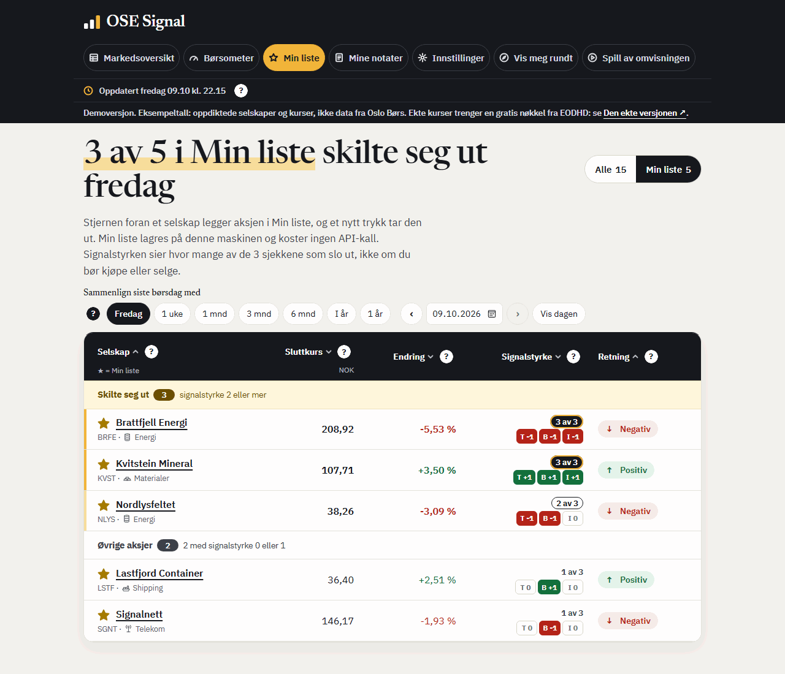

Min liste med knapperaden øverst, valget «Alle / Min liste» og den samme tabellen som i oversikten, med stjernen foran hvert selskap. Kontrollen sjekket at merkingen overlever en omstart og ikke koster API-kall, at filteret beholder rekkefølgen fra FR-102, og at lista ikke har antall aksjer eller kjøpskurs. [Spesifikasjonen](../_bmad-output/implementation-artifacts/spec-8-3-min-liste.md)

### 8.4 Se nærmere i aksjedetaljen

Ikke bygget: «Ekstra, hvis tiden rekker», står som backlog i sprintstatusen. [Storyen](../_bmad-output/planning-artifacts/epics.md#story-84-se-nærmere-i-aksjedetaljen)

### 8.5 Endring i kroner, og høy og lav i aksjedetaljen

Ikke bygget: «Ekstra, hvis tiden rekker», står som backlog i sprintstatusen. [Storyen](../_bmad-output/planning-artifacts/epics.md#story-85-endring-i-kroner-og-høy-og-lav-i-aksjedetaljen)

### 8.6 Børsometeret

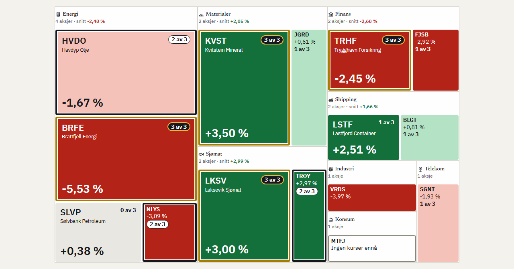

Børsometeret med én rute per aksje, samlet etter bransje, og snittet for bransjen i overskriften, eller «1 aksje» der bransjen har én aksje. Kontrollen sjekket at antallet bransjer og aksjer telles fra lista, at gult bare står ved 3 av 3 siste børsdag, og at siden sier «bransje» og ikke «sektor».

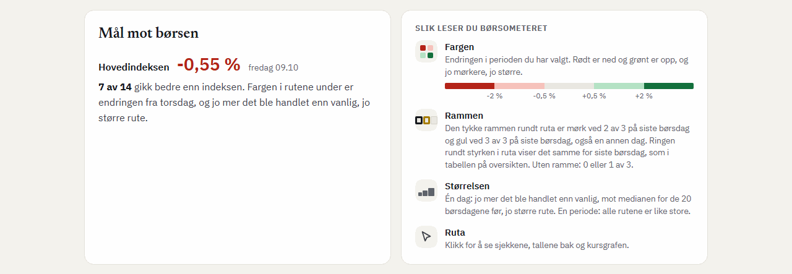

«Mål mot børsen» med hovedindeksen som tall, som kom med 8.6b og ble et kort i 8.20b, og «Slik leser du børsometeret» med fargene, rammene og størrelsen på rutene, som erstattet «Hva fargene betyr» i 8.20b. Kontrollen sjekket at børsometeret ikke trenger nye kall eller en ny tabell. [Spesifikasjonen](../_bmad-output/implementation-artifacts/spec-8-6-boersometeret.md)

### 8.7 Sjekk 2 og 3 i kursgrafen

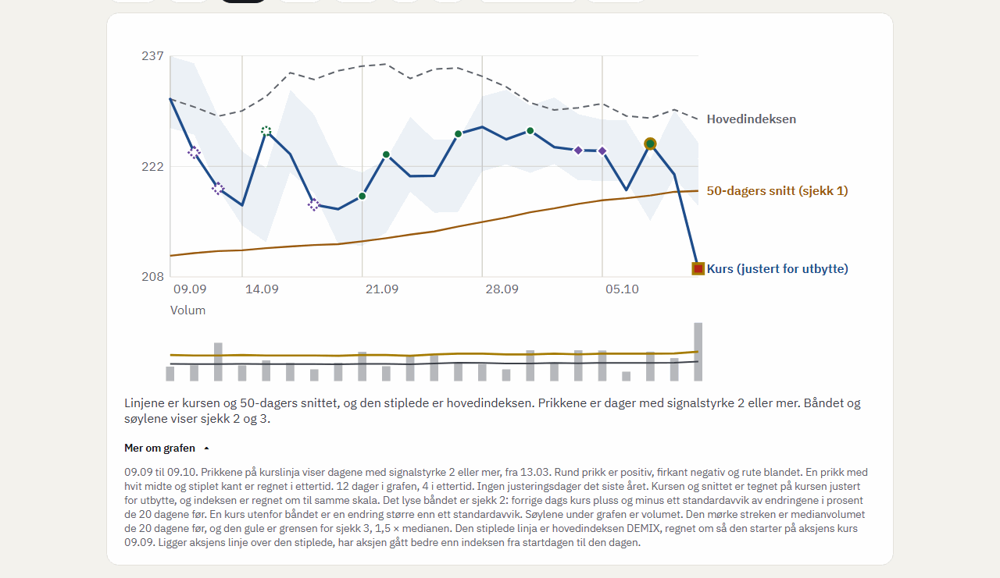

Kursgrafen for en måned med båndet for sjekk 2 rundt forrige dags kurs, og volumsøylene for sjekk 3 under, med streken for medianvolumet og streken for grensen. Kontrollen sjekket at strekene regnes med samme funksjon og samme vindu som sjekk 3, og at den siste dagen i grafen gir samme utslag som sjekkene på siden. [Spesifikasjonen](../_bmad-output/implementation-artifacts/spec-8-7-sjekk-2-og-3-i-grafen.md)

### 8.8 Signaldager i kursgrafen

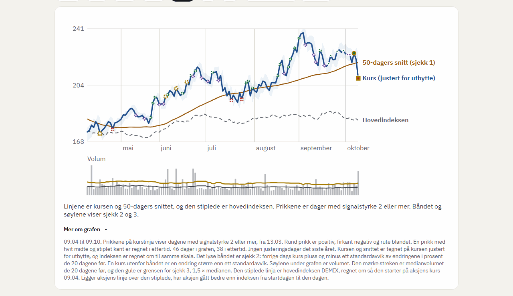

Kursgrafen for seks måneder med en prikk for hver dag aksjen skilte seg ut, rund for positiv, firkant for negativ og rute for blandet, og «Mer om grafen» åpnet med datoen prikkene starter. Kontrollen sjekket at prikkene leses fra de lagrede vurderingene og ikke regnes av kursene, og at en dag uten vurdering aldri ser ut som styrke 0. [Spesifikasjonen](../_bmad-output/implementation-artifacts/spec-8-8-signaldager-i-kursgrafen.md)

### 8.9 «Vis meg rundt»

Erstattet av 8.26: «Vis meg rundt» åpner nå boksen fra omvisningen (8.25) med stegene for siden, og den nummererte lista fra 8.9 er tatt bort. [Spesifikasjonen](../_bmad-output/implementation-artifacts/spec-8-9-vis-meg-rundt.md)

### 8.10 Innstillinger øverst

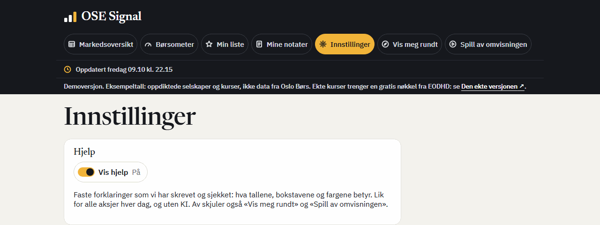

Innstillinger, med knappen øverst i stripa og bryteren «Vis hjelp». Kontrollen sjekket at valget lagres i en egen tabell som bare webserveren skriver, at det overlever en omstart og gjelder maskinen, og at det ikke koster API-kall. [Spesifikasjonen](../_bmad-output/implementation-artifacts/spec-8-10-innstillinger-oeverst.md)

### 8.10b «Vis KI-tekst» i Innstillinger

Bryteren «Vis KI-tekst» i Innstillinger. Kontrollen sjekket at den alltid viser det samme som bryteren ved KI-teksten, og at valget ikke koster API-kall. Bryteren ved KI-teksten på aksjesiden, som bildet for 10.9 viser, har det samme valget. [Spesifikasjonen](../_bmad-output/implementation-artifacts/spec-8-10b-vis-ki-tekst-i-innstillinger.md)

### 8.11 Ferdige lister og filter på signalet

De ferdige listene står i steg 3 i bildet for 8.29, én per bransje med antallet aksjer og «De 15 mest omsatte» fra 8.28 først. Filteret på signalet ble tatt bort i 8.26. [Spesifikasjonen](../_bmad-output/implementation-artifacts/spec-8-11-ferdige-lister.md)

### 8.11c «Utenfor målingen» med medianen av kursene

Ikke synlig i demoen: teksten «regnet av kursene til» står bare ved en aksje der medianen regnes av kursene i basen, og ingen side i demoen viser den. «Følg en aksje» viser omsetningen med «målt» og merket «Utenfor målingen», som i bildet for 8.22. [Spesifikasjonen](../_bmad-output/implementation-artifacts/spec-8-11c-utenfor-maalingen.md)

### 8.12 Endret signalstyrke siden forrige børsdag

Ikke bygget: «Ekstra, hvis tiden rekker», står som backlog i sprintstatusen. [Storyen](../_bmad-output/planning-artifacts/epics.md#story-812-endret-signalstyrke-siden-forrige-børsdag)

### 8.13 Lær noe nytt

Ikke bygget: «Ekstra, hvis tiden rekker», står som backlog i sprintstatusen. [Storyen](../_bmad-output/planning-artifacts/epics.md#story-813-lær-noe-nytt)

### 8.14 Justeringsdager i kursgrafen

Ikke synlig i demoen: demoen har ingen justeringsdager, så grafen har ingen streker, og «Mer om grafen» sier bare at det ikke var noen det siste året. [Spesifikasjonen](../_bmad-output/implementation-artifacts/spec-2-6-justeringsdager.md)

### 8.15 Sortering ved klikk i kolonneraden

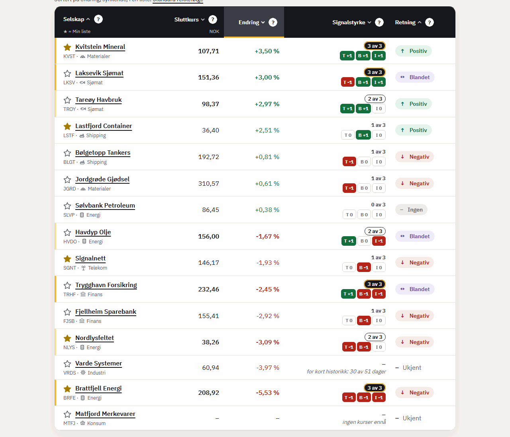

Tabellen sortert på endring, synkende, etter et klikk på kolonnenavnet, som én liste uten delene, og med den valgte kolonnen merket med lysere felt og oransje strek (8.15b). Kontrollen sjekket at et nytt klikk snur rekkefølgen, at rader uten verdi står sist i begge retninger, og at kolonneraden sier kolonnen og retningen også til skjermleseren. [Spesifikasjonen](../_bmad-output/implementation-artifacts/spec-8-15-sortering-ved-klikk-i-kolonneraden.md)

### 8.16 Regelen for startdagen, og periodene i kursgrafen

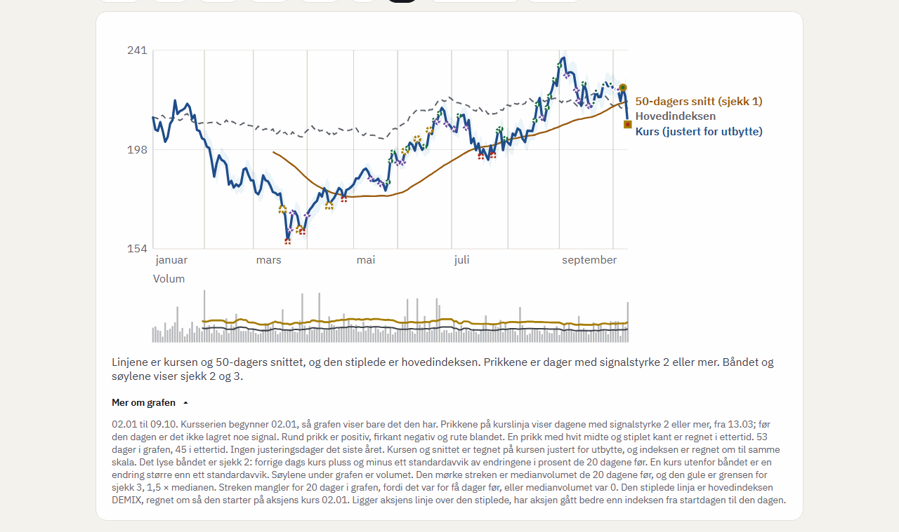

Kursgrafen med 1 år valgt: navn ved annenhver måned, og «Mer om grafen» åpen, med linja om at kursserien er kortere enn perioden. Kontrollen sjekket at én funksjon gir startdagen for hver periode, med faste datoer rundt helger, helligdager og nyttår, og at 1 år viser bare det kursserien har og sier det. [Spesifikasjonen](../_bmad-output/implementation-artifacts/spec-8-16-periodene-i-kursgrafen.md)

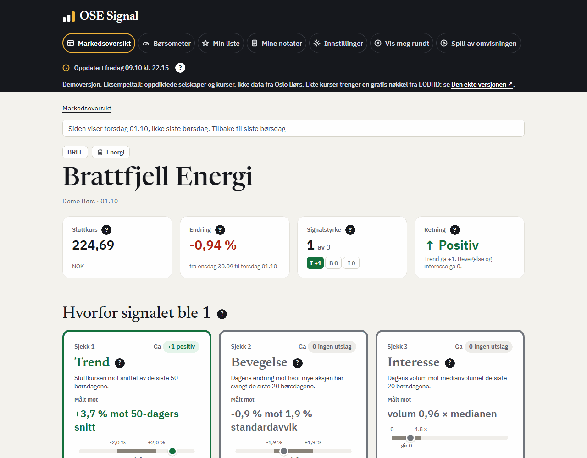

Aksjesiden med en tidligere dag valgt (8.16b): merket øverst sier at siden viser en tidligere dag, med lenke tilbake til siste børsdag, og kortene og sjekkene gjelder den dagen. Kontrollen sjekket at alt leses fra det som er lagret for dagen, og at signalet aldri regnes på nytt (AD-7). [Spesifikasjonen](../_bmad-output/implementation-artifacts/spec-8-16b-dagen-paa-hele-siden.md)

### 8.17 Periodevalget i oversikten, Min liste og børsometeret

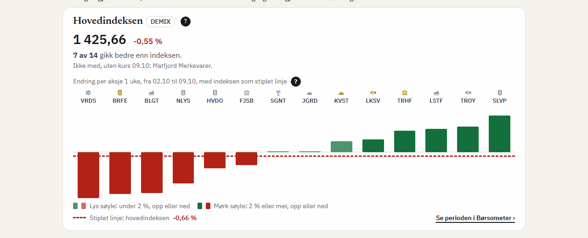

Hovedindeksen på oversikten med perioden 1 uke: søylene viser endringen per aksje i perioden, med indeksen som stiplet linje, og linja over søylene sier perioden og dagene. Kontrollen sjekket at søylene og indekslinja følger samme periode og dag som tabellen, og at endringen regnes av kursserien på `adjusted_close`. [Spesifikasjonen](../_bmad-output/implementation-artifacts/spec-8-17a-periodevalget-i-oversikten.md)

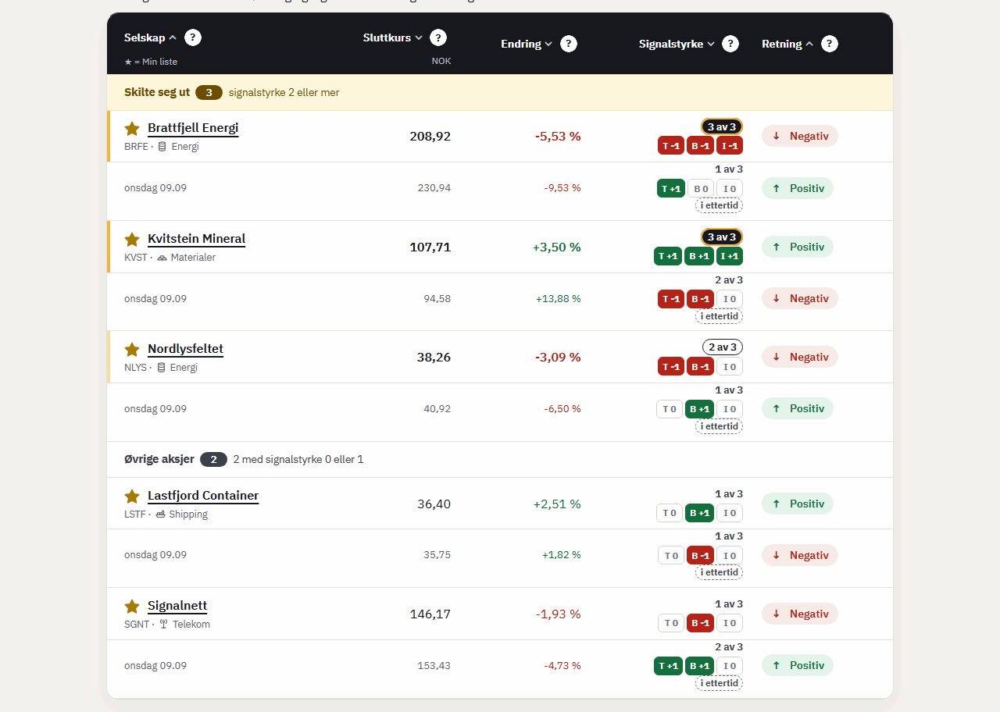

Min liste sammenlignet med 1 mnd (8.17b): hver aksje har siste børsdag øverst og en linje under med dagen den sammenlignes med, sluttkursen da, endringen fram til siste børsdag og signalet som er lagret for dagen, merket «i ettertid» når det ble regnet senere (2.17). Kontrollen sjekket at linja under har styrken som tekst uten pille, og at signalet for sammenligningsdagen aldri regnes på nytt. [Spesifikasjonen](../_bmad-output/implementation-artifacts/spec-8-17b-periodevalget-i-min-liste-og-boersometeret.md)

### 8.18 Kommende eks.dato i kursgrafen

Ikke bygget: står i backlog i sprintstatusen, og gruppen la den utenfor v1 (svaret 09.11 kl. 10:30 og 10:43). [Storyen](../_bmad-output/planning-artifacts/epics.md#story-818-kommende-eksdato-i-kursgrafen)

### 8.19 Neste henting i stripa øverst

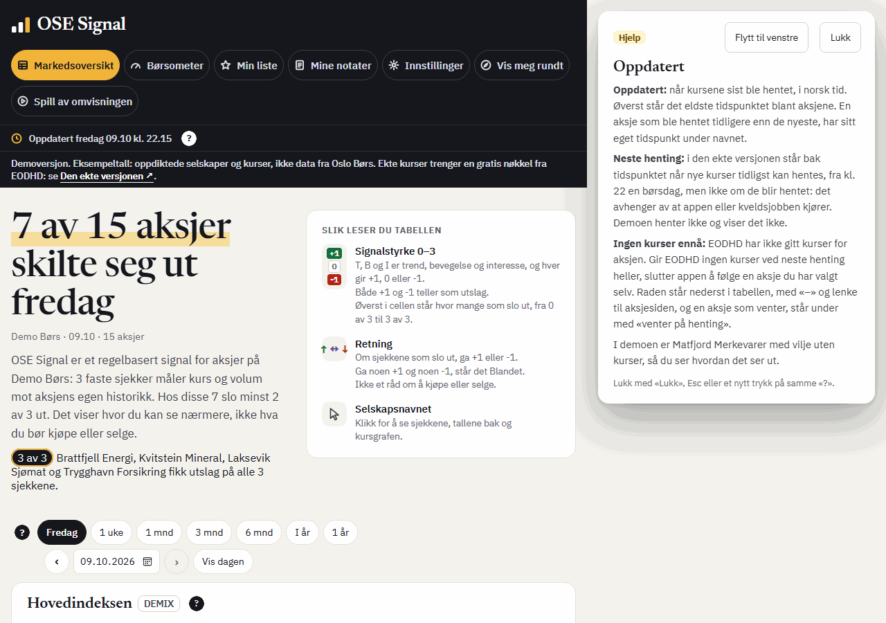

Hjelpen ved «Oppdatert» øverst på oversikten, med avsnittet om neste henting. Kontrollen sjekket at linja om når nye kurser tidligst kan hentes regnes av børskalenderen og grensen kl. 22 uten API-kall, og at den bare står i den ekte versjonen, fordi demoen ikke henter. [Spesifikasjonen](../_bmad-output/implementation-artifacts/spec-8-19-neste-henting-i-stripa.md)

### 8.20 UX-rettingene etter gjennomgangen 06.11

Periodevalget på aksjesiden med en dag valgt: periodeknappene og datoen med «Vis dagen» står på én linje, med pilene til forrige og neste børsdag ved datoen. Kontrollen sjekket på alle fire sidene med periodevalg, ved 1280 og 390 px, at feltet viser dagen ved den første knappen og ved en valgt dag, og er tomt i en periode. [Spesifikasjonen](../_bmad-output/implementation-artifacts/spec-8-20-ux-rettingene-etter-gjennomgangen-06-11.md)

### 8.21 Egne notater på aksjesiden, med tenkte kjøp og salg

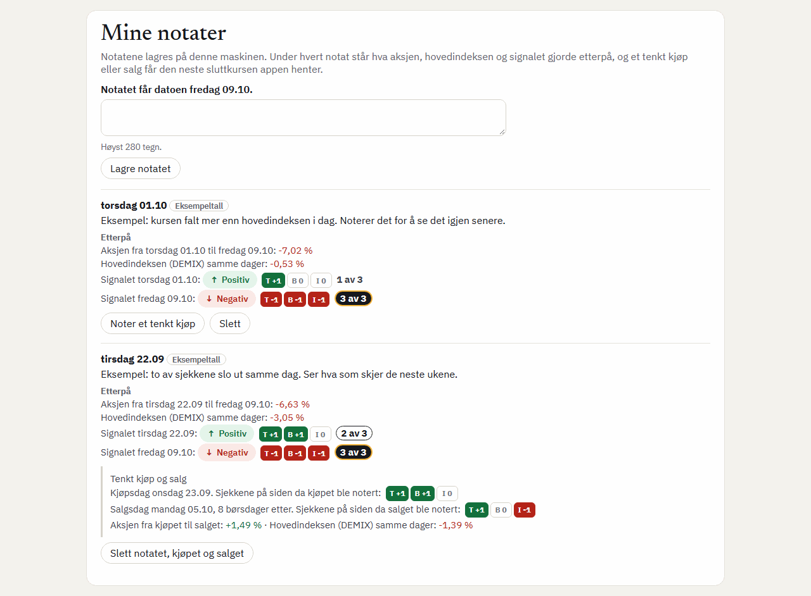

«Mine notater» på aksjesiden, med skjemaet og oppdiktede eksempler merket «Eksempeltall», og under hvert notat hva aksjen, hovedindeksen og signalet gjorde etterpå. Kontrollen sjekket at et notat får dagen siden viser, at kursen ved et tenkt kjøp og salg leses fra serien og aldri lagres, og at siden ikke sier at noe var riktig eller galt. [Spesifikasjonen](../_bmad-output/implementation-artifacts/spec-8-21-egne-notater-paa-aksjesiden.md)

### 8.22 Faste bransjer, «Følg en aksje» med hele lista og «Din egen liste» i tre steg

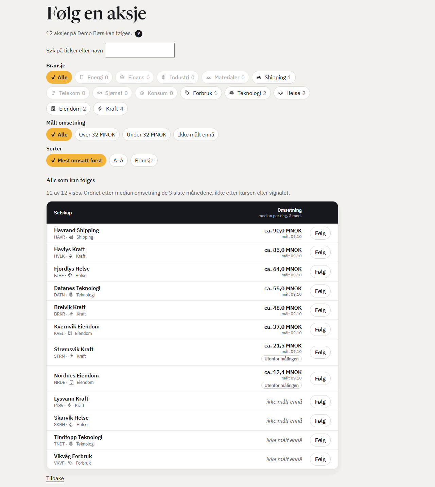

«Følg en aksje» med hele lista som kan følges i demoen, søket, filteret på bransje og omsetning og sorteringen «Mest omsatt først». Kontrollen sjekket at lista er ordnet etter omsetning og ikke etter kursen eller signalet, og at en aksje uten måling er merket «ikke målt ennå». [Spesifikasjonen](../_bmad-output/implementation-artifacts/spec-8-22-foelg-en-aksje-og-min-liste.md)

### 8.23 Funnene fra brukertesten 10.11 (del A)

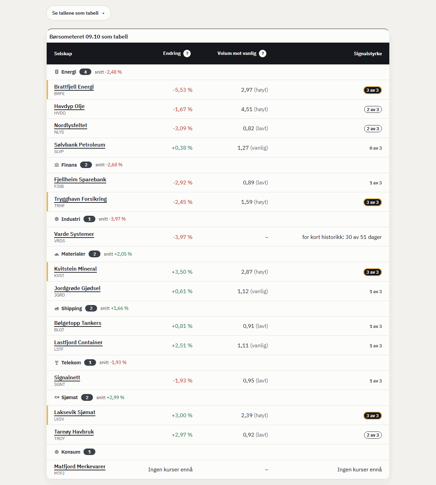

Tabellen under børsometeret, som står åpen fra start, med bransjeradene og «?» ved «Endring» og «Volum mot vanlig». Kontrollen sjekket at tabellen er åpen, at volumet mot vanlig har to desimaler, og at tallet og ordet ved det aldri sier ulikt. Kontrollen sjekket også at hver av de 17 delene fra brukertesten kan ses i demoen, og at hver del har en mutant som ble fanget. [Spesifikasjonen](../_bmad-output/implementation-artifacts/spec-8-23-funnene-fra-brukertesten.md)

### 8.24 Notatene, to ting etter flettingen

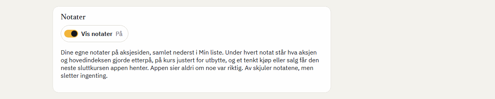

Bryteren «Notater» i Innstillinger, uten «?» og med forklaringen under, som ved Hjelp og KI-tekst. Kontrollen sjekket at «?» ikke står igjen ved Notater.

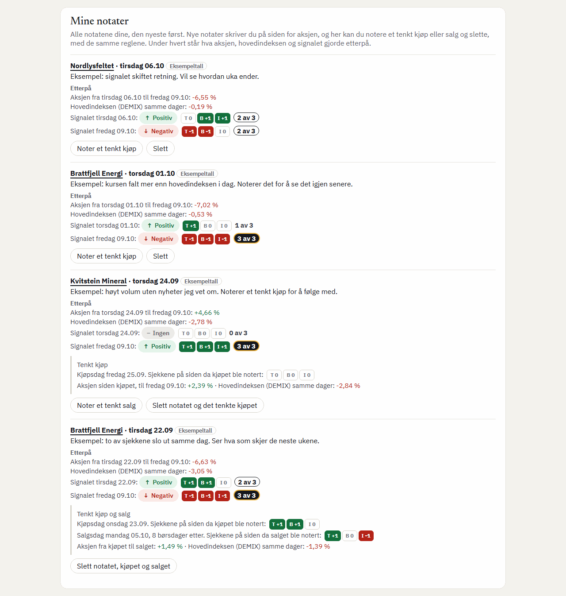

Notatene samlet nederst i Min liste. Hvert notat har knappene som passer for det: «Noter et tenkt kjøp», «Noter et tenkt salg» og en knapp for å slette. Kontrollen sjekket at knappene følger de samme reglene og varslene som på aksjesiden, og at svaret går tilbake til Min liste. [Spesifikasjonen](../_bmad-output/implementation-artifacts/spec-8-24-notatene-to-ting.md)

### 8.25 «Spill av omvisningen» ved «Vis meg rundt»

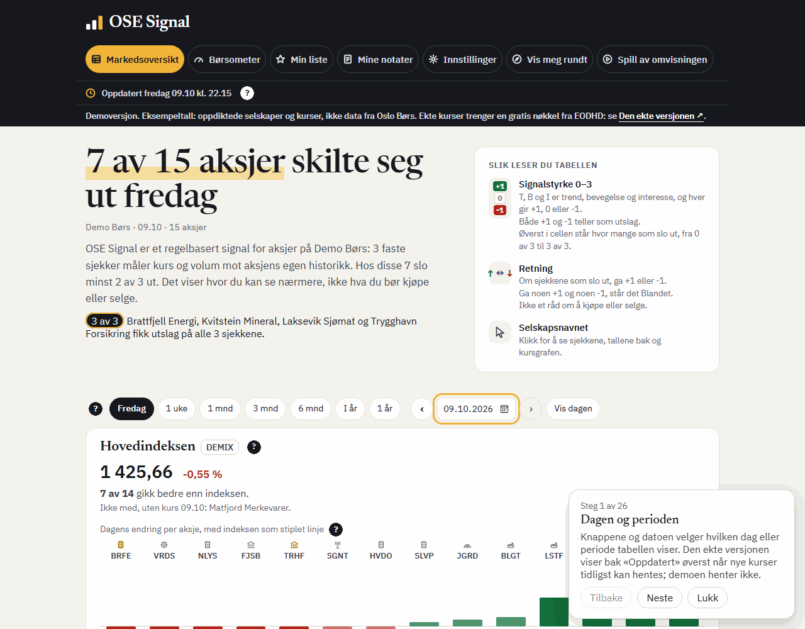

Det første steget i omvisningen etter «Spill av omvisningen»: én del av oversikten er merket, og boksen har teksten, telleren og «Tilbake», «Neste» og «Lukk». Kontrollen sjekket at omvisningen går gjennom oversikten, en aksjeside, børsometeret, Min liste, «Følg en aksje» og Innstillinger i den rekkefølgen, at Esc lukker, og at boksen har rollen dialog. [Spesifikasjonen](../_bmad-output/implementation-artifacts/spec-8-25-spill-av-omvisningen.md)

### 8.26 «Vis meg rundt» spiller av siden, knappene øverst og funnene fra demoprøven

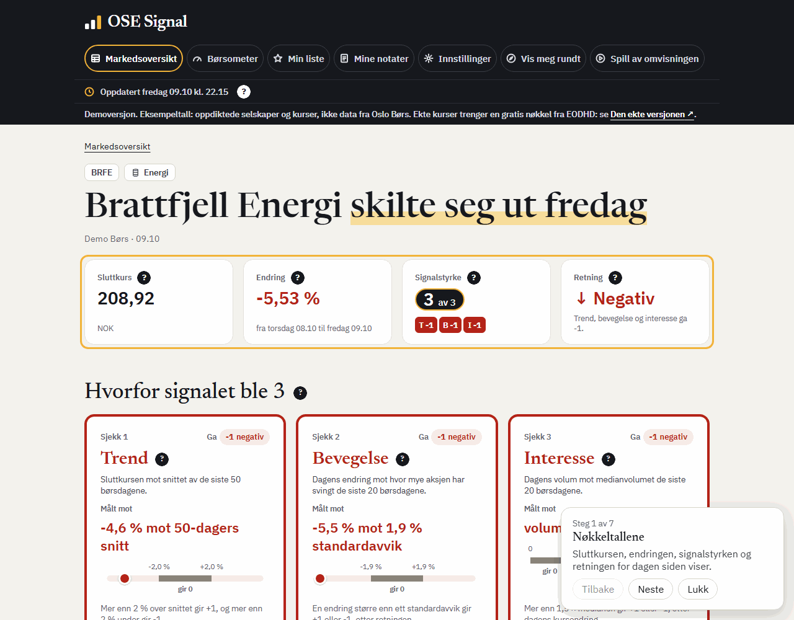

«Vis meg rundt» på aksjesiden: den samme boksen som omvisningen, bare med stegene for siden, og knappene «Vis meg rundt» og «Spill av omvisningen» med hvert sitt ikon i raden øverst etter «Innstillinger». Kontrollen sjekket at siden ikke hopper, at den nummererte lista fra 8.9 er borte, og at ingen knapp mangler i raden.

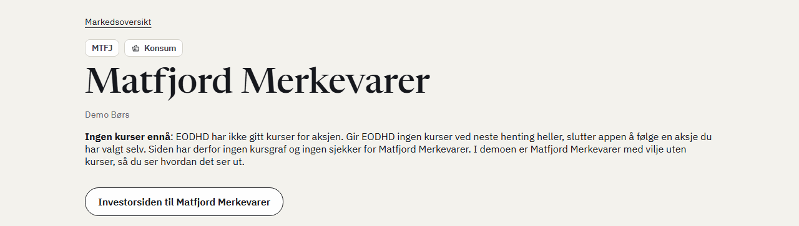

Aksjesiden for den oppdiktede aksjen demoen har uten kurser, med «Ingen kurser ennå» og hvorfor. Kontrollen sjekket at en aksje uten kurser har de samme ordene og den samme forklaringen overalt i appen. [Spesifikasjonen](../_bmad-output/implementation-artifacts/spec-8-26-vis-meg-rundt-spiller-av-siden.md)

### 8.27 «Mine notater» i et panel fra en knapp øverst

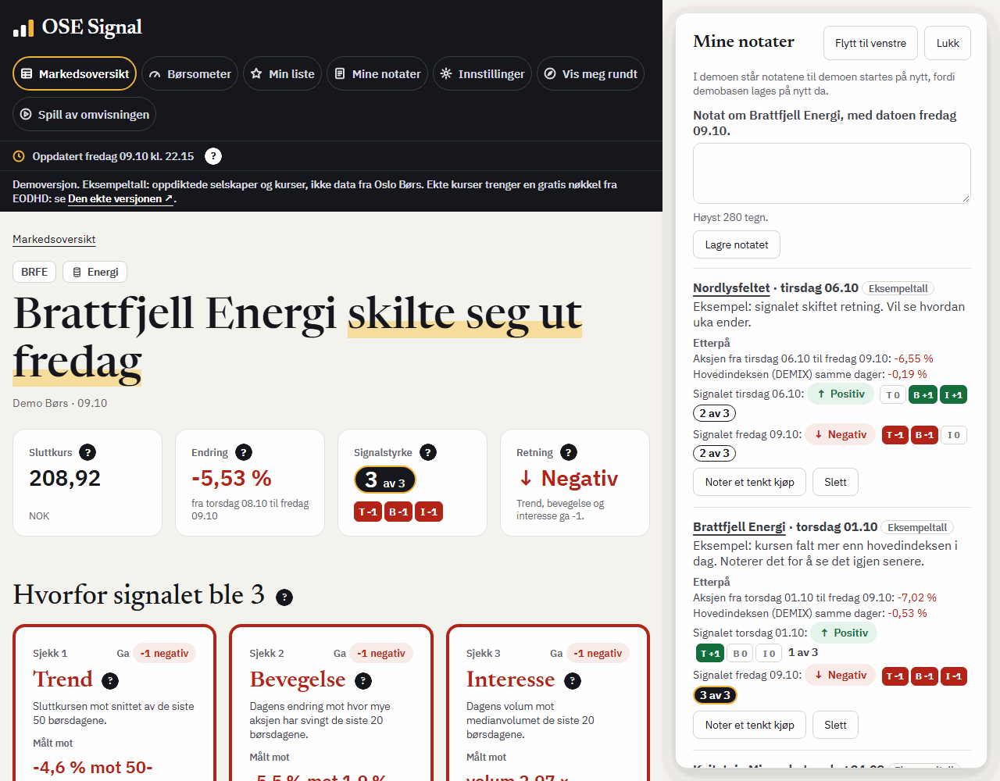

Panelet «Mine notater» åpnet fra knappen øverst, fast i kanten av aksjesiden, med alle notatene, de nyeste først, og et skjema for aksjen og dagen siden viser. Kontrollen sjekket at panelet har hvert notat, at et notat fra panelet får riktig aksje og dag, og at demoen sier at notatene står til den startes på nytt. [Spesifikasjonen](../_bmad-output/implementation-artifacts/spec-8-27-mine-notater-i-panel.md)

### 8.28 «De 15 mest omsatte» som ferdig liste

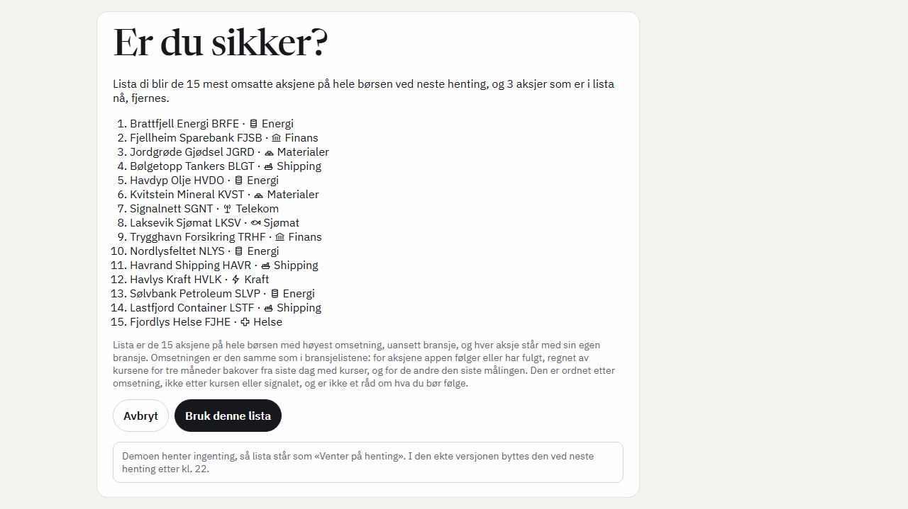

«Er du sikker?» for de 15 mest omsatte, som sier hele børsen og viser bransjen ved hver aksje. Kontrollen sjekket at lista har høyst 15 aksjer med måling og bransje, ordnet etter omsetning, og at hver aksje følges med sin egen bransje. [Spesifikasjonen](../_bmad-output/implementation-artifacts/spec-8-28-de-15-mest-omsatte.md)

### 8.29 «Din egen liste: kom i gang» som tavla, og investorknappen 44 px

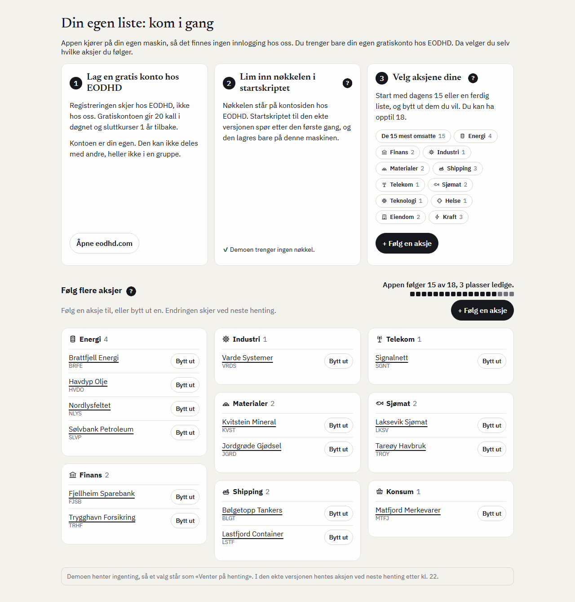

«Din egen liste: kom i gang» i Min liste, med én overskrift, de tre stegkortene og bransjekortene i kolonner uten hull. Kontrollen sjekket at delen har én overskrift og ingen ramme, at titlene har linjehøyde 1,2, at brikkene i steg 3 er 30 px høye, og at steg 2 ikke har noe felt for nøkkelen (AD-10). Knappen til investorsiden, som bildet for 10.5 viser, ble minst 44 px høy i samme story, også når teksten brytes. [Spesifikasjonen](../_bmad-output/implementation-artifacts/spec-8-29-din-egen-liste-kom-i-gang.md)

### 8.30 De ledige rutene i plassstreken med nok kontrast

Streken står i bildet for 8.29, under «Appen følger N av 18». Storyen ga de ledige rutene en farge med minst 3:1 kontrast mot bakgrunnen og mot de brukte. [Spesifikasjonen](../_bmad-output/implementation-artifacts/spec-8-30-plassstreken-kontrast.md)

### 8.31 Stegkortene og styrken for én dag målt i nettleseren

Ingen skjerm: storyen la bare til tester som måler stegkortene og styrken for én dag i nettleseren, uten endring i appen. [Spesifikasjonen](../_bmad-output/implementation-artifacts/spec-8-31-maalene-i-nettleseren.md)

## Epic 9: Dokumentasjon av prosessen

### 9.0 Fem tester sjekker det de lover

Ingen skjerm: fem tester som nå feiler mot en mutant for det de lover. [Spesifikasjonen](../_bmad-output/implementation-artifacts/spec-9-0-fem-tester-sjekker-det-de-lover.md)

### 9.1 `docs/kvalitetssikring.md`

Ingen skjerm: dokumentet om hvordan koden er kvalitetssikret. [Storyen](../_bmad-output/planning-artifacts/epics.md#story-91-docskvalitetssikringmd)

### 9.2 `docs/ai-prompts/bygging/`

Ingen skjerm: instruksjonene fra 21.–24.09 i dagsfilene i `docs/ai-prompts/`. [Storyen](../_bmad-output/planning-artifacts/epics.md#story-92-docsai-promptsbygging)

### 9.3 Arbeidsmønsteret

Ingen skjerm: beskrivelsen av arbeidsmønsteret i `docs/ai-prompts/README.md`. [Storyen](../_bmad-output/planning-artifacts/epics.md#story-93-arbeidsmønsteret)

### 9.4 Relevanseksperimentet, del 1 — utvalg, innsamling og merking

Ingen skjerm: kriteriene og resultatet står i `relevanseksperiment.md`, og artiklene og merkingen ligger bare lokalt. [Storyen](../_bmad-output/planning-artifacts/epics.md#story-94-relevanseksperimentet-del-1--utvalg-innsamling-og-merking)

### 9.5 Relevanseksperimentet, del 2 — KI-kjøringen

Ikke bygget: del 2 utgår fra 06.10 og kjøres ikke. [Storyen](../_bmad-output/planning-artifacts/epics.md#story-95-relevanseksperimentet-del-2--ki-kjøringen)

### 9.6 Product brief v8 etter plan B

Ingen skjerm: versjon 8 av product brief. [Storyen](../_bmad-output/planning-artifacts/epics.md#story-96-product-brief-v8-etter-plan-b)

### 9.7 Linter og formatterer i CI

Ingen skjerm: ruff i CI og i testene. [Spesifikasjonen](../_bmad-output/implementation-artifacts/spec-9-7-linter-og-formatterer-i-ci.md)

### 9.8 Kopien `.agents/skills/` tas bort

Ingen skjerm: kopien av BMAD-skillene er tatt ut av repoet. [Spesifikasjonen](../_bmad-output/implementation-artifacts/spec-9-8-agents-kopien-bort.md)

### 9.9 Dokumenttestene i én kommando

Ingen skjerm: testene for dokumentene i én kommando, `uv run pytest --dokumentene`. [Spesifikasjonen](../_bmad-output/implementation-artifacts/spec-9-9-dokumenttestene.md)

### 9.10 De lave funnene fra 10.6, 8.8, 8.11b og 3.4h

Ingen egen skjerm: sorteringen blir stående når bryteren ved «Børsdagen kort fortalt» brukes, noe et bilde ikke viser, og aksjesiden leser basen med færre oppslag. [Spesifikasjonen](../_bmad-output/implementation-artifacts/spec-9-10-de-lave-funnene.md)

### 9.11 PRD-en etter tilbakemeldingen fra faglærer 12.11

Ingen skjerm: en ny versjon av PRD-en med endringsloggen. [Spesifikasjonen](../_bmad-output/implementation-artifacts/spec-9-11-prd-etter-tilbakemeldingen.md)

### 9.12 Rådordene i alle malene, taggene i CI og technology.md

Ingen egen skjerm: en test for rådordene i malene, hjelpetekstene og omvisningen, taggene i CI og lenken til `technology.md`. Den eneste synlige endringen er setningen «og hver aksje står med sin egen bransje» på «Er du sikker?», som bildet for 8.28 viser. [Spesifikasjonen](../_bmad-output/implementation-artifacts/spec-9-12-raadordene-i-alle-malene.md)

### 9.13 Dokumentrunden etter v1.1

Ingen skjerm: statusene, de åpne punktene og vurderingsmatrisen. [Spesifikasjonen](../_bmad-output/implementation-artifacts/spec-9-13-dokumentrunden-etter-v1-1.md)

### 9.14 Kontrollrunden etter v1.1

Ingen skjerm: kontrollen av basen, dokumentene og koden, med funnene i spesifikasjonen. [Spesifikasjonen](../_bmad-output/implementation-artifacts/spec-9-14-kontrollrunden-etter-v1-1.md)

### 9.15 Meldingene etter v1.1 og det som ikke brukes

Ingen skjerm: meldingene fra hentingen og kode som ikke brukes; ingen bilder endret. [Spesifikasjonen](../_bmad-output/implementation-artifacts/spec-9-15-meldingene-og-det-som-ikke-brukes.md)

### 9.16 Flere brukerreiser i PRD-en

Ingen skjerm: brukerreisene UJ-2 og UJ-3 i PRD-en. [Spesifikasjonen](../_bmad-output/implementation-artifacts/spec-9-16-flere-brukerreiser.md)

### 9.17 En heuristisk evaluering av demoen

Ingen skjerm: evalueringen står i `docs/heuristisk-evaluering.md`, og ingen kode ble endret. [Spesifikasjonen](../_bmad-output/implementation-artifacts/spec-9-17-heuristisk-evaluering.md)

### 9.18 Rettingene før brukertest 2

Månedspilene i «Signalet dag for dag» med lenken tilbake til måneden for dagen siden viser, når en annen måned er valgt (HE14). Kontrollen sjekket at hver retting har en test som feilet mot koden før rettingen.

Raden «Øvrige aksjer» i tabellen på oversikten, med ett tall per gruppe (HE9). Kontrollen sjekket at en gruppe uten aksjer ikke nevnes. [Spesifikasjonen](../_bmad-output/implementation-artifacts/spec-9-18-rettingene-foer-brukertest-2.md)

### 9.19 Grensen på 640–760 px og bildene av appen

Ingen synlig endring ved 1280 px: rettingen gjelder tabellen mellom 640 og 760 px, og bildene i `docs/appen/` ble tatt på nytt. [Spesifikasjonen](../_bmad-output/implementation-artifacts/spec-9-19-grensen-og-bildene.md)

### 9.20 PRD-en mot faglærers rubrikk

Ingen skjerm: PRD-en, sporingsfila og svarbrevet til faglærer. [Spesifikasjonen](../_bmad-output/implementation-artifacts/spec-9-20-prd-mot-rubrikken.md)

### 9.21 Bildene av spørsmålet før sletting og lenken tilbake

Ingen skjerm: to bilder i README-en av rettinger fra 9.18. [Spesifikasjonen](../_bmad-output/implementation-artifacts/spec-9-21-bildene-av-he2-og-he14.md)

### 9.22 Morgensjekken uten falske alarmer, «51 børsdager» og ett navn på sletteknappen

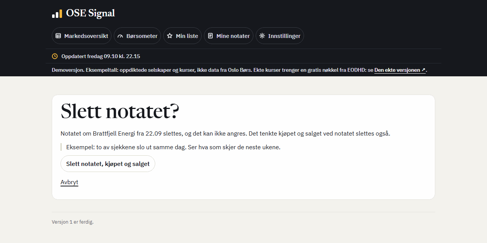

Spørsmålet før sletting av et notat med tenkt kjøp og salg, med knappen «Slett notatet, kjøpet og salget», det samme navnet som knappen ved notatet har. Kontrollen sjekket at navnene er like på aksjesiden og i Min liste. [Spesifikasjonen](../_bmad-output/implementation-artifacts/spec-9-22-morgensjekken-og-to-rettinger.md)

### 9.23 «51 børsdager» i koden og norsk tid i morgensjekken

Ingen skjerm: en kommentar i koden og klokkeslettene i morgensjekken. [Spesifikasjonen](../_bmad-output/implementation-artifacts/spec-9-23-boersdager-og-norsk-tid.md)

### 9.24 UX-dokumentene, DESIGN.md og EXPERIENCE.md

Ingen skjerm: UX-dokumentene `DESIGN.md` og `EXPERIENCE.md`, uten kode. [Spesifikasjonen](../_bmad-output/implementation-artifacts/spec-9-24-ux-dokumentene.md)

### 9.25 Svarene på E1, E2, E4, E5 og E6 i UX-dokumentene

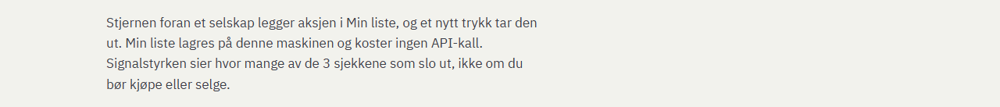

Innledningen i Min liste, som sier «Min liste» om aksjene med stjerne (E1). Kontrollen sjekket at «lista» ble «Min liste» der teksten gjelder aksjene med stjerne.

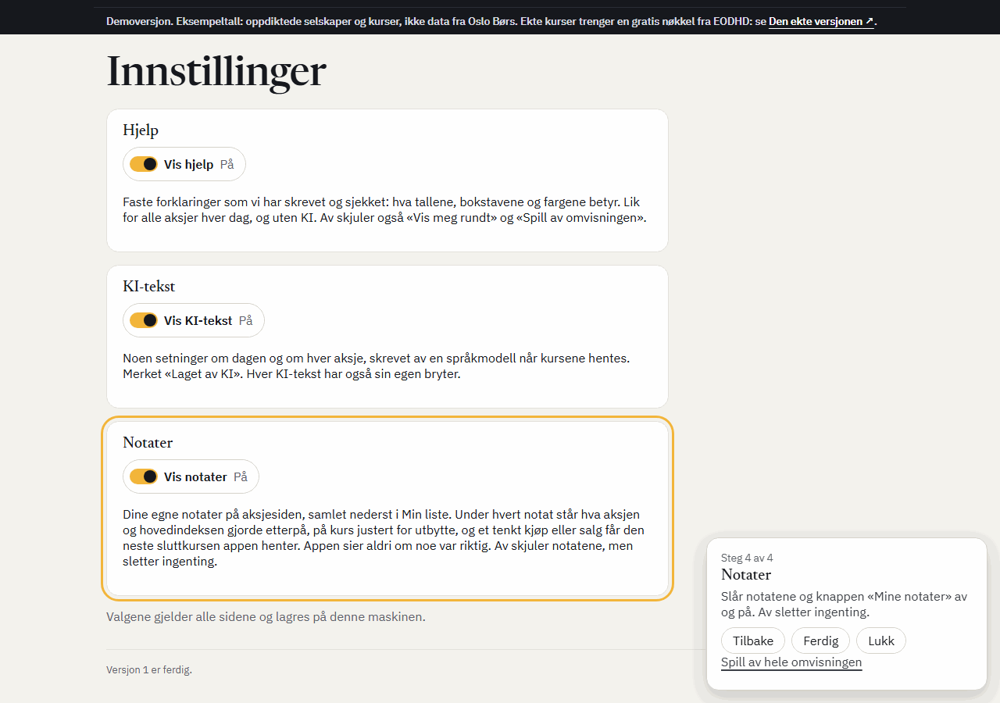

Innstillinger med «Vis meg rundt» åpen på steget for «Notater», med kortet «Notater» merket (E6). Kontrollen sjekket at omvisningen i Innstillinger har et steg for «Notater», som stegene for «Hjelp» og «KI-tekst». [Spesifikasjonen](../_bmad-output/implementation-artifacts/spec-9-25-svarene-paa-ux-spoersmaalene.md)

### 9.26 Skjermene i OSE Signal, ordnet etter epic og story

Ingen egen skjerm i appen: storyen er denne siden. [Spesifikasjonen](../_bmad-output/implementation-artifacts/spec-9-26-skjermene.md)
